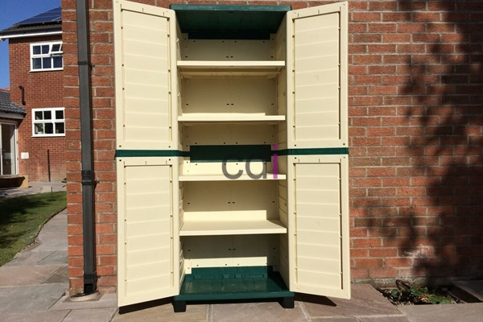

**Lemari Plastik 3 Pintu: Pilihan Cerdas untuk Penyimpanan Optimal di Rumah Anda** - Hai Mitra CDI! Butuh solusi penyimpanan yang praktis dan hemat biaya untuk Rumah Anda? Lemari plastik 3 pintu hadir sebagai jawaban cerdas! Dengan ragam desain menarik dan harga bersahabat, lemari ini bisa jadi solusi penataan ruangan yang Anda cari.

## Mengapa Lemari Plastik 3 Pintu Layak Jadi Pilihan? Keunggulan yang Wajib Diketahui

Mungkin Anda bertanya, kenapa harus pilih lemari plastik 3 pintu? Nah, ada beberapa alasan kuat yang perlu Anda pertimbangkan. Yang pertama, material plastik membuatnya tahan terhadap masalah utama seperti kelembapan dan serangan rayap – masalah yang sering dihadapi di iklim tropis seperti di Indonesia. Ini berarti lemari Anda akan lebih tahan lama dibandingkan dengan lemari kayu konvensional. Kedua, fleksibilitas desainnya luar biasa! Lemari plastik 3 pintu tersedia dalam beragam warna dan ukuran, jadi mudah sekali menyesuaikannya dengan gaya interior Rumah Anda. Ketiga, harganya yang ramah di kantong menjadikannya pilihan cerdas untuk semua kalangan. 

Selain itu, lemari ini punya bobot yang ringan sehingga mudah dipindahkan. Ini sangat berguna saat Anda ingin menata ulang ruangan atau bahkan saat pindahan. Dan yang terpenting, perawatannya super mudah – cukup bersihkan dengan kain lap dan sabun ringan. Ingin tahu lebih detail perbandingan lemari plastik dengan material lain? Yuk, simak Lemari Plastik Dibanding yang Lain.

## Panduan Memilih Lemari Plastik 3 Pintu yang Sesuai Kebutuhan

Memilih lemari plastik 3 pintu yang tepat butuh sedikit pertimbangan. Agar tidak salah pilih, perhatikan beberapa faktor ini. Pertama, ukur ruang yang tersedia. Pastikan lemari yang Anda pilih ukurannya pas dengan kamar tidur atau area penyimpanan di Rumah Anda. Jangan sampai terlalu besar atau terlalu kecil, ya!

Kedua, perhatikan kualitas plastik yang digunakan. Pilih lemari yang terbuat dari plastik tebal dan kuat. Jenis plastik *polypropylene* (PP) umumnya lebih tahan lama. 

Ketiga, pikirkan fitur apa yang Anda butuhkan. Apakah Anda butuh rak, gantungan baju, atau laci? Sesuaikan dengan barang-barang yang akan Anda simpan. Beberapa model bahkan dilengkapi kunci pengaman atau roda agar mudah dipindahkan.

## Update Harga Lemari Plastik 3 Pintu Terbaru (2026)

Harga lemari plastik 3 pintu memang bervariasi, tergantung ukuran, kualitas bahan, desain, dan merek. Untuk memberi gambaran, Anda bisa menemukan opsi mulai dari Rp 300.000 hingga Rp 1.500.000.  Harga ini hanyalah estimasi dan bisa berubah sewaktu-waktu. Untuk info harga terkini dan penawaran terbaik, hubungi Kami.

Berikut ini tabel perkiraan harga berdasarkan kualitas dan fiturnya:

<table class="table">
  <caption>Perkiraan Harga Lemari Plastik 3 Pintu (2026)</caption>
  <thead>
    <tr><th>Kualitas</th><th>Fitur</th><th>Estimasi Harga</th></tr>
  </thead>
  <tbody>
    <tr><td>Ekonomis</td><td>Standar, tanpa kunci</td><td>Rp 300.000 - Rp 600.000</td></tr>
    <tr><td>Menengah</td><td>Rak dan gantungan baju, kunci sederhana</td><td>Rp 600.000 - Rp 1.000.000</td></tr>
    <tr><td>Premium</td><td>Rak, gantungan baju, laci, kunci ganda</td><td>Rp 1.000.000 - Rp 1.500.000</td></tr>
  </tbody>
</table>

Ingat, harga di atas bisa jadi berbeda tergantung toko dan promo.  Untuk mendapatkan gambaran lengkap tentang harga dan kualitas, jangan ragu untuk membaca Review Harga dan Kualitas Lemari Plastik.

## Cara Merawat Lemari Plastik 3 Pintu Agar Tahan Lama

Agar lemari plastik 3 pintu di Rumah Anda tetap awet dan terlihat seperti baru, ikuti tips perawatan ini. Pertama, bersihkan secara rutin dengan kain lap basah dan sabun ringan. Hindari bahan pembersih keras yang bisa merusak permukaan plastik.

Kedua, hindari meletakkan lemari di bawah sinar matahari langsung atau sumber panas. Sinar matahari bisa membuat plastik menjadi rapuh dan warnanya pudar.

Ketiga, jangan terlalu membebani lemari dengan barang berat. Ini bisa menyebabkan lemari cepat rusak atau melengkung. Untuk barang berat, pertimbangkan opsi seperti Lemari Pakaian Pintu Geser.

Butuh konsultasi lebih lanjut? Jangan sungkan! Manfaatkan tombol **Telepon** dan **WhatsApp** yang tersedia di bawah halaman ini untuk menghubungi Kami. Kami siap membantu Anda menemukan lemari plastik 3 pintu yang sempurna untuk Rumah Anda!