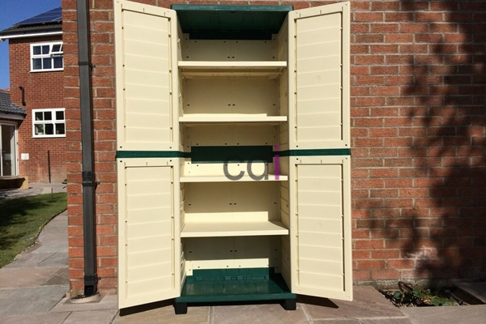

**Lemari Plastik 4 Susun: Pilihan Terbaik untuk Penyimpanan Efisien di Rumah Anda** - Hai Mitra CDI! Apakah Anda sedang mencari solusi penyimpanan yang praktis, terjangkau, dan serbaguna untuk Rumah Anda? Lemari plastik 4 susun adalah jawabannya! Dengan fleksibilitas tinggi, perawatan mudah, serta beragam desain menarik, lemari ini menjadi favorit banyak keluarga modern.

## Mengapa Harus Memilih Lemari Plastik 4 Susun? Keunggulan dan Manfaatnya

Apa yang membuat lemari plastik 4 susun begitu istimewa, Mitra? Bayangkan sebuah solusi penyimpanan yang ringan, mudah dipindahkan, dan sangat fleksibel untuk berbagai ruangan di Rumah Anda. Lemari jenis ini memang unggul dalam hal kepraktisan. Material plastik yang digunakan juga tahan terhadap kelembapan dan korosi, sehingga cocok digunakan di kamar tidur, ruang tamu, dapur, atau bahkan area outdoor yang terlindung. Ditambah lagi, secara umum, lemari plastik lebih ramah di kantong dibandingkan lemari berbahan kayu atau besi dengan ukuran serupa.

Dengan desain 4 susunnya, Anda bisa mengatur barang-barang dengan lebih terstruktur dan efisien. Tiap susun dapat dimaksimalkan untuk menyimpan pakaian, aksesori, perlengkapan mandi, mainan anak-anak, atau apa pun yang Anda butuhkan. Pengaturan yang rapi ini tak hanya menghemat ruang, tetapi juga mempercantik tampilan ruangan. Nah, yang paling penting, perawatan lemari plastik ini sangat mudah! Cukup bersihkan dengan lap basah dan sabun ringan, selesai!

## Beragam Jenis Lemari Plastik 4 Susun untuk Melengkapi Rumah Anda

Pilihan lemari plastik 4 susun di pasaran sangat beragam, Mitra. Anda bisa menemukan model dengan pintu, tanpa pintu, atau kombinasi keduanya. Lemari dengan pintu memberikan perlindungan ekstra untuk barang-barang Anda dari debu dan pandangan luar, sementara model tanpa pintu memungkinkan akses yang lebih cepat dan mudah.

Selain itu, ada juga lemari plastik yang dilengkapi laci, sangat ideal untuk menyimpan barang-barang kecil seperti kaus kaki, pakaian dalam, atau perhiasan. Beberapa model bahkan dilengkapi roda, sehingga mudah dipindahkan saat Anda ingin membersihkan ruangan atau menata ulang tata letak Rumah Anda. Material plastik yang digunakan pun bervariasi, mulai dari polypropylene (PP) yang kuat dan tahan lama, hingga ABS yang menawarkan tampilan lebih mewah.

## Panduan Memilih Lemari Plastik 4 Susun yang Sesuai dengan Kebutuhan Anda

Bagaimana cara memilih lemari plastik 4 susun yang tepat, Mitra? Pertama, ukur area yang tersedia di Rumah Anda. Pastikan ukuran lemari yang Anda pilih sesuai dengan dimensi ruangan agar tidak terlalu sempit atau terlalu longgar. Kemudian, pertimbangkan jumlah barang yang akan Anda simpan untuk menentukan ukuran lemari yang optimal.

Selanjutnya, perhatikan kualitas material plastik yang digunakan. Pilihlah lemari yang terbuat dari plastik berkualitas tinggi, tahan terhadap benturan, goresan, dan paparan sinar matahari. Jangan lupa juga untuk memperhatikan desain dan warna lemari agar serasi dengan gaya interior Rumah Anda. Pilih warna yang netral dan mudah dipadukan dengan perabot lain.

Fitur tambahan seperti roda, laci, atau pintu juga perlu dipertimbangkan sesuai kebutuhan Anda. Untuk mendapatkan harga terbaik, bandingkan penawaran dari berbagai toko atau merek. Informasi harga lemari plastik 4 susun tahun 2026 berkisar antara… hubungi Kami sekarang untuk mendapatkan penawaran harga terkini dan sesuai dengan kebutuhan proyek Anda! Jangan ragu untuk menanyakan detail spesifik kepada tim Kami. [Gantungan Baju Lemari Tarik: Solusi Ruang Efisien untuk Pakaian Anda](/blog/gantungan-baju-lemari-tarik/) bisa menjadi pelengkap penyimpanan yang menarik.

## Tips Jitu Merawat Lemari Plastik 4 Susun Agar Awet Bertahun-tahun

Merawat lemari plastik 4 susun sangatlah mudah dan tidak memerlukan usaha yang besar. Cukup bersihkan permukaan lemari secara berkala dengan lap basah dan sabun ringan. Hindari penggunaan bahan pembersih yang keras atau abrasif yang dapat merusak permukaan plastik. 

Hindari meletakkan benda-benda tajam atau berat di atas lemari untuk mencegah goresan. Saat memindahkan lemari, angkat dengan hati-hati dan jangan menyeretnya di lantai. Sebaiknya, hindari menempatkan lemari di tempat yang terlalu panas atau lembap agar plastik tidak rapuh atau berjamur. Dengan perawatan yang tepat, lemari plastik 4 susun Anda akan tetap awet dan memberikan manfaat jangka panjang untuk Rumah Anda.

Untuk pertanyaan lebih lanjut atau konsultasi desain interior untuk Rumah Anda, jangan ragu untuk menghubungi Kami melalui tombol **Telepon** atau **WhatsApp** yang tersedia di halaman ini.