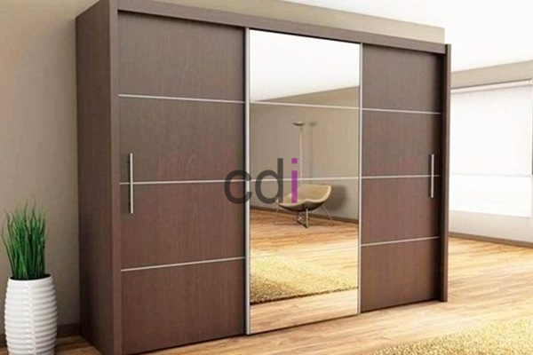

**Lemari Sliding 2 Pintu: Solusi Penyimpanan Efisien untuk Ruang Minimalis** - Hai Mitra CDI! Punya kamar tidur yang terasa sempit? Atau sedang mencari cara pintar untuk menata pakaian dan barang-barang pribadi? Nah, lemari sliding 2 pintu bisa jadi jawaban tepat! Furnitur satu ini memang dirancang untuk mempermudah hidup Anda, khususnya di ruangan dengan lahan terbatas. Yuk, kita bahas lebih lanjut tentang keunggulan dan tips memilih lemari sliding 2 pintu yang ideal.

## Kenapa Pilih Lemari Sliding 2 Pintu?

Dibandingkan lemari biasa yang membuka dengan ayunan, lemari dengan pintu geser menawarkan keuntungan istimewa. Bayangkan, tidak perlu lagi menyisakan ruang kosong untuk membuka-menutup pintu. Praktis, kan? Ini jadi solusi cerdas terutama untuk kamar tidur berukuran kecil di (not detected). 

Selain menghemat ruang, lemari sliding 2 pintu seringkali memberikan sentuhan modern pada interior ruangan. Desainnya yang simpel dan bersih cocok dipadukan dengan berbagai gaya dekorasi, mulai dari skandinavia, minimalis, hingga industrial. Pilihan warna dan finishingnya pun beragam, jadi Anda bisa menemukan yang paling sesuai dengan selera.

## Material & Desain: Sesuaikan dengan Kebutuhan Anda

Pemilihan material akan memengaruhi tampilan, kekuatan, dan harga lemari sliding 2 pintu. Beberapa opsi populer antara lain:

*   **Multipleks:** Harganya relatif terjangkau dan cukup kokoh. Tapi, perlu diingat bahwa multipleks bisa melengkung jika terpapar kelembaban, jadi pastikan dilapisi dengan baik.
*   **Partikel Board (PB):** Pilihan paling ekonomis, namun kurang tahan lama dan rentan rusak jika terkena air. Cocok untuk anggaran terbatas.
*   **Medium Density Fiberboard (MDF):** Lebih padat dan kuat daripada partikel board, juga lebih tahan terhadap kelembaban. Mudah dicat atau dilapisi finishing sesuai keinginan.
*   **Kayu Solid:** Investasi jangka panjang yang menawarkan kualitas dan estetika terbaik. Memberikan kesan alami dan mewah pada kamar tidur Anda di (not detected).

Tak hanya material, desain lemari juga punya banyak variasi. Anda bisa memilih lemari dengan tambahan cermin, laci internal, rak sepatu terintegrasi, atau bahkan kombinasi dengan meja rias. Pertimbangkan kebutuhan penyimpanan harian Anda dan gaya interior kamar tidur Anda saat menentukan desain yang paling pas.

## Kisaran Harga Lemari Sliding 2 Pintu di (not detected)

Harga lemari sliding 2 pintu tentu bervariasi, tergantung material, desain, ukuran, dan tempat Anda membelinya. Untuk gambaran, berikut ini perkiraan harga di wilayah (not detected) pada tahun 2026:

| Material        | Ukuran (PxLxT) | Estimasi Harga |
|-----------------|----------------|----------------|
| Partikel Board  | 120x60x180 cm  | Rp 1.800.000 - 3.000.000 |
| MDF             | 120x60x180 cm  | Rp 2.500.000 - 4.500.000 |
| Multipleks      | 120x60x180 cm  | Rp 3.000.000 - 5.000.000 |
| Kayu Solid      | 120x60x180 cm  | Rp 5.000.000 - 10.000.000+ |

Harga di atas hanyalah estimasi dan bisa berubah sewaktu-waktu. Untuk mendapatkan penawaran harga paling akurat sesuai dengan proyek Anda, silakan hubungi Kami. Anda juga bisa mempertimbangkan layanan custom lemari untuk mendapatkan desain yang persis sesuai keinginan. Jangan lupa cek juga Harga Lemari Pakaian Sliding Terbaru untuk perbandingan harga lebih detail.

## Tips Jitu: Memilih & Merawat Lemari Sliding Anda

Saat memilih, pastikan rel dan mekanisme penguncian lemari berkualitas baik. Pilih rel yang terbuat dari material kuat dan tahan lama, serta bergerak mulus tanpa macet. Sistem penguncian yang bagus akan mencegah pintu lemari terbuka sendiri.

Untuk perawatan, bersihkan permukaan lemari secara rutin dengan kain lembut dan cairan pembersih ringan. Hindari penggunaan bahan kimia keras atau benda abrasif yang dapat merusak lapisan finishing. Jaga agar rel lemari tetap bersih dari debu dan kotoran agar pintu dapat bergerak lancar. Seperti yang dibahas di [Lemari Pakaian Pintu Geser: Solusi Penyimpanan Modern untuk Ruang Optimal](/blog/lemari-pakaian-pintu-geser/), lemari pintu geser memang solusi tepat untuk memaksimalkan ruang di kamar tidur Anda.

Butuh konsultasi lebih lanjut? Jangan ragu untuk menghubungi Kami melalui tombol **WhatsApp** atau **Telepon** yang tersedia di halaman ini. Kami siap membantu Anda mewujudkan kamar tidur impian di (not detected)! [Lemari Kayu 3 Pintu: Solusi Penyimpanan Optimal untuk Ruang Tidur Modern](/blog/lemari-kayu-3-pintu/) juga bisa menjadi pertimbangan Anda.