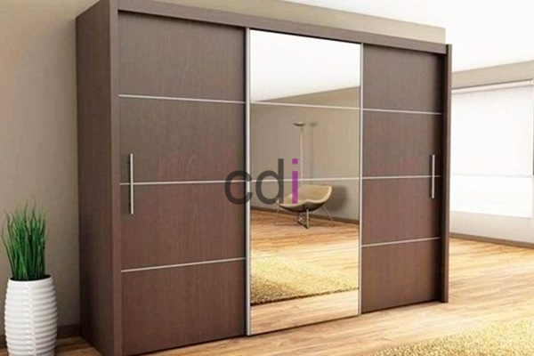

**Lemari Sliding 3 Pintu: Solusi Penyimpanan Efisien untuk Hunian Modern** - Hai Mitra CDI! Sedang memikirkan cara cerdas memaksimalkan ruang di kamar tidur? Atau ingin tampilan kamar yang lebih ringkas dan modern? Nah, lemari sliding 3 pintu bisa jadi jawabannya. Mari kita kupas tuntas bagaimana furnitur ini bisa jadi solusi tepat untuk hunian Mitra di (not detected).

### Mengapa Lemari Sliding 3 Pintu? Keunggulan yang Tidak Bisa Diabaikan

Lemari pakaian dengan pintu geser, atau sliding, menawarkan sejumlah keuntungan dibandingkan model pintu ayun konvensional. Salah satu yang paling terasa? Efisiensi ruang! Pintu yang meluncur horizontal ini tidak memerlukan area bebas untuk membuka dan menutup – ideal untuk kamar di (not detected) yang ukurannya terbatas. Selain itu, lemari sliding 3 pintu umumnya menawarkan kapasitas penyimpanan yang lebih besar dibandingkan lemari 3 pintu dengan model ayun.

Dari segi tampilan, desainnya cenderung lebih *sleek* dan minimalis, mudah menyatu dengan berbagai tema dekorasi. Pintu sliding juga lebih aman, khususnya untuk keluarga dengan anak-anak, karena mengurangi risiko tersenggol. Ditambah lagi, fleksibilitas desainnya sangat tinggi – Mitra bisa memilih finishing pintu sesuai selera, mulai dari kaca, cermin, hingga panel kayu.

### Memilih Material Lemari Sliding 3 Pintu Terbaik untuk Mitra

Memilih material lemari sliding 3 pintu adalah kunci untuk memastikan furnitur tersebut tahan lama, cantik, dan sesuai anggaran. Ada beberapa opsi yang populer:

*   **Kayu Solid:** Pilihan premium yang menawarkan kekuatan dan keindahan alami. Harganya memang lebih tinggi dan butuh perawatan rutin, tapi hasilnya sepadan. Jenis kayu yang sering digunakan antara lain jati, mahoni, dan merbau.
*   **Particle Board (MDF):** Lebih terjangkau dan mudah dibentuk, menjadikannya pilihan populer. Perlu diingat, MDF kurang tahan terhadap kelembaban dan benturan keras.
*   **Multipleks:** Menawarkan keseimbangan antara harga dan kekuatan. Lebih tahan lembap dibandingkan MDF, tapi tetap memerlukan lapisan *finishing* yang baik.
*   **Kayu Jati Belanda (Jati Landa):** Pilihan menarik dengan harga menengah, cukup kokoh dan cocok untuk finishing cat atau pelitur.

Selain material utama, pertimbangkan juga *finishing* pintu. Melamine memberikan kesan mengkilap dan mudah dibersihkan, sementara HPL (High Pressure Laminate) tahan gores. Cat duco menawarkan kebebasan dalam memilih warna.

### Perkiraan Biaya: Menyesuaikan dengan Budget Mitra CDI

Biaya lemari sliding 3 pintu sangat bervariasi, tergantung material, ukuran, desain, dan kompleksitas pemasangan. Sebagai gambaran, lemari dengan material particle board dan finishing melamine bisa didapatkan mulai dari Rp 3.000.000 hingga Rp 6.000.000. Untuk multipleks dengan finishing HPL, harganya berkisar Rp 6.000.000 hingga Rp 10.000.000. Sementara itu, lemari berbahan kayu solid dengan finishing cat duco biasanya dimulai dari Rp 12.000.000.

Harga ini adalah estimasi, dan bisa berubah sewaktu-waktu. Untuk mendapatkan penawaran terbaru yang sesuai dengan proyek Mitra di (not detected), segera hubungi Kami untuk konsultasi lebih lanjut. Biaya tambahan mungkin timbul untuk desain custom, pemasangan, dan pengiriman.  Jangan ragu untuk berkonsultasi dengan desainer interior Kami untuk mendapatkan solusi terbaik sesuai anggaran Mitra.  Mitra juga bisa melihat referensi [Harga Lemari Pakaian Sliding [Terbaru]](/blog/harga-lemari-pakaian-sliding-terbaru/) untuk mendapatkan gambaran harga pasar.

### Panduan Praktis: Memilih Lemari Sliding 3 Pintu yang Tepat

Supaya tidak salah pilih, perhatikan tips berikut sebelum membeli lemari sliding 3 pintu:

*   **Ukuran Ruangan:** Ukur kamar tidur Mitra dengan teliti. Pilih ukuran lemari yang proporsional agar tidak membuat ruangan terasa sesak di (not detected).
*   **Kebutuhan Penyimpanan:** Buat daftar barang yang akan disimpan. Apakah Mitra lebih butuh rak, gantungan baju, laci, atau kombinasi?
*   **Gaya Interior:** Sesuaikan desain lemari dengan gaya kamar tidur. Model minimalis cocok untuk kamar modern, sementara desain ukiran kayu lebih pas untuk gaya klasik.
*   **Kualitas Material:** Pilih material yang berkualitas agar lemari awet dan tahan lama. Periksa juga kualitas rel sliding agar pintu bergerak lancar dan senyap.
*   **Reputasi Penjual:** Belilah dari penjual terpercaya yang memberikan garansi produk.

Butuh bantuan untuk mewujudkan kamar tidur impian Mitra CDI di (not detected)? Jangan sungkan untuk klik tombol **WhatsApp** atau **Telepon** di bawah untuk berkonsultasi dengan tim ahli Kami. Kami siap membantu!