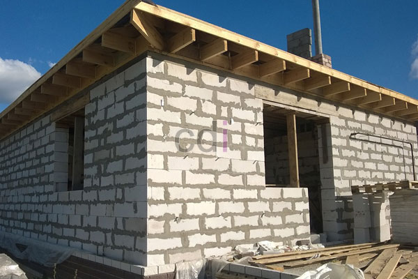

**Inilah Material Bangunan Untuk Bangunan Kokoh** - Hai Mitra CDI! Ingin membangun struktur yang tahan uji waktu dan segala kondisi? Tentu saja, kunci utamanya ada pada pemilihan material bangunan yang tepat. Bangunan kokoh bukan sekadar impian, tapi fondasi keamanan dan kenyamanan jangka panjang. Memilih bahan berkualitas—walau mungkin sedikit lebih mahal di awal—adalah investasi penting. Nah, mari kita bahas lebih lanjut tentang material apa saja yang berperan krusial dalam menciptakan bangunan kokoh di (not detected).

*Pilihan material bangunan terbaik*

## Mengapa Material Bangunan Kuat Itu Penting?

Berbagai material seperti semen, kayu, pasir, batu, bata, bahkan batako dinding—semuanya harus dipilih secara cermat. Mitrа CDI, ingatlah, kekuatan bangunan diukur dari kualitas material yang digunakan. Arsitek dan kontraktor berpengalaman sangat memperhatikan aspek ini untuk memastikan struktur kokoh dan mampu bertahan puluhan tahun. Pemilihan bahan yang tepat bukan hanya soal estetika, tapi juga soal keamanan.

Bayangkan, rumah impian Anda adalah tempat berlindung bagi keluarga tercinta. Bangunan yang kuat akan melindungi mereka dari angin kencang, banjir, bahkan gempa bumi. Mempersiapkan diri menghadapi kemungkinan terburuk memang terdengar pesimis, tapi justru itulah langkah bijak. Dengan material berkualitas, Anda memberikan rasa aman dan nyaman bagi orang-orang tersayang.

Jangan mudah tergoda oleh harga murah yang mencurigakan. Harga yang terlalu rendah seringkali mengindikasikan kualitas yang kompromi. Investasi pada material bangunan berkualitas adalah langkah cerdas untuk menghindari risiko kerusakan atau bahkan kegagalan struktur akibat bahan yang tidak memenuhi standar.

## Strategi Cerdas Membeli Material Bangunan

Jadi, kita sudah sepakat bahwa material bangunan yang kuat itu krusial. Lalu, bagaimana cara membelinya? Kuncinya adalah memilih supplier yang terpercaya dan menyediakan **material bangunan** berkualitas tinggi. Memang, harganya mungkin sedikit lebih tinggi di awal, tapi pertimbangkan keuntungan jangka panjangnya: minim perawatan dan risiko kegagalan struktur yang mahal. 

Sebagai gambaran, berikut beberapa material yang biasa digunakan untuk memastikan bangunan kokoh:

*   **Semen:** Pilih semen Portland yang sesuai dengan kebutuhan konstruksi Anda. Ada berbagai grade semen dengan kekuatan yang berbeda-beda.
*   **Besi Baja:** Besi baja adalah tulang punggung bangunan beton. Pastikan besi yang digunakan memiliki standar SNI dan tahan terhadap korosi.
*   **Pasir:** Pasir yang baik harus bersih dari kotoran organik dan memiliki gradasi yang sesuai.
*   **Batu Kali:** Batu kali digunakan untuk pondasi dan struktur bangunan yang membutuhkan kekuatan tinggi.
*   **Bata Merah:** Pilih bata merah yang dibakar dengan sempurna dan tidak mudah pecah.
*   **Kayu:** Gunakan kayu yang sudah dikeringkan dan diberi pengawet agar tahan terhadap serangan rayap dan jamur.
*   **Atap:** Pilih material atap yang tahan terhadap cuaca ekstrem dan memiliki daya serap air yang baik. Misalnya, genteng beton atau atap metal.

Di CDI, kami menyediakan beragam **material bangunan** berkualitas tinggi untuk proyek Anda di (not detected). Kunjungi halaman [Material Alam](/jual-material) untuk melihat katalog lengkap kami. Atau, datang langsung ke lokasi kami di (not detected) untuk melihat contoh material secara langsung. Jangan ragu untuk berkonsultasi dengan tim ahli kami, ya! Kami siap membantu Anda mewujudkan bangunan impian yang kokoh dan aman. [Hubungi kami sekarang juga](URL_KONTAK) untuk penawaran terbaik!