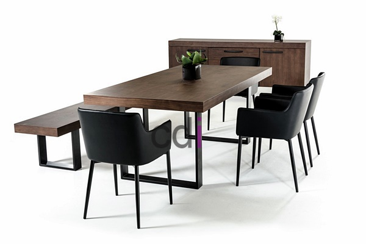

**Meja Belajar Lipat Dewasa: Solusi Cerdas untuk Ruang Belajar Anda** - Hai Mitra CDI! Sedang mencari cara untuk menciptakan ruang belajar yang nyaman dan efisien di rumah? Terkadang, keterbatasan ruang menjadi tantangan utama. Nah, meja belajar lipat dewasa bisa jadi jawaban tepat, lho! Dengan desainnya yang praktis, Anda dapat menikmati area belajar yang fungsional tanpa harus mengorbankan banyak tempat.

Memiliki ruang belajar yang mendukung produktivitas itu penting. Tapi, tidak semua rumah punya ruangan khusus untuk itu. Untungnya, ada solusi cerdas seperti meja belajar lipat dewasa. Mitra dapat memaksimalkan ruang yang ada, sekaligus menikmati kenyamanan saat belajar atau bekerja.

## Mengapa Memilih Meja Belajar Lipat Dewasa?

Meja belajar lipat dewasa menawarkan fleksibilitas yang tak tertandingi. Saat tidak digunakan, meja ini mudah dilipat dan disimpan, sehingga ruangan terasa lebih lapang. Kelebihannya tidak berhenti di situ. Meja jenis ini juga mudah dipindahkan ke berbagai sudut rumah sesuai kebutuhan Anda. Ditambah lagi, seringkali harganya lebih bersahabat dibandingkan meja belajar konvensional.

Selain kemudahan penggunaan, pemasangan dan perawatannya pun sangat praktis. Kebanyakan model tidak memerlukan perakitan yang rumit, dan membersihkannya pun cukup dengan kain lap biasa. Jadi, ini adalah pilihan yang ideal bagi Anda yang menginginkan solusi belajar yang efisien dan tanpa ribet.

## Material dan Desain: Sesuaikan dengan Kebutuhan Anda

Pilihan material untuk meja belajar lipat dewasa cukup beragam. Ada yang terbuat dari kayu solid, *particle board*, MDF (Medium Density Fiberboard), bahkan logam. Kayu solid menawarkan kesan alami dan kokoh, meskipun harganya cenderung lebih tinggi. *Particle board* dan MDF menjadi alternatif ekonomis, tetapi sebaiknya dilapisi laminasi atau veneer agar lebih tahan terhadap air dan goresan. Sementara itu, rangka logam sering digunakan untuk memberikan kekuatan dan stabilitas tambahan.

Desainnya pun bervariasi. Mitra bisa menemukan model dengan berbagai ukuran, warna, dan fitur tambahan seperti rak buku terintegrasi atau laci penyimpanan. Penting untuk mempertimbangkan kebutuhan Anda sebelum memilih desain yang paling sesuai.

## Panduan Memilih Meja Belajar Lipat Dewasa Terbaik

Memilih meja belajar lipat dewasa yang tepat membutuhkan sedikit pertimbangan. Perhatikan ukuran meja, pastikan sesuai dengan ruang yang tersedia dan nyaman digunakan. Ketinggian meja juga penting; pilih yang memungkinkan Anda belajar atau bekerja dalam posisi yang ergonomis. Jika sering menggunakan laptop, pastikan permukaan meja cukup luas untuk menampung laptop dan perlengkapan lainnya.

Kualitas material dan konstruksi juga harus menjadi prioritas. Pilih meja yang terbuat dari material kokoh dan tahan lama. Periksa engsel dan mekanisme lipatnya, pastikan berfungsi dengan baik dan tidak mudah rusak.

<table class="table">
  <caption>Perbandingan Material Meja Belajar Lipat Dewasa</caption>
  <thead>
    <tr><th>Material</th><th>Keunggulan</th><th>Kekurangan</th><th>Estimasi Harga (per unit)</th></tr>
  </thead>
  <tbody>
    <tr><td>Kayu Solid</td><td>Tahan lama, estetik alami</td><td>Mahal, membutuhkan perawatan</td><td>Rp 800.000 - Rp 2.500.000</td></tr>
    <tr><td>Particle Board</td><td>Ekonomis, pilihan warna beragam</td><td>Kurang tahan lama, mudah rusak jika terkena air</td><td>Rp 300.000 - Rp 800.000</td></tr>
    <tr><td>MDF</td><td>Permukaan halus, mudah dicetak</td><td>Kurang kuat dari kayu solid, sensitif terhadap kelembapan</td><td>Rp 400.000 - Rp 1.000.000</td></tr>
    <tr><td>Logam (Rangka)</td><td>Kokoh, stabil, tahan lama</td><td>Berat, kurang nyaman jika bersentuhan langsung dengan kulit</td><td>Rp 200.000 - Rp 500.000 (untuk rangka saja)</td></tr>
  </tbody>
</table>

Informasi harga di atas adalah perkiraan. Untuk mendapatkan penawaran terbaru dan paling akurat yang sesuai dengan kebutuhan proyek Mitra CDI, Kami sarankan untuk menghubungi Kami.

## Padu Padan dengan Desain Ruangan

Meja belajar lipat dewasa bisa dipadukan dengan berbagai gaya desain interior. Untuk tampilan minimalis, pilih meja dengan warna netral dan desain sederhana. Kalau Anda menyukai gaya industrial, meja dengan rangka logam dan permukaan kayu akan sangat cocok. Pastikan warna dan gaya meja selaras dengan furnitur dan dekorasi ruangan lainnya agar tercipta tampilan yang harmonis. Jangan lupa tambahkan kursi yang ergonomis dan pencahayaan yang memadai untuk menciptakan lingkungan belajar yang nyaman dan produktif.

Tertarik dengan meja belajar lipat dewasa? Atau ingin konsultasi lebih lanjut mengenai pilihan yang paling tepat untuk ruangan Anda di (not detected)? Jangan sungkan untuk menghubungi Kami melalui tombol **WhatsApp** atau **Telepon** yang tersedia di halaman ini. Kami siap membantu! Buat ruang belajar impian Anda bersama CDI!