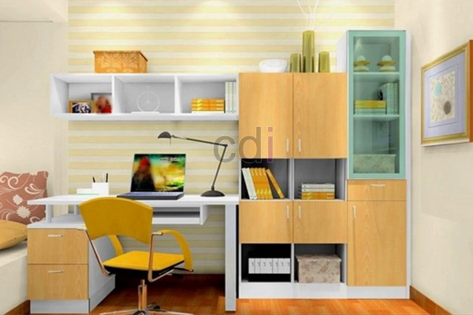

**Meja Belajar Minimalis Modern: Desain, Material, dan Harga Terbaik 2026** - Hai Mitra CDI! Mencari cara untuk menciptakan ruang belajar yang lebih efektif? Ruang belajar yang tertata rapi dan nyaman sangat penting untuk meningkatkan fokus dan hasil belajar. Nah, meja belajar minimalis modern bisa jadi solusi tepat. Desainnya yang bersih, efisien, dan serbaguna menjadikannya pilihan favorit banyak orang.

## Mengapa Meja Belajar Minimalis Modern Jadi Pilihan Unggulan?

Gaya minimalis itu tentang kesederhanaan dan fungsi. Meja belajar minimalis modern menerapkan prinsip ini dengan menghilangkan detail yang tidak perlu, sehingga menciptakan suasana belajar yang lebih tenang dan terfokus. Ini membantu meningkatkan konsentrasi, lho!

Tidak hanya itu, meja jenis ini sering dirancang dengan mempertimbangkan ergonomi – penting banget untuk kesehatan! Tinggi yang pas, ruang kaki yang lega, dan permukaan yang luas membantu menjaga postur tubuh yang baik saat belajar. Tentu saja, pemilihan material juga berpengaruh pada kenyamanan dan ketahanannya.

## Bahan Material Populer untuk Meja Belajar Minimalis Modern

Banyak pilihan material yang bisa digunakan untuk membuat meja belajar minimalis modern. Setiap material punya kelebihan dan kekurangannya masing-masing, juga berpengaruh pada harganya. Berikut beberapa yang paling banyak dicari:

*   **Kayu Solid:** Kayu jati, mahoni, atau oak memberikan kesan alami yang mewah dan tahan lama. Tapi, harganya memang cenderung lebih tinggi.
*   **Multipleks (MDF/HDF):** Pilihan yang lebih ekonomis dengan permukaan halus yang mudah dicat atau dilapisi veneer. Kekuatannya juga cukup baik untuk menopang aktivitas belajar.
*   **Besi:** Rangka besi menawarkan gaya industrial yang modern dan kuat. Kombinasinya dengan kayu bisa menciptakan tampilan yang unik dan menarik.
*   **Akrilik:** Material ini memberikan kesan futuristik dengan tampilannya yang transparan. Ringan, mudah dibersihkan, dan tersedia dalam berbagai pilihan warna.

Bagi Mitra yang mencari solusi hemat, meja belajar berbahan MDF/HDF dengan lapisan HPL (High Pressure Laminate) adalah pilihan cerdas. HPL hadir dalam beragam motif dan warna, tahan gores, dan tahan panas. Sementara itu, jika Anda mencari investasi jangka panjang, meja belajar dari kayu solid akan memberikan estetika dan daya tahan yang tak tertandingi.

## Perkiraan Biaya Meja Belajar Minimalis Modern di (not detected)

Harga meja belajar minimalis modern di (not detected) tentu saja bervariasi, tergantung pada material, ukuran, desain, dan tempat Anda membeli. Ini dia perkiraan biayanya di tahun 2026:

| Material        | Ukuran (P x L x T) | Estimasi Harga (Rp) |
|-----------------|-------------------|-----------------------|
| MDF/HPL         | 120 x 60 x 75 cm  | 800.000 - 2.000.000   |
| Multipleks Veneer | 120 x 60 x 75 cm  | 1.500.000 - 3.500.000  |
| Kayu Solid      | 120 x 60 x 75 cm  | 3.000.000 - 7.000.000+ |
| Besi & Kayu     | 120 x 60 x 75 cm  | 2.500.000 - 5.000.000+ |

Perlu diingat, harga ini hanya estimasi, ya! Untuk mendapatkan penawaran paling akurat dan sesuai dengan kebutuhan proyek Anda di (not detected), hubungi Kami sekarang juga.

## Tips Jitu Memilih Meja Belajar Minimalis Modern Idaman

Sebagai Mitra CDI, Anda pasti ingin yang terbaik! Saat memilih meja belajar minimalis modern, jangan lupa perhatikan beberapa hal ini:

*   **Ukuran Ruangan:** Pastikan ukuran meja sesuai dengan luas ruangan belajar. Meja yang terlalu besar bisa membuat ruangan terasa sempit.
*   **Aktivitas Belajar:** Sesuaikan desain meja dengan jenis kegiatan belajar yang sering dilakukan. Jika sering menggunakan komputer, pastikan ada ruang yang cukup untuk perangkatnya.
*   **Ergonomi:** Pilih meja dengan tinggi yang nyaman dan mendukung postur tubuh yang baik.
*   **Penyimpanan:** Pertimbangkan meja dengan laci atau rak tambahan untuk menyimpan buku dan perlengkapan belajar. Ini penting banget untuk menjaga kerapihan!

Apakah Anda sedang mencari meja belajar custom untuk menyesuaikan dengan selera dan kebutuhan spesifik di (not detected)? [Harga Custom Meja Belajar Di (not detected)](/meja/harga-custom-meja-belajar-di-(not detected)/) bisa jadi referensi menarik!

Butuh bantuan langsung untuk menghitung biaya atau berkonsultasi mengenai desain yang tepat? Jangan ragu untuk menghubungi tim Kami melalui tombol **WhatsApp** atau **Telepon** yang tersedia di bawah. Kami siap membantu Mitra CDI kapan saja!