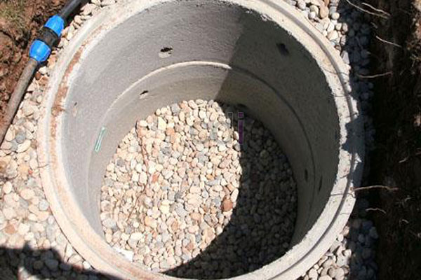
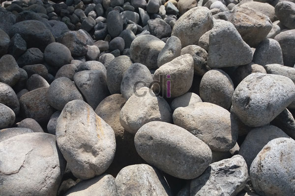

**Cara Membuat Resapan Air Dengan Batu Kali** - Halo Mitra CDI! Apakah Anda sedang mencari solusi cerdas untuk mengatasi masalah ketersediaan air bersih? Kami dari CDI memahami betul pentingnya memiliki sumber air yang berkelanjutan, terutama di tengah perubahan iklim dan meningkatnya kebutuhan air. Penggundulan hutan dan berkurangnya area resapan air memang menjadi perhatian serius, terutama di wilayah-wilayah seperti (not detected). Nah, artikel ini hadir untuk memberikan panduan praktis membuat resapan air sederhana menggunakan batu kali. Yuk, simak bersama!

### Mengapa Sumur Resapan Air Itu Penting?

Mencari alternatif sumber air bersih adalah langkah bijak. Kita tidak bisa terus bergantung pada pasokan air dari luar, apalagi jika harganya semakin mahal. Membangun sumur resapan air adalah investasi jangka panjang yang akan sangat bermanfaat bagi Anda dan lingkungan sekitar. Dengan memanfaatkan air hujan dan air permukaan, kita bisa mengurangi ketergantungan pada sumber air yang terbatas. Jadi, tunggu apa lagi? Mari mulai membangun sumur resapan air di sekitar Anda!

## Menentukan Lokasi Sumur Resapan yang Ideal

**Langkah pertama** agar sumur resapan berfungsi optimal adalah memilih lokasi yang tepat. Lokasi yang strategis akan memastikan penyerapan air berjalan lancar dan efektif. Berikut kriteria yang perlu diperhatikan:

- 1\. Lokasi sumur harus berada pada lahan yang relatif datar.
- 2\. Struktur tanah idealnya memiliki kemampuan menyerap air dengan baik (tanah hitam berpasir lebih disarankan daripada tanah liat).
- 3\. Hindari membuat sumur resapan di area tanah yang curam atau tidak stabil.
- 4\. Pastikan sumur resapan berjarak minimal 10 meter dari septic tank dan tempat pembuangan sampah.
- 5\. Kedalaman galian minimal 2 meter atau sampai mencapai lapisan tanah berpasir.

## Memilih Material Pengisi Sumur Resapan yang Tepat

Pemilihan material pengisi sumur resapan juga sangat krusial. Material yang tepat akan memaksimalkan proses penyaringan dan penyerapan air. Kami merekomendasikan penggunaan batu bronjol/batu kali pada bagian dasar sumur. Berikut beberapa jenis material yang bisa Anda gunakan:

- 1\. Batu kali hitam yang belum terbelah (batu bronjol).
- 2\. Ukuran maksimal diameter 30cm untuk batu bronjol.
- 3\. Bata merah yang berkualitas baik.
- 4\. Ijuk yang sudah dikeringkan.
- 5\. Arang kayu yang berfungsi sebagai filter alami.

> _Ingin mendapatkan batu bronjol berkualitas?_ [**Cek harga batu bronjol terbaik di sini!**](/product/batu-kali-dan-belah)

## Langkah-Langkah Pembuatan Sumur Resapan Air yang Efektif

Setelah lokasi dan material pengisi sumur resapan siap, saatnya kita mulai proses pembuatan. Ikuti langkah-langkah berikut dengan seksama:

- 1\. Siapkan tenaga kerja dan alat-alat penggalian yang memadai. Jika Anda memiliki pengalaman, Anda bisa mengerjakannya sendiri atau dengan bantuan teman dan warga sekitar.
- 2\. Ukur luas area yang akan digali, minimal 2 x 2 meter. Semakin luas area sumur resapan, semakin baik kemampuannya menampung cadangan air.
- 3\. Gali sumur hingga mencapai kedalaman minimal 2 meter atau sampai lapisan tanah berpasir. Bentuk sumur bisa disesuaikan dengan preferensi Anda, baik persegi atau bulat.
- 4\. Pasang dinding sumur menggunakan beton cetak atau tembok biasa setinggi sekitar 1 meter. Pastikan dinding sumur berada 15 cm di bawah permukaan tanah agar penutup sumur bisa rata. Fungsi dinding ini adalah menjaga struktur sumur agar tidak longsor.
- 5\. Buat saluran untuk pipa jet pump dan saluran untuk air hujan yang langsung dari atap rumah. Tambahkan juga saluran pembuangan air berlebih dari sumur.
- 6\. Buat penutup sumur menggunakan coran beton atau membeli beton cetak siap pakai dari toko material. Pastikan ukuran penutup sesuai dengan diameter sumur.
- 7\. Masukkan batu bronjol, bata merah, ijuk, dan arang kayu ke dalam dasar sumur secara berlapis.
- 8\. Tutup sumur resapan dan buat saluran air di sekitarnya untuk mengalirkan air dari luar ke dalam sumur.

Begitulah Mitra, panduan singkat dari kami mengenai cara membuat resapan air dengan batu kali. Semoga tips ini bermanfaat bagi Anda semua, terutama yang berada di (not detected). Dengan memiliki sumur resapan air, Anda tidak perlu khawatir lagi saat pasokan air bersih menipis. Selain itu, Anda juga turut berkontribusi dalam menjaga kelestarian lingkungan. Jangan ragu untuk menghubungi kami jika Anda membutuhkan material bangunan berkualitas atau jasa desain interior untuk rumah Anda! [Hubungi tim CDI sekarang juga](/[URL_CONTACT]) untuk konsultasi gratis dan penawaran terbaik.