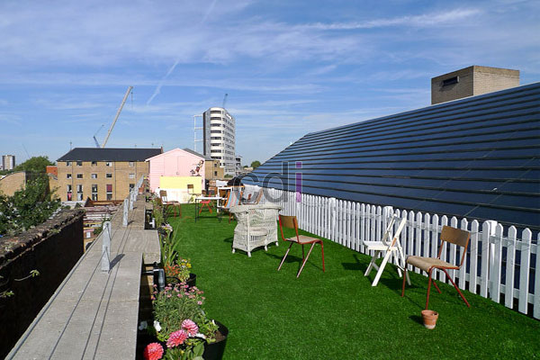

**Cara Membuat Taman di atas Dak dengan Rumput Sintetis** - Hai Mitra CDI! Punya rumah dengan lahan terbatas? Jangan khawatir! Membuat taman di atas dak bisa jadi solusi cerdas. Selain mempercantik rumah, taman di atap juga menciptakan suasana yang lebih segar dan sejuk. Tertarik mewujudkannya? Nah, mari kita bahas tips dan triknya supaya taman di atas dak Anda makin menarik dan sesuai impian!

*Inspirasi desain taman di atas dak lantai atap*

## Mewujudkan Taman Impian di Atas Bangunan

Berikut adalah panduan dari kami untuk menciptakan taman di atas bangunan rumah, ruko, atau properti lainnya. Yuk, simak baik-baik!

### Langkah Pertama: Fondasi yang Kuat

Idealnya, gunakan dak beton sebagai dasar taman Anda. Struktur dak beton lebih kokoh dan permukaannya rata, memungkinkan Anda berkreasi dengan lebih leluasa. Pastikan atap dilapisi lapisan *waterproof* yang berkualitas untuk mencegah kebocoran. Jangan lupakan instalasi saluran air bersih dan pembuangan yang baik. Ini krusial untuk menjaga kesehatan tanaman dan mencegah masalah di kemudian hari.

### Langkah Kedua: Konsep Taman yang Tepat

Selanjutnya, tentukan jenis dan desain taman yang Anda inginkan. Ada dua opsi utama: taman kering atau taman basah. Taman kering biasanya menggunakan tanaman yang tahan kekeringan dan ditanam dalam pot-pot khusus. Penataan bisa dilakukan berjajar, vertikal, atau kombinasi keduanya. Untuk lantai dak, Anda bisa memilih material kayu, bebatuan, atau bahkan rumput sintetis. Sementara itu, taman basah melibatkan lapisan tanah langsung di atas atap dan penanaman rumput serta tanaman perdu. Untuk taman basah, Anda memerlukan tambahan media tanam, lapisan tanah di atas dak beton, pagar/pot besar untuk menampung media tanam, dan perlengkapan lainnya.

### Langkah Ketiga: Memilih Tanaman yang Tahan Banting

Pilihlah tanaman yang mampu bertahan terhadap kondisi ekstrem seperti paparan sinar matahari langsung, minimnya air, dan hembusan angin kencang. Contohnya, tanaman dalam pot, rumput Jepang, dan lainnya. Sebaiknya pilih tanaman yang ringan dan memiliki sistem perakaran yang tidak agresif (tidak serabut atau menembus struktur dak). Beberapa pilihan yang cocok antara lain kamboja, puring, bougenville, bromelia, dan tentu saja, rumput sintetis untuk tampilan yang praktis dan minim perawatan.

### Langkah Keempat: Sentuhan Akhir yang Memanjakan

Tingkatkan kenyamanan taman atap Anda dengan menambahkan elemen dekoratif dan furnitur. Kursi taman, meja, ayunan, atau bahkan *bean bag* bisa menjadi tempat bersantai yang sempurna. Pastikan furnitur yang Anda pilih tahan terhadap cuaca panas dan hujan. Pertimbangkan juga penambahan pergola untuk naungan, lampu untuk menciptakan suasana hangat di malam hari, dan air mancur atau kolam kecil untuk memberikan sentuhan kesegaran. Pergola sangat ideal untuk tanaman rambat, sementara lampu bisa memberikan kesan dramatis dan romantis.

Dengan mengikuti tips ini, Anda bisa menciptakan taman di atas dak dengan rumput sintetis yang indah dan fungsional. Semoga inspirasi ini bermanfaat dan membantu Anda mewujudkan taman impian di atas Dak dengan Rumput Sintetis! Butuh bantuan atau konsultasi lebih lanjut? Jangan ragu untuk menghubungi tim ahli kami. Kami siap membantu Anda!