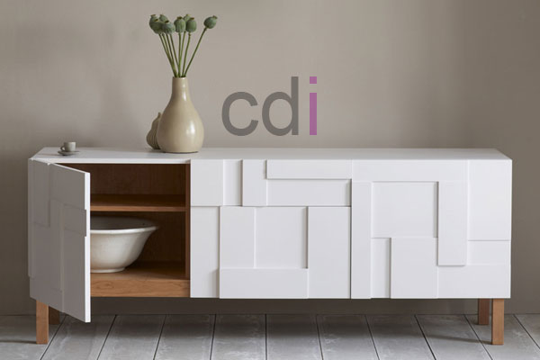

**Tips Memilih Bufet Minimalis untuk Ruang Keluarga** - Hai Mitra CDI! Ruang keluarga adalah jantung rumah, tempat kita berkumpul dan menciptakan kenangan indah bersama orang-orang tersayang. Nah, supaya momen kebersamaan terasa lebih nyaman, penting juga memperhatikan penataan ruangan. Terutama jika keluarga Anda cukup besar, pemilihan furnitur yang tepat jadi kunci. Salah satu solusi cerdas adalah dengan memanfaatkan bufet minimalis untuk ruang keluarga. Furniture ini dirancang pas untuk mengisi sudut ruangan, dengan desain dan ukuran yang bisa disesuaikan dengan luas ruang keluarga Anda.

*Bufet Minimalis*

Penting untuk merencanakan desain dan ukuran yang tepat agar bufet serasi dengan furnitur lain di ruangan. Sebagai produsen dan distributor bufet berkualitas di Jabodetabek, Kami telah dipercaya banyak pelanggan. Tapi, jika Anda masih bingung bagaimana memilih bufet minimalis modern yang berkualitas, yuk simak tips berikut ini. Kami akan uraikan panduan memilih furnitur bufet minimalis agar Anda tak salah pilih.

## Panduan Memilih Furnitur Bufet Minimalis untuk Ruang Keluarga

Agar Anda puas dengan pembelian, ada beberapa kiat yang bisa dijadikan acuan. Produk bufet Kami sudah terjamin kualitas desain dan bahannya, tapi tips ini tetap berguna saat Anda berbelanja di tempat lain.

### 1. Prioritaskan Bahan Dasar Kayu Berkualitas

Kualitas sebuah bufet tidak hanya dilihat dari tampilannya saja, tetapi juga dari material yang digunakan. Semakin baik bahan dasarnya, semakin awet pula bufet tersebut. Kayu jati adalah pilihan populer karena dikenal tahan lama dan kuat. Meskipun biasanya harganya lebih tinggi, jangan khawatir! Di Kami, Anda akan mendapatkan kualitas premium dengan harga yang bersaing. Dijamin, investasi Anda akan sepadan dengan kualitas yang didapatkan.

### 2. Padukan Warna dengan Dekorasi Ruangan

Pemilihan warna yang tepat akan mempercantik tampilan ruang keluarga Anda. Warna bufet yang serasi dengan dominasi warna ruangan akan menciptakan harmoni visual. Jika Anda bingung, jangan ragu untuk berkonsultasi dengan tim desain Kami. Dengan pengalaman lebih dari 12 tahun, Kami siap membantu Anda memilih warna yang paling sesuai dengan konsep ruangan Anda. Pertimbangkan untuk menyelaraskan warna bufet dengan warna pintu atau furnitur lainnya untuk tampilan yang lebih kohesif.

### 3. Perhatikan Ukuran Ruangan

Sebelum berbelanja, ukur area yang akan ditempati bufet. Sesuaikan ukuran bufet dengan luas ruang keluarga agar tidak terlalu besar atau terlalu kecil. Ruang yang terlalu penuh akan terasa sesak, sementara bufet yang terlalu kecil mungkin tidak berfungsi optimal. Manfaatkan sisa ruang secara strategis agar bufet dapat ditempatkan dengan nyaman.

### 4. Jangan Terburu-buru dalam Memutuskan

Pilihlah bufet yang benar-benar Anda sukai dan sesuai dengan kebutuhan. Kami menawarkan beragam model bufet minimalis ruang keluarga dengan kualitas terjamin. Luangkan waktu untuk membandingkan berbagai pilihan dan mempertimbangkan kriteria yang Anda inginkan. Jangan ragu untuk meminta desain dan ukuran khusus yang sesuai dengan preferensi Anda. Hubungi Kami melalui telepon atau email yang tertera di website ini untuk mendapatkan konsultasi terbaik.

### 5. Kunjungi Toko atau Workshop Langsung

Cara terbaik untuk menghindari penipuan adalah dengan mengunjungi toko atau workshop bufet minimalis secara langsung. Dengan datang langsung, Anda dapat memeriksa kualitas bahan dan detail pengerjaan bufet. Anda juga akan lebih leluasa dalam memilih produk yang sesuai dengan selera Anda. Di lokasi penjualan langsung, Anda bisa berinteraksi langsung dengan penjual dan mendapatkan informasi yang lebih akurat. 

Jangan ragu untuk menghubungi kami jika Anda membutuhkan bantuan dalam memilih bufet yang sempurna untuk ruang keluarga Anda di (not detected). Kami siap membantu Anda menciptakan ruang keluarga yang nyaman dan indah! 
<table class="table">
  <caption>Pilihan Material Bufet CDI</caption>
  <thead>
    <tr><th>Material</th><th>Kelebihan</th><th>Kekurangan</th></tr>
  </thead>
  <tbody>
    <tr><td>Kayu Jati</td><td>Tahan lama, Kuat, Tampilan Mewah</td><td>Harga relatif mahal</td></tr>
    <tr><td>Kayu Mahoni</td><td>Awet, Mudah Dibentuk, Harga Terjangkau</td><td>Perawatan tambahan agar tidak mudah berjamur</td></tr>
    <tr><td>Multiplex</td><td>Harga ekonomis, Pilihan Warna Banyak</td><td>Kurang tahan lama dibanding kayu solid</td></tr>
  </tbody>
</table>
 [Bufet Dapur Gantung Minimalis: Pilihan Hemat Ruang & Estetika Modern](/blog/bufet-dapur-gantung-minimalis/)  untuk ide bufet yang mempercantik dapurmu!