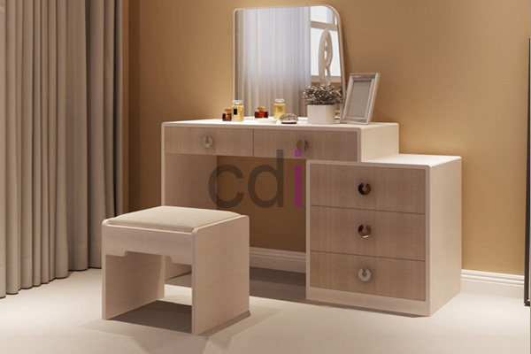

**Cara Memilih Desain Meja Rias Minimalis** - Halo Mitra CDI! Pernahkah Anda merasa kesulitan menata ruang karena meja rias yang terlalu besar? Atau justru merasa kurang nyaman saat berdandan karena meja rias yang sempit dan berantakan? Nah, memilih desain meja rias minimalis bisa jadi solusi tepat. Meja rias ini bukan cuma soal tempat menyimpan kosmetik, lho. Ia juga bisa jadi elemen penting yang mempercantik tampilan kamar Anda. Apalagi kalau ruang yang tersedia tidak terlalu luas. Yuk, simak beberapa tips berikut ini agar Anda mendapatkan meja rias minimalis yang nyaman dan sesuai dengan kebutuhan!

*Desain Meja Rias Minimalis*

## Tips Agar Meja Rias Minimalis Nyaman Digunakan

### Ukur Luas Kamar dengan Cermat

Langkah pertama yang penting adalah mengukur luas kamar tidur Anda. Jangan sampai salah perkiraan! Ukuran meja rias minimalis yang ideal tentu saja harus proporsional dengan luas ruangan. Kalau ukurannya terlalu besar, kamar justru akan terasa sumpek. Coba pertimbangkan juga tata letak perabotan lain di kamar. Jika perlu, singkirkan sementara barang-barang yang kurang penting untuk memperkirakan ruang yang tersedia. Dengan begitu, Anda bisa lebih mudah menentukan ukuran meja rias yang pas. Ini akan memastikan kenyamanan Anda saat menggunakan meja rias.

### Pilih Bahan Dasar yang Sesuai Selera dan Konsep Ruangan

Bahan dasar meja rias minimalis juga perlu diperhatikan. Pilih bahan yang tidak hanya berkualitas, tapi juga sesuai dengan selera dan konsep ruangan Anda. Warna tentu jadi faktor penting. Sebaiknya, pilih warna yang senada dengan warna dinding atau perabotan lain di kamar. Ini akan menciptakan kesan yang harmonis dan luas. Hindari warna-warna yang terlalu mencolok jika Anda menginginkan suasana yang tenang dan nyaman. Apalagi, kami di CDI punya banyak pilihan bahan dan warna yang bisa Anda sesuaikan dengan keinginan. Pengalaman kami dalam pembuatan [furniture custom](https://www.cdi.co.id/furniture-custom/) akan memastikan kualitas dan desain yang memuaskan.

### Perhatikan Penataan Barang Agar Tetap Rapi

Ukuran meja rias minimalis memang terbatas. Oleh karena itu, penataan barang-barang rias sangat penting. Jangan menumpuk semua kosmetik dan peralatan rias di atas meja. Manfaatkan rak atau laci yang tersedia untuk menyimpan barang-barang yang jarang digunakan. Barang-barang yang sering dipakai sebaiknya diletakkan di tempat yang mudah dijangkau. Dengan penataan yang rapi, meja rias akan terlihat lebih luas dan nyaman digunakan. Perlu diingat, meja rias yang nyaman akan membuat proses berdandan menjadi lebih menyenangkan.

### Tambahkan Sentuhan Cermin untuk Ilusi Ruang

Cermin adalah elemen penting dalam desain meja rias minimalis. Selain berfungsi sebagai alat bantu saat berdandan, cermin juga bisa memberikan ilusi ruang yang lebih luas. Anda bisa memilih cermin dengan ukuran yang besar atau menambahkan beberapa cermin kecil di sekitar meja rias. Penataan cermin bisa disesuaikan dengan selera Anda. Pastikan juga cermin tersebut memberikan pencahayaan yang baik agar Anda bisa melihat diri dengan jelas.

Dengan menerapkan tips di atas, Anda pasti bisa menemukan meja rias minimalis yang sesuai dengan kebutuhan dan keinginan Anda. Kami di CDI siap membantu Anda mewujudkan meja rias impian Anda! Kami menawarkan berbagai pilihan desain meja rias modern dengan ukuran dan fitur yang beragam. Jangan ragu untuk menghubungi kami untuk informasi lebih lanjut mengenai  atau konsultasi desain. Kami siap memberikan pelayanan terbaik untuk Anda di (not detected)! [Harga Custom Meja Rias Di Babakan Pasar Bogor](https://www.cdi.co.id/meja/harga-custom-meja-rias-di-babakan-pasar-bogor/) juga bisa menjadi referensi Anda.