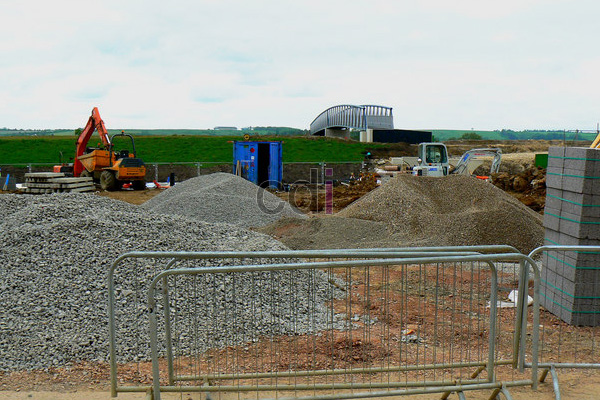

**Cara Memilih Material Bangunan Yang Tepat** - Hai Mitra CDI! Banyak sekali pilihan material bangunan yang tersedia saat ini, mulai dari batako yang jadi alternatif batu bata, hingga baja ringan yang menggantikan kayu untuk atap. Supaya bangunan Anda kokoh dan tahan lama, pemilihan **material bangunan** yang tepat itu krusial, baik untuk rumah, gedung, atau proyek lainnya. Meskipun ada banyak opsi, kualitas tetap jadi kunci utama. Yuk, kita bahas lebih lanjut!

## Mengapa Material Bangunan Berkualitas Tinggi Penting?

Mungkin awalnya terlihat lebih hemat memilih material dengan harga terjangkau. Tapi, pikirkan jangka panjangnya, ya? Bahan bangunan berkualitas tinggi sebenarnya justru bisa lebih ekonomis. Ada beberapa alasan kuat kenapa Anda sebaiknya berinvestasi pada kualitas:

### Kekuatan Struktur yang Terjamin

Material berkualitas unggul punya struktur yang lebih solid dan berkemampuan menahan beban lebih baik. Contohnya, bandingkan atap kayu dengan atap baja ringan. Jelas, baja ringan menawarkan kekuatan yang lebih andal. Baja ringan tahan terhadap keropos, karat, dan masalah lainnya yang sering terjadi pada kayu. Jadi, lebih awet dan aman, lho!

### Tahan Lama, Minim Perawatan

Selain kuat, material berkualitas tinggi juga dirancang untuk bertahan lama. Bangunan yang dibangun dengan material yang tepat bisa berdiri kokoh selama puluhan, bahkan ratusan tahun! Bayangkan, ada rumah-rumah tua yang masih berdiri tegak hingga sekarang. Di era modern ini, desain bangunan bahkan sudah dirancang untuk umur panjang. 

### Hemat Biaya Jangka Panjang

Jangan langsung kaget kalau harga material berkualitas terlihat lebih mahal. Sebenarnya, ini justru investasi yang cerdas! Dengan biaya perawatan yang lebih rendah, kebutuhan perbaikan yang jarang, dan umur pakai yang panjang, material berkualitas tinggi akan menghemat pengeluaran Anda dalam jangka waktu lama. Jadi, secara keseluruhan, justru lebih ekonomis!

Biar lebih yakin, sebaiknya pilih bahan bangunan berkualitas tinggi dengan mempertimbangkan faktor-faktor di atas. Selain itu, faktor keamanan juga sangat penting. Memilih material yang tepat dapat meminimalkan risiko bangunan roboh yang bisa mengancam keselamatan penghuni. Kesimpulannya, **material bangunan** berkualitas terbaik adalah pilihan yang lebih bijak, walau mungkin tampak lebih mahal di awal. Di (not detected), kami dari CDI siap membantu Anda menemukan material terbaik untuk proyek Anda. Jangan ragu untuk menghubungi kami untuk konsultasi gratis! 