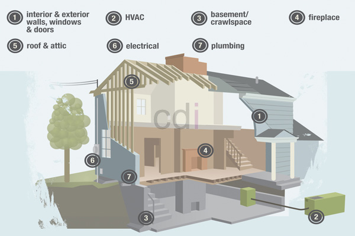

**Mempelajari Dasar Konstruksi Bangunan |** Hai Mitra CDI! Pernahkah Anda bertanya-tanya, apa saja yang sebenarnya membentuk sebuah konstruksi bangunan? Bukan cuma soal jadi dan berdiri kokoh, tapi juga prosesnya, elemen-elemen pentingnya, dan bahkan dampaknya bagi lingkungan sekitar. Nah, di artikel ini, kami akan membahas tuntas dasar-dasar konstruksi bangunan untuk Anda. Mari kita mulai yuk!

## Proses Utama dalam Konstruksi Bangunan

Membangun itu nggak cuma soal tembok dan semen, lho. Ada serangkaian kegiatan yang terencana dan terkelola dengan baik. Biasanya, proyek konstruksi bangunan ini dipantau oleh seorang manajer proyek dan arsitek. Mereka bertanggung jawab atas desain dan memastikan semuanya berjalan sesuai rencana. Tapi, mereka nggak turun langsung ke lapangan.

Nah, yang bertugas mengawasi langsung di lokasi adalah pengawas proyek atau mandor. Mandor ini memastikan para pekerja membangun sesuai instruksi dan standar kualitas yang ditetapkan. Bayangkan mereka sebagai nahkodi yang mengarahkan kapal proyek agar sampai tujuan dengan selamat dan tepat waktu.

## Unsur-Unsur Penting dalam Konstruksi Bangunan

Supaya bangunan berdiri kokoh dan aman digunakan, perencanaan yang matang itu kunci. Bentuk, struktur, dan pemilihan material harus diperhatikan betul. Selain itu, ada beberapa unsur dasar yang wajib ada dalam setiap konstruksi:

- **Pondasi**

Pondasi itu ibarat kaki bangunan, Mitra. Tugasnya menopang seluruh beban struktur dari atas dan menyalurkannya ke tanah. Pondasi yang kuat adalah fondasi utama sebuah bangunan yang kokoh dan tahan lama. Pemilihan jenis pondasi harus disesuaikan dengan kondisi tanah, lingkungan sekitar, dan beban bangunan. Jenis tanah sangat berpengaruh, lho! Pastikan juga pondasi aman dari longsor atau penurunan tanah yang bisa membahayakan bangunan.

- **Atap**

Kalau pondasi menopang dari bawah, atap melindungi dari atas. Atap melindungi bangunan dari panas matahari, hujan, angin, dan kelembapan. Biasanya, rangka atap terbuat dari kayu berkualitas. Elemen penting dalam rangka atap adalah kuda-kuda, yang berfungsi menahan gaya tarik bangunan. Untuk mendapatkan atap yang kuat, pilihlah kayu yang kering, tidak pecah-pecah, dan sudah diserut halus.

Selain kedua unsur penting di atas, **konstruksi bangunan** yang berkelanjutan juga harus mempertimbangkan dampak lingkungan. Pembangunan harus dilakukan dengan memperhatikan kebersihan, meminimalkan limbah konstruksi, dan mengurangi polusi. Dengan begitu, bangunan tidak hanya bermanfaat bagi penghuninya, tapi juga bagi lingkungan sekitar di (not detected).

Nah, itu tadi pembahasan mengenai dasar-dasar konstruksi bangunan. Semoga artikel ini bermanfaat untuk menambah wawasan Mitra CDI dalam dunia konstruksi. Jangan lupa untuk terus menjelajahi artikel-artikel menarik lainnya di situs kami untuk memperdalam pengetahuan Anda. Untuk informasi lebih lanjut atau konsultasi proyek di (not detected), jangan ragu untuk menghubungi kami. Yuk, wujudkan bangunan impian Anda bersama CDI! [Apakah Bagian Dasar dari Rumah yang Perlu Dipahami? Panduan Lengkap](/blog/apakah-bagian-dasar-dari-rumah/) mungkin bisa jadi bacaan tambahan yang menarik bagi Anda.

[[[PLACEHOLDER_N]]]