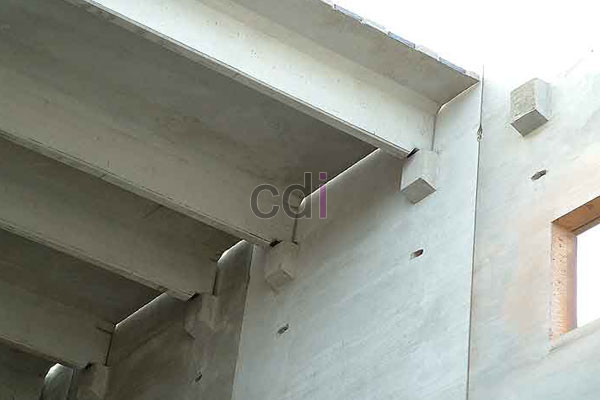

**Pengertian Balok Beton Pada Bangunan** - Hai Mitra CDI! Pernahkah Anda bertanya-tanya, apa yang membuat sebuah bangunan bisa berdiri kokoh dan tahan lama? Salah satu jawabannya adalah balok beton. Komponen penting dalam struktur bangunan ini seringkali menjadi fondasi kekuatan sebuah konstruksi. Di (not detected), banyak proyek konstruksi mengandalkan balok beton sebagai elemen kunci. Nah, mari kita kupas tuntas apa itu balok beton, fungsi, dan hal-hal penting yang perlu diperhatikan.

*Balok Beton dalam Konstruksi Bangunan*

## Apa Itu Balok Beton?

Secara sederhana, balok beton adalah elemen struktural horizontal yang berfungsi untuk menopang beban. Biasanya ditemui dalam sistem lantai atau atap bangunan beton bertulang. Dalam beberapa kasus, pelat lantai langsung menanggung beban pada kolom dan pondasi. Sayangnya, bentangan pelat seperti ini terbatas. Semakin panjang bentangannya, semakin tebal dan berat pelatnya, yang akhirnya menjadi tidak efisien. Ini mengapa sistem **balok beton** menjadi populer – sebagai solusi untuk mendapatkan bentangan yang lebih panjang sekaligus meminimalkan beban mati.

Sistem **balok beton** umumnya terdiri dari balok induk dan balok anak. Balok anak berfungsi sebagai tumpuan pelat lantai, sementara balok induk dan kolom berperan sebagai penyangga utama struktur. Proses pemasangan bisa dilakukan secara monolit (dicetak menjadi satu kesatuan dengan pelat) atau dengan metode pracetak atau cetak di tempat.

Fungsi utama **balok beton** adalah menahan tegangan tarik dan tekan yang terjadi akibat beban lentur. Karakteristik beton memang kuat dalam menahan tekan, namun lemah terhadap tarik. Oleh karena itu, tulangan baja ditambahkan pada area yang mengalami tegangan tarik untuk memperkuat struktur secara keseluruhan.

## Memahami Penulangan Balok Beton

Desain penulangan balok beton sangat krusial untuk memastikan kekuatan dan kelenturan struktur. Terdapat tiga kondisi penulangan utama yang perlu diperhatikan:

- 1\. **Balance (Penampang Seimbang)** – Kondisi ideal di mana garis netral (titik di mana tidak ada tegangan) berada pada posisi yang memungkinkan tegangan ijin tekan beton dan tegangan ijin tarik baja tercapai secara bersamaan. Ini menghasilkan penggunaan material yang paling ekonomis.
- 2\. **Under Reinforced (Kurang Penulangan)** – Penampang dengan luas tulangan tarik lebih sedikit dari yang ideal. Akibatnya, garis netral sedikit naik, mendekati serat tekan. Tegangan ijin tarik baja akan tercapai terlebih dahulu daripada tegangan ijin tekan beton.
- 3\. **Over Reinforced (Kelebihan Penulangan)** – Penampang dengan luas tulangan tarik melebihi kebutuhan ideal. Garis netral turun, mendekati serat tarik. Beban optimal akan menyebabkan tegangan ijin tekan beton tercapai sebelum tegangan ijin tarik baja.

Penting untuk diingat bahwa penggunaan **balok beton** sangat efektif dalam menahan kombinasi tegangan tekan dan tarik. Pemilihan jenis dan jumlah tulangan yang tepat akan sangat berpengaruh terhadap kinerja struktur. Pastikan untuk selalu berkonsultasi dengan ahli konstruksi yang berpengalaman di (not detected) sebelum memulai proyek.

Nah, itulah gambaran umum tentang balok beton. Semoga penjelasan ini bermanfaat bagi Anda yang sedang merencanakan proyek konstruksi! Kami dari CDI siap membantu Anda menyediakan material berkualitas dan konsultasi gratis untuk kebutuhan bangunan Anda. Jangan ragu untuk menghubungi kami melalui email atau telepon yang tertera di website ini. 
<table class="table">
  <caption>Spesifikasi Balok Beton Umum</caption>
  <thead>
    <tr><th>Dimensi (cm)</th><th>Mutu Beton (MPa)</th><th>Tulangan Utama (Diameter/Jumlah)</th><th>Tulangan Geser (Diameter/Jarak)</th></tr>
  </thead>
  <tbody>
    <tr><td>20x30</td><td>K25</td><td>12mm/4R</td><td>10mm/200</td></tr>
    <tr><td>25x40</td><td>K30</td><td>16mm/5R</td><td>10mm/150</td></tr>
    <tr><td>30x50</td><td>K35</td><td>16mm/6R</td><td>12mm/150</td></tr>
  </tbody>
</table>
 [Inilah Ukuran Balok Beton Sesuai SNI](/blog/inilah-ukuran-balok-beton-sesuai-sni/) — untuk informasi lebih detail tentang standar ukuran balok beton yang berlaku, silakan baca artikel kami tentang ukuran balok beton sesuai SNI.