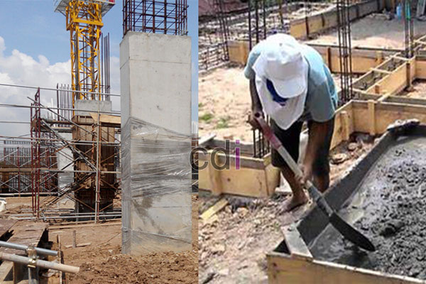

**Mengenal Beton Rakitan atau Pracetak** - Hai Mitra CDI! Pernahkah Anda memikirkan cara mempercepat proyek konstruksi tanpa mengorbankan kualitas? Di dunia konstruksi yang terus berkembang, inovasi selalu hadir untuk menjawab tantangan tersebut. Salah satu solusi yang semakin populer, khususnya untuk proyek skala besar di (not detected), adalah pemanfaatan beton rakitan atau pracetak. Yuk, kita bahas lebih lanjut apa itu beton pracetak, kelebihan kekurangannya, dan bagaimana perbandingannya dengan beton konvensional.

*Beton Rakitan atau Pracetak: Solusi Cerdas untuk Proyek Anda*

## Apa Itu Beton Rakitan atau Pracetak?

Beton Rakitan atau Pracetak adalah beton yang dicetak dengan bentuk baku sesuai pesanan di pabrik khusus. Proses pencetakannya menggunakan cetakan khusus, sehingga menghasilkan elemen beton siap pakai yang mudah dirakit di lokasi proyek. Desainnya pun dirancang agar pemasangan menjadi lebih efisien dan menghasilkan tampilan yang rapi.

## Kelebihan dan Kekurangan Beton Rakitan atau Pracetak

Ada beberapa alasan kenapa beton pracetak semakin digemari. Pertama, bentuknya yang presisi dan rapih tentu saja menjadi nilai plus. Proses pemasangan juga jauh lebih praktis dan cepat, yang secara otomatis bisa menghemat anggaran biaya pembangunan. Mayoritas pekerjaan pengecoran dilakukan di pabrik yang memiliki kontrol kualitas lebih ketat.

Namun, ada juga hal yang perlu dipertimbangkan. Beberapa pihak khawatir mengenai kualitas beton pracetak karena proses pencetakannya tidak bisa dipantau langsung di lapangan. Meskipun begitu, produsen beton pracetak yang terpercaya tentu saja memiliki standar kualitas yang tinggi.

## Jenis-Jenis Beton Berdasarkan Lokasi Pencetakan

Secara umum, beton dapat diklasifikasikan berdasarkan tempat pengecorannya:

- 1. **Beton In-situ:** Beton yang dicetak langsung di lokasi proyek, baik secara manual dengan mesin molen, atau menggunakan layanan pengecoran *ready mix concrete*.
- 2. **Beton Rakitan atau Pracetak (Precast Concrete):**  Beton siap pasang yang diproduksi di pabrik khusus percetakan beton.

## Membandingkan Beton Pracetak dan Beton In-situ

Lantas, bagaimana jika kita membandingkan beton pracetak dengan beton in-situ dari segi kualitas dan harga?  Secara finansial, harga beli beton rakitan memang cenderung lebih tinggi. Tetapi, perlu diingat bahwa penggunaan beton pracetak dapat mempercepat waktu pengerjaan proyek dan mengurangi biaya tenaga kerja.

Sebaliknya, beton in-situ memerlukan waktu yang lebih lama untuk mengeras. Contohnya, pengecoran lantai dua membutuhkan minimal tiga hari sebelum bisa dilanjutkan ke tahap berikutnya. Hal ini tentu saja bisa memperlambat progres proyek, terutama untuk konstruksi berskala besar.  Di sisi lain, beton in-situ memungkinkan kita untuk menyesuaikan bentuk beton sesuai kebutuhan spesifik proyek, dan kualitasnya dapat dipantau secara langsung.

> _Kesimpulannya, ada trade-off antara biaya, waktu, dan kontrol kualitas. Pengecoran manual cenderung lebih mahal dalam hal biaya tenaga kerja dan waktu pengerjaan, tetapi menawarkan kontrol kualitas yang lebih besar. Sementara beton rakitan atau pracetak menawarkan efisiensi biaya dan waktu, namun perlu memilih produsen yang terpercaya. Pilihan terbaik tentu saja bergantung pada kebutuhan dan prioritas proyek konstruksi Anda di (not detected)._

Semoga informasi ini bermanfaat bagi Mitra CDI yang sedang merencanakan proyek konstruksi. Jika Anda membutuhkan informasi lebih lanjut seputar *ready mix concrete* atau cor beton curah siap pakai, silahkan kunjungi artikel kami [DISINI](/blog/ready-mix-concrete-atau-cor-beton-curah-siap-pakai "cor beton curah siap pakai"). Jangan ragu untuk menghubungi kami untuk konsultasi gratis dan penawaran harga terbaik.  Kami siap mendukung kesuksesan proyek Anda!

<table class="table">
  <caption>Perbandingan Beton Pracetak dan Beton In-situ</caption>
  <thead>
    <tr><th>Fitur</th><th>Beton Pracetak</th><th>Beton In-situ</th></tr>
  </thead>
  <tbody>
    <tr><td>Harga</td><td>Cenderung lebih mahal</td><td>Cenderung lebih murah</td></tr>
    <tr><td>Waktu Pengerjaan</td><td>Lebih cepat</td><td>Lebih lama</td></tr>
    <tr><td>Biaya Tenaga Kerja</td><td>Lebih rendah</td><td>Lebih tinggi</td></tr>
    <tr><td>Kualitas</td><td>Tergantung produsen</td><td>Dapat dipantau langsung</td></tr>
    <tr><td>Fleksibilitas Bentuk</td><td>Terbatas</td><td>Lebih fleksibel</td></tr>
  </tbody>
</table>

[Keuntungan dan Kerugian dari Beton Pracetak](/blog/keuntungan-dan-kerugian-dari-beton-pracetak/) - Artikel ini membahas lebih dalam tentang plus minus penggunaan beton pracetak dalam berbagai jenis proyek konstruksi.