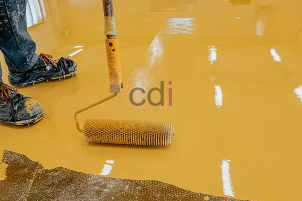

**Epoxy Lantai dan Epoxy Coating: Panduan Lengkap Sebelum Aplikasi** - Hai Mitra CDI! Sedang mencari solusi lantai yang tahan lama, cantik, dan serbaguna? Epoxy lantai bisa jadi jawabannya! Di [not detected], kami sering mendapatkan pertanyaan seputar perbedaan epoxy lantai dan epoxy coating, serta bagaimana cara aplikasinya yang benar. Yuk, simak panduan lengkap ini agar Mitra CDI makin paham dan mendapatkan hasil yang maksimal.

## Apa Itu Epoxy Lantai dan Epoxy Coating? Semuanya Dibahas di Sini!

Epoxy lantai dan epoxy coating memang sering tertukar, tapi keduanya punya perbedaan penting, lho. Secara sederhana, epoxy adalah resin yang diaplikasikan di atas permukaan lantai untuk meningkatkan kekuatan, daya tahan, dan tentu saja, keindahannya. Pilihan aplikasinya pun beragam, disesuaikan dengan kebutuhan serta kondisi ruangan Mitra CDI.

Nah, untuk memastikan hasil epoxy lantai yang tahan lama dan berkualitas, persiapan serta penanganan permukaan yang tepat itu krusial. Berikut sepuluh poin penting tentang epoxy lantai dan epoxy coating yang perlu Mitra CDI ketahui sebelum mulai aplikasi.

## 10 Hal Penting tentang Epoxy Lantai dan Epoxy Coating

### 1. Ketebalan adalah Pembeda Utama: Epoxy Flooring vs. Epoxy Coating

Perbedaan utama antara epoxy flooring dan epoxy coating terletak pada ketebalannya. Epoxy lantai, atau epoxy flooring, umumnya memiliki ketebalan minimal 2 milimeter. Sementara itu, lapisan yang lebih tipis dari itu disebut sebagai epoxy coating atau pelapisan epoxy.

Mengapa ini penting? Epoxy flooring berfungsi sebagai bagian integral dari struktur lantai itu sendiri, memberikan kekuatan dan daya tahan yang signifikan. Di sisi lain, epoxy coating lebih berperan sebagai lapisan pelindung permukaan.

### 2. Persiapan Permukaan: Langkah Krusial yang Sering Terabaikan

Kualitas persiapan permukaan adalah kunci utama keberhasilan aplikasi epoxy. Permukaan yang tidak bersih dan kering dapat menyebabkan masalah penguapan, dan merusak daya rekat epoxy secara permanen.

Pastikan permukaan lantai yang akan dilapisi epoxy benar-benar bersih dari debu, minyak, dan kotoran lainnya. Kondisi permukaan yang prima akan memastikan lapisan epoxy menempel secara maksimal dan tahan lama.

### 3. Kompatibel dengan Beragam Jenis Permukaan

Salah satu kelebihan epoxy adalah fleksibilitasnya. Epoxy bisa diaplikasikan pada berbagai material permukaan keras, seperti baja, keramik, beton, bahkan vinyl. Ini menjadikannya solusi yang praktis untuk berbagai kebutuhan, di [not detected] atau di mana saja! 

### 4. Fleksibilitas Epoxy: Kunci Ketahanan Terhadap Pengikisan

Mungkin terdengar aneh, tapi epoxy yang fleksibel justru seringkali lebih kuat menahan pengikisan dibandingkan epoxy yang terlalu kaku. Fleksibilitas memungkinkan lapisan epoxy untuk sedikit bergerak dan menyesuaikan diri dengan perubahan suhu dan tekanan.

### 5. Lebih dari Sekadar Tahan Lama: Epoxy Lantai untuk Estetika Ruangan

Epoxy lantai seringkali diasosiasikan dengan aplikasi industri yang mengutamakan fungsi. Namun, untuk penggunaan di rumah, kantor, atau area komersial yang mengutamakan tampilan visual, epoxy lantai dapat dikustomisasi dengan berbagai warna dan motif.

Bahkan, efek visual 3D yang menakjubkan juga bisa dicapai dengan aplikasi epoxy lantai — misalnya, menciptakan ilusi air atau ombak laut pada lantai kamar mandi.

### 6. Kombinasi Material: Tingkatkan Performa Epoxy Sesuai Kebutuhan Anda

Epoxy sangat fleksibel dalam hal kombinasi material. Untuk meningkatkan keamanan, lapisan anti-slip dapat ditambahkan dengan campuran butiran kuarsa. Sementara itu, lapisan top coat berbahan urethane memberikan perlindungan ekstra dan hasil akhir yang lebih tahan lama.

### 7. Epoxy untuk Area Luar Ruangan? Bisa Sekali!

Epoxy juga cocok untuk aplikasi di area outdoor, terutama jika dikombinasikan dengan material seperti kerikil. Kombinasi ini tidak hanya menciptakan permukaan yang tahan lama, tetapi juga memberikan tampilan visual yang menarik.

### 8. Waktu Pengeringan: Jangan Terburu-buru!

Meskipun epoxy lantai terlihat mengeras dalam waktu singkat, jangan langsung digunakan! Umumnya, dibutuhkan waktu sekitar 18 hingga 24 jam agar area tersebut aman dilalui. Namun, proses pengerasan sempurna memerlukan waktu sekitar 30 hari.

Suhu ruangan yang dingin dapat memperlambat proses pengeringan. Idealnya, suhu ruangan tempat aplikasi epoxy berada di atas 15 derajat Celsius untuk hasil terbaik.

### 9. Jangan Korban Kualitas: Hindari Epoxy Murah

Produk epoxy murah seringkali hanya mengandung 30–40% kandungan solid. Ini berarti, setelah mengering, ketebalan dan daya tahan yang Mitra CDI dapatkan hanya sekitar 40% dari yang seharusnya.

Untuk investasi jangka panjang, pilihlah produk epoxy dengan kandungan solid 90–100%.

### 10. Lindungi dari Sinar Ultraviolet (UV)

Lantai epoxy yang terpapar sinar matahari langsung berisiko menguning dari waktu ke waktu. Untuk mencegahnya, pilihan warna epoxy yang lebih gelap, penggunaan lapisan tambahan yang tahan UV, atau membatasi paparan sinar matahari langsung sangat disarankan.

## Kenapa Harus Memilih Epoxy Lantai dari CDI di [not detected]?

Sebagai Creative Design Interior (CDI), Kami mengerti betul bahwa setiap ruangan dan setiap proyek memiliki kebutuhan yang unik. Kami siap membantu Mitra CDI menentukan jenis dan spesifikasi epoxy lantai yang paling tepat — mulai dari kebutuhan industri yang mengutamakan fungsi, hingga ruang komersial dan hunian yang juga mengutamakan estetika.

Jangan tunda lagi! Hubungi Kami sekarang melalui tombol **WhatsApp** atau **Telepon** yang tersedia di halaman ini untuk konsultasi lebih lanjut mengenai kebutuhan epoxy lantai Mitra CDI. Kami siap memberikan solusi terbaik untuk lantai impian Anda! [Internal Link: Tersedia Jasa Cat Epoxy: Cara Buat Cat Epoxy Profesional](/blog/cara-buat-cat-epoxy/) — Pelajari lebih lanjut tentang metode aplikasi epoxy terbaik dari tim ahli kami! [Internal Link: Harga Epoxy Lantai 20kg: Estimasi & Pilihan Terbaik untuk Proyek Anda](/blog/harga-epoxy-lantai-20kg/) — Cek estimasi harga terbaru dan pilihan epoxy untuk proyek Anda.