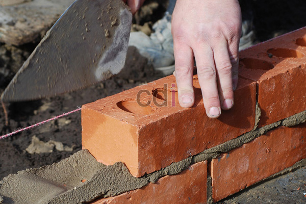

**Cara Menghitung Biaya Upah Tukang Bangunan** - Hai Mitra CDI! Lagi merencanakan pembangunan di (not detected)? Tentu saja, salah satu hal terpenting adalah memahami perkiraan biaya, termasuk upah tukang bangunan. Nah, artikel ini hadir untuk memberikan panduan lengkap tentang cara menghitung biaya upah tukang, lengkap dengan daftar harga terkini yang bisa Anda jadikan acuan. Yuk, simak selengkapnya!

## Memperkirakan Ongkos / Biaya Upah Tukang Bangunan

Pernahkah Anda bertanya-tanya, bagaimana cara menentukan harga borongan yang adil untuk tukang bangunan? Prinsip dasar teknik sipil sebenarnya memiliki rumus yang bisa diterapkan. Walaupun tidak selalu digunakan secara ketat, rumus ini bisa menjadi titik awal perhitungan yang baik.

**Harga upah borongan** = _(Upah Harian X Jumlah Hari Kerja) + Estimasi Keuntungan_

Berikut ini adalah daftar tarif umum upah tukang bangunan yang berlaku di berbagai kota besar seperti Bogor, Jakarta, Bekasi, Depok, Tangerang, dan Bandung. Daftar ini bisa Anda jadikan referensi awal dalam menyusun Rencana Anggaran Biaya (RAB) proyek Anda.

**Harga Upah Persiapan Pembangunan**
<table style="text-align: center; height: auto;" border="1" width="100%" cellspacing="0" cellpadding="3"><tbody><tr><td>Jenis Pekerjaan</td><td>Harga</td></tr><tr><td>Bouwplank</td><td>Rp. 35.700 /m</td></tr><tr><td>Direksikit</td><td>Rp. 73.000 /m²</td></tr><tr><td>Pemagaran</td><td>Rp. 32.500 /m</td></tr></tbody></table>

**Harga Upah Kerja Galian & Pondasi**
<table style="text-align: center; height: auto;" border="1" width="100%" cellspacing="0" cellpadding="3"><tbody><tr><td>Jenis Pekerjaan</td><td>Harga</td></tr><tr><td>Lantai kerja</td><td>Rp. 28.700 /m²</td></tr><tr><td>Urungan tanah leveling lantai</td><td>Rp. 66.000 /m³</td></tr><tr><td>Galian tanah pondasi</td><td>Rp. 94.500 /m³</td></tr><tr><td>Pemasangan batu kali</td><td>Rp. 99.500 /m³</td></tr></tbody></table>

**Harga Upah Pekerjaan Beton Bertulang**
<table style="text-align: center; height: auto;" border="1" width="100%" cellspacing="0" cellpadding="3"><tbody><tr><td>Jenis Pekerjaan</td><td>Harga</td></tr><tr><td>Beton Sloof</td><td>Rp. 78.500 /m</td></tr><tr><td>Beton Plat Dak</td><td>Rp. 68.000 /m²</td></tr><tr><td>Beton Balok Dak</td><td>Rp. 78.500 /m</td></tr><tr><td>Beton Bertulang Ring Balok</td><td>Rp. 54.500 /m</td></tr><tr><td>Beton Bertulang kolom Praktis</td><td>Rp. 48.500 /m</td></tr></tbody></table>

**Harga Upah Kerja Pasang Bata**
<table style="text-align: center; height: auto;" border="1" width="100%" cellspacing="0" cellpadding="3"><tbody><tr><td>Jenis Pekerjaan</td><td>Harga</td></tr><tr><td>Tali air</td><td>Rp. 20.000 /m</td></tr><tr><td>Sudutan</td><td>Rp. 20.000 /m</td></tr><tr><td>Sekonengan</td><td>Rp. 22.500 /m</td></tr><tr><td>Pekerjaan Plester + Aci</td><td>Rp. 35.500 /m²</td></tr><tr><td>Pasang Bata</td><td>Rp. 29.000 /m</td></tr></tbody></table>

**Harga Upah Kerja Pasang Kusen**
<table style="text-align: center; height: auto;" border="1" width="100%" cellspacing="0" cellpadding="3"><tbody><tr><td>Jenis Pekerjaan</td><td>Harga</td></tr><tr><td>Pasang daun jendela</td><td>Rp. 92.000 /unit</td></tr><tr><td>Pasang kusen jendela</td><td>Rp. 98.000 /unit</td></tr><tr><td>Pasang daun pintu panel</td><td>Rp. 195.500 /unit</td></tr><tr><td>Pasang Kusen Pintu</td><td>Rp. 175.500 /unit</td></tr></tbody></table>

**Harga Upah Kerja Pasang Rangka Atap**
<table style="text-align: center; height: auto;" border="1" width="100%" cellspacing="0" cellpadding="3"><tbody><tr><td>Jenis Pekerjaan</td><td>Harga</td></tr><tr><td>Pasang talang</td><td>Rp. 68.500 /m</td></tr><tr><td>Listplank</td><td>Rp. 57.000 /m</td></tr><tr><td>Kerpus</td><td>Rp. 97.500 /m</td></tr><tr><td>Pasang Atap (reng, usuk, kuda-kuda)</td><td>Rp. 132.500 /m²</td></tr></tbody></table>

**Harga Upah Kerja Pasang Plafon**
<table style="text-align: center; height: auto;" border="1" width="100%" cellspacing="0" cellpadding="3"><tbody><tr><td>Jenis Pekerjaan</td><td>Harga</td></tr><tr><td>Pasang plafon gypsum /grc</td><td>Rp. 34.500 /m²</td></tr><tr><td>Pasang List plafon gypsum /kayu</td><td>Rp. 17.500 /m</td></tr></tbody></table>

**Harga Upah Kerja Pasang Keramik**
<table style="text-align: center; height: auto;" border="1" width="100%" cellspacing="0" cellpadding="3"><tbody><tr><td>Jenis Pekerjaan</td><td>Harga</td></tr><tr><td>Keramik 100 X 100</td><td>Rp. 62.400 /m²</td></tr><tr><td>Keramik&nbsp; 80 X 80</td><td>Rp. 53.600 /m²</td></tr><tr><td>Keramik 60 X 60</td><td>Rp. 47.500 /m²</td></tr><tr><td>Keramik 40 X 40</td><td>Rp. 38.500 /m²</td></tr><tr><td>Keramik 30 X 30</td><td>Rp. 35.500 /m²</td></tr><tr><td>Keramik plin</td><td>Rp. 31.500 /m</td></tr><tr><td>Keramik dinding</td><td>Rp. 58.500 /m²</td></tr><tr><td>Keramik lantai kamar mandi</td><td>Rp. 48.500 /m²</td></tr></tbody></table>

**Harga Upah Kerja Pemasangan Listrik**
<table style="text-align: center; height: auto;" border="1" width="100%" cellspacing="0" cellpadding="3"><tbody><tr><td>Jenis Pekerjaan</td><td>Harga</td></tr><tr><td>Fiting lampu dan saklar</td><td>Rp. 105.000 /titik</td></tr><tr><td>Stop kontak</td><td>Rp. 88.000 /titik</td></tr></tbody></table>

**Harga Upah Kerja Pemasangan Sanitasi**
<table style="text-align: center; height: auto;" border="1" width="100%" cellspacing="0" cellpadding="3"><tbody><tr><td>Jenis Pekerjaan</td><td>Harga</td></tr><tr><td>Closet duduk</td><td>Rp. 225.000 /unit</td></tr><tr><td>Closet jongkok</td><td>Rp. 145.500 /unit</td></tr><tr><td>Wall shower</td><td>Rp. 78.000 /unit</td></tr><tr><td>Wastafel</td><td>Rp. 199.000 /unit</td></tr><tr><td>Bath up</td><td>Rp. 1.380.000 /unit</td></tr><tr><td>Kran</td><td>Rp. 25.500 /unit</td></tr><tr><td>Floordrain</td><td>Rp. 38.000 /unit</td></tr><tr><td>Bak control</td><td>Rp. 478.000 /unit</td></tr><tr><td>Pemipaan air kotor</td><td>Rp. 38.500 /m</td></tr><tr><td>Pemipaan air bersih</td><td>Rp. 28.500 /m</td></tr></tbody></table>

**Daftar Harga Upah Pengecatan Rumah**
<table style="text-align: center; height: auto;" border="1" width="100%" cellspacing="0" cellpadding="3"><tbody><tr><td>Jenis Pekerjaan</td><td>Harga</td></tr><tr><td>Cat dinding</td><td>Rp. 19.500 /m²</td></tr><tr><td>Cat ram</td><td>Rp. 52.000 /m</td></tr><tr><td>Cat melamic /duco daun pintu panel</td><td>Rp. 900.000 /unit</td></tr><tr><td>Cat melamic /duco daun jendela</td><td>Rp. 90.000 /m</td></tr><tr><td>Cat melamic /duco kusen</td><td>Rp. 97.000 /m</td></tr></tbody></table>

Sebagai penutup, perlu diingat bahwa tarif di atas bersifat estimasi. Untuk mendapatkan informasi harga yang lebih akurat dan sesuai dengan lokasi Anda di (not detected), jangan ragu untuk menghubungi tim ahli kami melalui tombol di bawah. Kami siap membantu Anda menghitung biaya pembangunan secara detail dan memberikan solusi terbaik untuk proyek Anda! Jangan tunda lagi, konsultasikan rencana Anda sekarang juga.