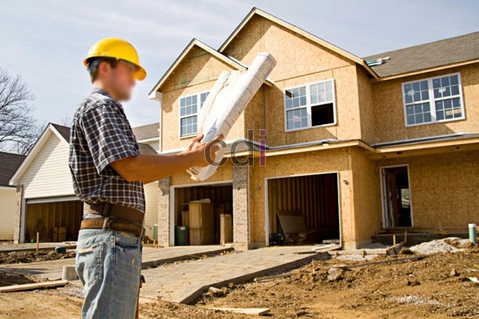

**Merencanakan Pembangunan Rumah Tinggal** - Hai Mitra CDI! Punya rencana membangun rumah impian di (not detected)? Tentu saja, memiliki rumah yang nyaman dan kokoh adalah impian banyak orang. Tapi, bagaimana caranya agar proses *merencanakan pembangunan rumah tinggal* ini berjalan lancar dan sesuai harapan? Yuk, simak tips dari kami! Jangan sampai perencanaan yang kurang matang jadi penghambat punya rumah idaman, ya.

Nah, di artikel ini kami dari [CDI](https://www.creativedesigninterior.com) akan berbagi panduan praktis untuk Anda. Apa saja yang perlu diperhatikan saat *merencanakan pembangunan rumah tinggal* supaya hasilnya sesuai dengan yang Anda bayangkan? Berikut ini rangkuman dari hasil observasi kami dan berbagai sumber terpercaya:

## Menentukan Lokasi yang Tepat dan Strategis

Memilih lokasi rumah adalah langkah awal yang krusial. Faktor lokasi sangat memengaruhi anggaran yang harus Anda siapkan. Semakin strategis lokasinya, biasanya semakin tinggi harga tanah dan biaya pembangunan. Pertimbangkan dengan seksama apakah lokasi tersebut sesuai dengan kemampuan finansial Anda, sekaligus potensi pengembangan rumah di masa depan. Apakah nantinya kita bisa membangun rumah sesuai dengan kemampuan kita atau tidak, perlu dipikirkan baik-baik.

## Mendesain Rumah dengan Detail dan Presisi

Setelah lokasi aman, saatnya memikirkan desain rumah. Merencanakan desain rumah yang detail akan membantu mewujudkan rumah impian Anda sesuai fungsinya. Anda bisa menggunakan jasa konsultan arsitektur, mendesain sendiri dengan memanfaatkan informasi dari buku, internet, atau berdiskusi dengan ahli desain rumah. Pastikan gambar kerja yang dihasilkan detail dan jelas, serta didukung oleh tukang bangunan yang kompeten dan memahami struktur bangunan dengan baik. Dengan begitu, rumah Anda akan terbangun sesuai harapan.

## Memilih Material Bangunan yang Berkualitas

Material bangunan adalah investasi jangka panjang untuk kekuatan dan ketahanan rumah Anda. Jadi, sangat penting untuk mempertimbangkan kualitas dan harga dengan cermat. Misalnya, jika perencanaan pembangunan rumah Anda melibatkan cor beton, pahami betul mutu cor yang tepat. Kami merekomendasikan mutu cor K225 hingga K300 untuk cor dak, kolom, selup, dan bagian struktural lainnya.

> _"Kami juga menyediakan berbagai jenis material bangunan berkualitas, mulai dari Pasir Hitam Cor, Pasir Putih Bangka, Lampung, Mundu, Rangkas, Cilegon, Cimangkok, hingga Batu Belah, Split, Makadam, dan Base Coarse. Harga kami kompetitif dan bisa disesuaikan dengan budget Anda! Untuk informasi lebih lanjut dan pemesanan, silahkan hubungi kami via tombol Telepon atau WhatsApp di halaman ini. Anda juga bisa melihat daftar harganya dengan klik [**DAFTAR HARGA MATERIAL PASIR DAN BATU** "](/blog/daftar-harga-material-pasir-dan-batu-terlengkap)._

## Memastikan Kualitas Tukang Bangunan yang Profesional

Kualitas tukang bangunan sangat berpengaruh pada hasil akhir pembangunan rumah Anda. Hampir 40% anggaran proyek biasanya dialokasikan untuk upah tukang. Jika Anda memiliki pengetahuan tentang konstruksi bangunan, mungkin bisa menggunakan jasa tukang amatiran untuk menghemat biaya. Namun, jika Anda kurang berpengalaman, sebaiknya gunakan jasa tukang yang handal dan berpengalaman.

> _Merencanakan pembangunan rumah tinggal memang memerlukan pertimbangan yang matang. Tapi, dengan tips dan panduan dari kami ini, Anda bisa mendapatkan banyak ide untuk mewujudkan rumah impian Anda di (not detected). Jangan ragu untuk memulai perencanaan sekarang juga!_

Demikian beberapa tips yang bisa kami bagikan. Jika Anda membutuhkan pasokan cor beton curah siap pakai (ready mix concrete) atau material alam untuk proyek bangunan Anda, jangan ragu untuk menghubungi kami. Tim kami siap memberikan solusi dan harga terbaik untuk Anda. Kami akan memastikan pesanan Anda diproses dengan cepat dan efisien.

Semoga bermanfaat, dan selamat membangun rumah impian Anda di (not detected)! Terima kasih.

[3 Hal Penting Dalam Merencanakan Pembangunan Rumah](/blog/hal-wajib-merencanakan-pembangunan-rumah/) — Tips perencanaan rumah yang bisa jadi acuan awal.