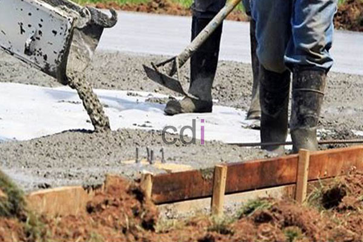

**Metode Pengecoran Yang Baik Dan Benar** - Hai Mitra CDI! Membangun rumah atau struktur bangunan yang kokoh dan tahan lama tentu jadi prioritas utama, ya? Nah, salah satu kunci pentingnya terletak pada kualitas pengecoran beton. Bukan cuma soal metode yang tepat, tapi juga takaran material yang pas. Yuk, simak panduan lengkap ini untuk memahami teknik pembuatan cor beton yang benar dan bisa Anda terapkan di (not detected)!

## Teknik Pengecoran yang Tepat: Fondasi Bangunan Kuat

Dalam dunia konstruksi, metode pengecoran yang baik dan benar sangat krusial. Komposisi semen, split, dan pasir harus diperhatikan dengan seksama. Standar yang berlaku menganjurkan penggunaan ukuran berat, bukan volume. Jadi, idealnya perbandingan 1:2:3 (semen:pasir:split) berarti 1 kg semen, 2 kg pasir, dan 3 kg split. Sayangnya, di lapangan sering ditemui penyesuaian berdasarkan volume—misalnya 1 m³ semen : 2 m³ pasir : 3 m³ split—yang kurang akurat.

Para tukang bangunan biasanya memanfaatkan alat ukur sederhana seperti ember, pengki, dolak, atau sekop untuk mencapai perbandingan yang tepat. Misalnya, satu ember semen : dua ember pasir : tiga ember batu split. Atau, menggunakan ukuran standar 1 zak semen sebagai patokan: 1 zak semen setara dengan 5 sekop pengki, 1 dolak, atau 0,024 m³.

## Proses Pencampuran Adonan Beton yang Merata

Pencampuran adonan beton memerlukan ketelitian. Pastikan semua material tercampur merata sebelum menambahkan air. Setelah air ditambahkan, aduk terus hingga menjadi satu kesatuan. Ciri-ciri adonan tercampur sempurna adalah warna abu-abu kehitaman yang homogen. 

Untuk pencampuran manual, mulailah dengan meletakkan pasir dalam wadah, kemudian campurkan dengan kerikil dan aduk menggunakan sekop. Bentuk campuran menjadi seperti gunung, lalu buat lubang besar (kawah) di bagian atas. Masukkan semen ke dalam lubang tersebut, lalu aduk seluruh material dengan cangkul hingga merata. Ulangi terus hingga semua bahan menyatu sempurna. Setelah itu, bentuk kembali adonan menjadi gunung kecil dan buat kawah untuk menuangkan air di bagian atas.

Perhatikan takaran air yang digunakan—jangan terlalu kental atau terlalu encer—karena akan berpengaruh signifikan pada kualitas cor beton. Nah, biar lebih yakin, Anda juga bisa membaca tips tentang [Beberapa Masalah Saat Pengecoran](/blog/beberapa-masalah-saat-pengecoran/) yang sering terjadi, lho!

## Mengoptimalkan Pengecoran Sesuai Kondisi Cuaca di (not detected)

Jumlah air yang digunakan dalam adonan juga perlu disesuaikan dengan kondisi cuaca. Saat cuaca panas, tambahkan lebih banyak air untuk memperlambat proses pengeringan. Sebaliknya, saat cuaca dingin, kurangi jumlah air untuk mempercepat pengeringan. Untuk volume adonan besar, penggunaan mesin pengaduk akan sangat membantu.

## Alternatif Mudah: Menggunakan Jasa Cor Readymix

Butuh solusi praktis? Anda bisa mempertimbangkan penggunaan jasa cor readymix. Campuran material dan mutu beton yang digunakan sudah terjamin, sesuai standar SNI, dan didukung oleh badan hukum yang kredibel. Banyak perusahaan penyedia cor readymix di (not detected) yang siap melayani proyek kecil maupun besar, seperti Jayamix, Holcim, Pionir, dan Gresik. Pilih penyedia yang paling sesuai dengan kebutuhan dan anggaran Anda.

Demikianlah beberapa poin penting yang perlu Anda perhatikan dalam kegiatan pengecoran. Semoga panduan ini bermanfaat dan memperluas wawasan Anda, ya! Jangan ragu untuk menghubungi kami untuk konsultasi lebih lanjut atau penawaran jasa pengecoran terbaik di (not detected).