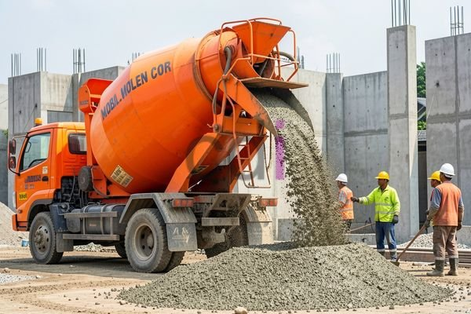

**Mobil Molen Cor: Panduan Lengkap Pemilihan, Harga, dan Perawatan Tahun 2026** - Hai Mitra CDI! Pengecoran beton adalah kunci utama dalam setiap pembangunan, dan mobil molen cor adalah "jantung" yang menjamin kualitas serta kelancaran prosesnya. Nah, artikel ini akan membahas tuntas semua yang perlu Anda ketahui tentang mobil molen cor, mulai dari memilih yang tepat, memahami harga terkini, hingga tips perawatan agar awet dan efisien – khususnya di wilayah (not detected).

## Mengoptimalkan Pekerjaan dengan Jenis Mobil Molen Cor yang Tepat
Mobil molen cor, atau *concrete mixer truck*, adalah solusi praktis untuk mencampur dan mengangkut beton sekaligus. Bayangkan efisiensinya: beton tercampur merata selama perjalanan, mencegah penggumpalan dan memastikan kualitas terjaga. Ada beberapa opsi yang bisa Anda pilih, tergantung kebutuhan proyek. Untuk proyek kecil seperti pembangunan rumah atau renovasi di (not detected), mobil molen cor berukuran kecil (3 meter kubik) adalah pilihan ideal. Jika Anda membangun gedung komersial atau infrastruktur skala menengah, pertimbangkan mobil molen cor berukuran sedang (6-8 meter kubik). Sementara itu, proyek konstruksi besar seperti jalan tol atau gedung bertingkat memerlukan kapasitas lebih besar, yaitu mobil molen cor di atas 8 meter kubik. Pastikan Anda mempertimbangkan volume beton yang diperlukan dan aksesibilitas lokasi proyek saat memilih.

Selain ukuran, perhatikan juga sistem penggerak. Ada yang menggunakan roda (on-road) untuk jalan aspal, dan ada yang menggunakan rantai (off-road) untuk medan berat dan berlumpur. Sistem rantai memang unggul di medan sulit, tapi kurang efisien di jalan mulus. Lalu, pilih juga jenis drum pencampur—*tilt drum* (yang bisa dimiringkan untuk mengeluarkan beton) atau *non-tilt drum* (yang membutuhkan pompa beton).

## Menjelajahi Estimasi Harga Mobil Molen Cor: Baru vs. Bekas di Tahun 2026
Harga mobil molen cor tentu bervariasi. Kapasitas, merek, kondisi, dan fitur tambahan berpengaruh besar. Untuk mobil molen baru 3 meter kubik, Anda bisa memperkirakan budget mulai dari Rp 400.000.000 hingga Rp 600.000.000. Pilihan 6-8 meter kubik biasanya ada di kisaran Rp 700.000.000 – Rp 1.200.000.000. Sementara mobil molen berkapasitas besar (di atas 8 meter kubik) dapat mencapai lebih dari Rp 1.500.000.000. Harga ini hanyalah estimasi, ya! Untuk mendapatkan penawaran paling akurat sesuai dengan kebutuhan proyek Anda di (not detected), sebaiknya hubungi Kami.

Selain harga pembelian, jangan lupakan biaya operasional seperti bahan bakar, perawatan berkala, dan gaji operator. Alternatif menarik lainnya adalah menyewa mobil molen cor, terutama untuk proyek jangka pendek. Harga sewa bervariasi tergantung durasi, lokasi, dan jenis mobil molen yang dipilih. Kisaran harga sewa harian biasanya antara Rp 1.500.000 – Rp 3.000.000, sedangkan untuk sewa bulanan bisa mencapai Rp 30.000.000 – Rp 60.000.000.

## Memaksimalkan Usia Pakai: Tips Jitu Perawatan Mobil Molen Cor
Perawatan rutin adalah investasi penting untuk menjaga kinerja dan umur panjang mobil molen cor Anda. Setelah setiap penggunaan, wajib bersihkan drum pencampur dari sisa beton yang menempel. Karena beton yang mengeras di dalam drum bisa mengurangi efisiensi pencampuran dan bahkan merusak komponen. Selain itu, periksa kondisi ban, sistem hidrolik, dan mesin secara berkala. Pastikan semua bagian yang bergerak dilumasi sesuai rekomendasi pabrikan.

Kualitas bahan bakar juga krusial. Gunakan bahan bakar yang direkomendasikan oleh pabrikan agar mesin tetap prima. Jangan lupa ganti filter oli dan filter udara secara teratur. Dengan pemeliharaan preventif yang baik, Anda bisa menghindari biaya perbaikan yang mahal dan memastikan mobil molen cor selalu siap bekerja. Lakukan juga inspeksi menyeluruh pada sistem kelistrikan dan pastikan semua kabel terhubung dengan aman.

## Menemukan Penyedia Jasa Mobil Molen Cor Terpercaya di (not detected) dan Sekitarnya
Memilih penyedia jasa yang terpercaya adalah kunci kelancaran proyek Anda. Pastikan mereka memiliki armada yang lengkap, terawat, dan didukung oleh tenaga operator berpengalaman serta bersertifikasi. Jangan ragu untuk meminta referensi dari pelanggan sebelumnya untuk mengetahui reputasi mereka. Nah, di Creative Design Interior, Kami menyediakan layanan penyewaan mobil molen cor dengan berbagai kapasitas dan harga yang bersaing. Kami juga melayani pengecoran beton siap pakai dengan kualitas yang sudah teruji.

Butuh bantuan langsung untuk menentukan mobil molen yang paling ideal untuk proyek Anda di (not detected)? Atau ingin konsultasi mengenai perkiraan biaya pengecoran beton? Yuk, klik tombol **WhatsApp** atau **Telepon** di bawah ini untuk berbicara langsung dengan tim Kami! Jangan tunda lagi, pastikan proyek Anda berjalan lancar dengan solusi yang tepat. [1 Mobil Molen Berapa Kubik: Menghitung Kapasitas dan Estimasi Biaya](/blog/1-mobil-molen-berapa-kubik/)