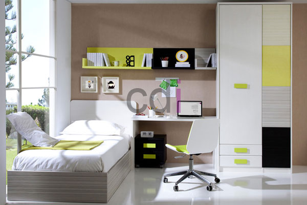

**Model Dipan Minimalis Anak [Terbaru]** - Hai Mitra CDI! Ada momen spesial saat si kecil mulai mandiri dan ingin tidur sendiri, ya? Nah, sebagai orang tua, kita tentu ingin memberikan yang terbaik untuk kenyamanan mereka. Dipan minimalis anak adalah solusi cerdas! Desainnya yang simpel dan modern nggak cuma cocok untuk orang dewasa, tapi juga bikin kamar si kecil makin nyaman dan stylish.

*Dipan Minimalis Anak: Pilihan Tepat untuk Kamar Si Kecil*

Dipan minimalis untuk anak-anak memang lagi jadi favorit banyak orang tua. Desainnya yang menarik dan kekinian bikin kamar anak makin estetik. Tapi, jangan cuma fokus soal penampilan, kualitas juga penting banget! Dipan yang kokoh dan nyaman akan menjamin tidur si kecil pulas sepanjang malam.

## Ide Model Dipan untuk Anak-Anak

Memilih dipan untuk anak memang butuh pertimbangan khusus. Sebaiknya ajak si kecil saat berbelanja, biar mereka bisa langsung memilih model yang disuka. Model dipan minimalis modern memang sedang digandrungi karena desainnya yang bersih dan nyaman. Selain itu, dipan ini juga sesuai dengan tren sekarang. Pasti anak-anak senang punya dipan yang lagi hits! Nah, kalau mau yang beda, kalian juga bisa pilih dipan dengan desain yang unik. Meskipun desain dipannya klasik, kalian bisa memadukannya dengan kasur bermotif karakter favorit anak, misalnya Doraemon, superhero, atau klub sepakbola kesayangan mereka.

## Kenapa Dipan Minimalis Cocok untuk Anak?

Ada beberapa keunggulan yang bisa kalian dapatkan kalau memilih dipan minimalis untuk anak:

### 1. Harga Lebih Ramah di Kantong

Salah satu hal yang paling menarik, dipan minimalis biasanya punya harga yang lebih terjangkau. Karena ukurannya yang tidak terlalu besar dan dirancang untuk satu orang, harganya tentu lebih bersahabat di kantong.

### 2. Kuat dan Tahan Lama

Ukuran yang pas membuat dipan minimalis lebih awet. Anak-anak masih dalam tahap pertumbuhan, jadi dipan yang ukurannya sesuai akan lebih kokoh menopang mereka. Pilih material berkualitas seperti kayu, multiplek, atau besi agar dipan tidak mudah rusak.

### 3. Melatih Kemandirian Anak

Dengan punya dipan sendiri, anak akan belajar mandiri dan tidak selalu bergantung pada orang tua. Ini penting banget, lho! Terutama untuk anak laki-laki, karena kelak mereka akan tumbuh menjadi sosok yang bertanggung jawab. Kalau punya lebih dari satu anak, kalian bisa pertimbangkan dipan tingkat untuk menghemat ruang dan mengajarkan anak untuk saling berbagi.

## Info Lebih Lanjut Soal Harga Dipan Minimalis

Tertarik untuk membeli dipan minimalis anak? Yuk, langsung pesan di CDI! Kami menyediakan berbagai macam model dipan yang menarik, mulai dari anak-anak hingga dewasa. Kualitas terjamin, harga bersahabat, dan pelayanan terbaik untuk Anda. Harga dipan minimalis anak-anak sangat bervariasi, tergantung kualitas dan ukuran dipan yang dipilih. Semakin berkualitas materialnya dan semakin besar ukurannya, harga akan menyesuaikan. Jangan khawatir! Kami sering memberikan diskon spesial untuk pelanggan setia. Dijamin Anda nggak akan kecewa! Untuk informasi lebih lanjut, atau konsultasi sebelum membeli, silahkan hubungi kami. Kami siap membantu!

Dapatkan penawaran terbaik untuk desain interior dan furniture impian Anda di (not detected)! Jangan ragu untuk menghubungi kami untuk konsultasi gratis dan penawaran harga terbaik. Kami siap mewujudkan kamar impian si kecil di (not detected)! [Jasa Custom Dipan Anak Tingkat Di Baranangsiang](/dipan/jasa-custom-dipan-anak-tingkat-di-baranangsiang/)