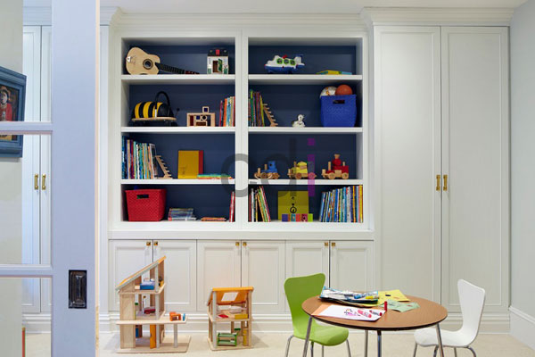
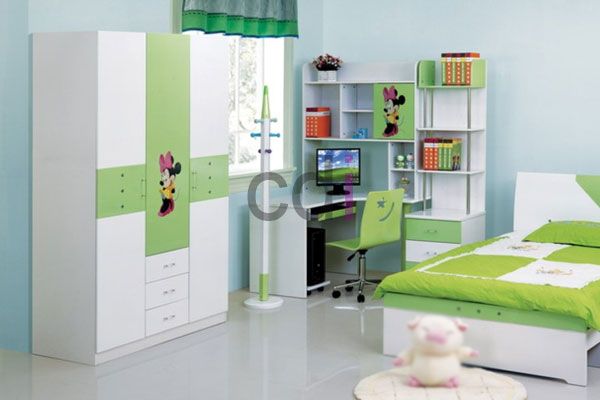
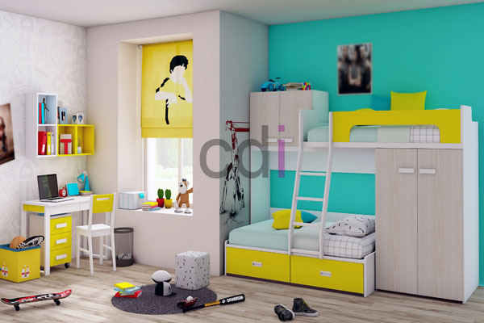

**Model Lemari Pakaian Anak yang Unik** - Hai Mitra CDI! Menciptakan hunian yang nyaman dan menarik bagi si kecil itu penting banget, kan? Apalagi soal desain interior kamar anak. Salah satu elemen kunci yang sering terlupakan padahal bisa bikin kamar jadi lebih fungsional dan estetik adalah lemari pakaian. Nah, untuk Mitra yang sedang mencari inspirasi, yuk kita intip beberapa model lemari pakaian anak yang unik dan bisa jadi pilihan! Di (not detected), kami siap membantu mewujudkan kamar impian anak Anda.

Lemari pakaian bukan cuma sekadar tempat menyimpan baju, tapi juga bagian dari dekorasi kamar yang bisa memengaruhi mood dan kreativitas anak.  Memilih model yang tepat bisa bikin kamar anak jadi lebih rapi, menyenangkan, dan tentunya sesuai dengan kepribadian si kecil. 

Jadi, apa saja sih jenis-jenis lemari pakaian anak yang lagi tren? Berikut ini adalah beberapa ide yang bisa Anda jadikan referensi.

## 4 Jenis Lemari Pakaian Anak yang Unik

### 1. Lemari dengan Rak di Tengah

*Lemari Anak Multifungsi*

Model lemari ini lagi populer banget, lho! Lemari pakaian anak dengan tambahan rak di tengah, bahkan bisa dilengkapi dengan kasur atau tempat tidur. Ide brilian, kan?

Dengan desain seperti ini, kamar anak jadi terasa lebih ringkas dan luas. Tempat tidur yang biasanya memakan banyak ruang, kini bisa menyatu dengan lemari pakaian. Selain hemat ruang, lemari ini juga menawarkan ruang penyimpanan yang lebih besar. Biasanya, pengrajin akan menyesuaikan lebar lemari dengan lebar kasur, meskipun ada juga yang memotong sebagian lemari agar lebih fleksibel.

### 2. Lemari Anak Karakter Favorit

Anak-anak biasanya punya karakter kartun atau superhero kesayangan. Nah, kamu bisa memanfaatkan hal ini untuk memilih lemari pakaian anak. Ada banyak sekali pilihan lemari dengan motif karakter yang lucu dan menggemaskan. Atau, kalau mau lebih unik, kamu bisa melukis lemari polos dengan gambar karakter favorit si kecil.

Dengan begitu, anak-anak akan lebih senang dan bersemangat saat merapikan pakaian mereka.  Lemari karakter ini juga bisa meningkatkan rasa kepemilikan dan tanggung jawab anak terhadap barang-barang pribadinya. Di (not detected) kami bisa custom lemari karakter sesuai keinginan Anda tentunya!

Meskipun mencari karakter yang spesifik mungkin perlu sedikit usaha, kepuasan melihat anak-anak senang dengan lemari barunya pasti sepadan.

### 3. Lemari Anak Berwarna-Warni

Kalau Anda suka dengan konsep rumah berwarna cerah dan unik, model lemari ini bisa jadi pilihan yang tepat. Lemari pakaian anak dengan kombinasi warna-warni yang ceria akan membuat kamar anak jadi lebih hidup dan menyenangkan. 

Warna-warna cerah seperti merah, biru, hijau, dan kuning bisa merangsang kreativitas dan imajinasi anak. Pastikan saja pemilihan warnanya tetap harmonis dengan tema kamar secara keseluruhan ya. 

Tapi ingat, jangan lupa perhatikan juga aspek keamanan dan kualitas bahan lemari. Lemari anak harus terbuat dari bahan yang kuat dan tahan lama, seperti kayu solid, multipleks, atau besi. Hindari bahan plastik atau bahan rapuh lainnya yang bisa membahayakan anak.  

Di (not detected), kami punya beragam pilihan bahan berkualitas tinggi untuk memastikan lemari anak Anda awet dan aman digunakan.

### 4. Custom Lemari Pakaian Anak Impian

Bagi Anda yang ingin memiliki lemari pakaian anak yang benar-benar unik dan sesuai dengan selera anak, pesan custom adalah pilihan terbaik. Kami dari CDI (not detected) siap membantu Anda mewujudkan desain lemari impian Anda. Kami bisa menyesuaikan ukuran, warna, motif, dan fitur lemari sesuai dengan kebutuhan dan keinginan Anda.  

Jangan ragu untuk menghubungi kami untuk konsultasi gratis dan mendapatkan penawaran harga terbaik.  Kami akan memberikan solusi desain yang optimal untuk kamar anak Anda.  Untuk info harga terkini, silakan lihat tabel harga di atas atau hubungi tim kami.  Yuk, wujudkan kamar anak yang unik dan nyaman bersama kami!

<table class="table">
  <caption>Pilihan Bahan Lemari Anak</caption>
  <thead>
    <tr><th>Jenis Bahan</th><th>Kelebihan</th><th>Kekurangan</th></tr>
  </thead>
  <tbody>
    <tr><td>Kayu Solid</td><td>Kuat, tahan lama, tampilan alami</td><td>Harga relatif mahal, perlu perawatan</td></tr>
    <tr><td>Multipleks</td><td>Lebih terjangkau, stabil, mudah dirakit</td><td>Kurang tahan lama dibandingkan kayu solid</td></tr>
    <tr><td>Besi</td><td>Sangat kuat, tahan lama, desain industrial</td><td>Harga mahal, rentan berkarat</td></tr>
  </tbody>
</table>
