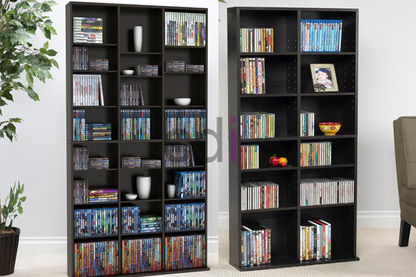
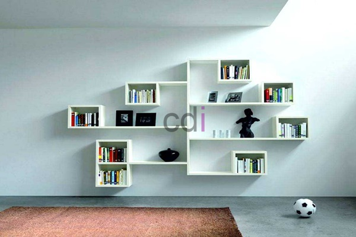
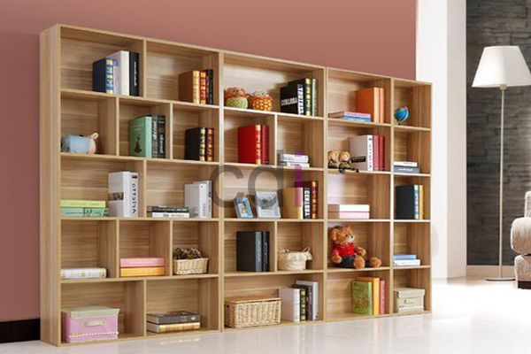

**Model Rak Buku Kayu Untuk Rumah Minimalis** - Hai Mitra CDI! Pernah merasa koleksi buku kesayangan mulai memenuhi setiap sudut rumah? Atau justru bingung mencari tempat penyimpanan yang pas untuk mempercantik ruangan minimalis Anda? Kami punya solusinya! 

Meskipun era digital semakin berkembang, buku tetap memiliki daya tariknya tersendiri. Entah itu novel yang menghibur, komik yang menginspirasi, atau buku-buku pengetahuan lainnya, memiliki perpustakaan pribadi adalah kebanggaan tersendiri. Nah, supaya buku-buku tersebut tertata rapi dan tetap mendukung konsep rumah minimalis Anda di (not detected), yuk simak berbagai model rak buku kayu yang bisa menjadi inspirasi.

## Bentuk Rak Buku Kayu yang Cocok untuk Rumah Minimalis

### 1. Rak Buku Ekstra Slot

Ingin memaksimalkan ruang penyimpanan tanpa mengorbankan estetika minimalis? Rak buku dengan desain ekstra slot ini adalah jawabannya! Bentuknya yang tinggi menjulang namun dengan lebar yang ramping, sangat ideal untuk rumah minimalis dengan luas terbatas.

Rak ini tidak hanya berfungsi sebagai tempat menyimpan buku, tapi juga memiliki slot tambahan di bagian bawah yang bisa dimanfaatkan untuk berbagai keperluan lain. Kombinasi antara rak terbuka untuk memajang koleksi buku favorit dan laci tertutup di bagian bawah akan menciptakan tampilan yang rapi dan terorganisir. Dengan begitu, ruangan di (not detected) Anda akan terasa lebih lapang dan nyaman.

### 2. Rak Buku Geometris

Bosan dengan desain rak buku yang itu-itu saja? Rak buku geometris bisa menjadi pilihan menarik untuk Anda yang ingin menambahkan sentuhan unik pada interior minimalis. Bentuknya yang dinamis, dengan variasi tinggi dan lebar setiap kompartemennya, akan menciptakan kesan artistik dan modern.

Rak ini bukan hanya fungsional, tapi juga bisa menjadi fokus perhatian di ruangan. Anda bahkan bisa menambahkan dekorasi seperti bingkai foto atau tanaman hias minimalis untuk mempercantik tampilannya. Bayangkan bagaimana rak buku ini akan mempercantik sudut baca di rumah Anda di (not detected)!

### 3. Rak Buku Maksimalis

Memiliki banyak koleksi buku namun khawatir akan memakan banyak tempat? Jangan khawatir! Rak buku maksimalis dirancang khusus untuk mengakomodasi kebutuhan penyimpanan Anda. Konsepnya yang sederhana namun efisien, menjadikan rak ini solusi ideal untuk rumah minimalis dengan koleksi buku yang melimpah.

Biasanya, rak buku ini dibuat secara *custom* sesuai dengan ukuran dan kebutuhan ruangan Anda. Dengan begitu, rak tersebut akan terintegrasi dengan sempurna dengan interior rumah Anda di (not detected), menciptakan kesan minimalis yang harmonis. Pilihan warna netral juga akan membantu rak buku ini menyatu dengan dekorasi ruangan yang sudah ada.

Dengan berbagai pilihan model rak buku kayu minimalis di atas, Anda tidak perlu lagi kesulitan menata buku-buku kesayangan. Kami siap membantu Anda mewujudkan rak buku impian sesuai dengan keinginan dan kebutuhan Anda. Selain model-model di atas, Anda juga bisa memesan rak buku dari bahan multiplek berkualitas dengan finishing HPL, yang sering digunakan di perkantoran.

Jangan tunda lagi! Segera hubungi kami untuk konsultasi dan pemesanan rak buku minimalis yang sempurna untuk rumah Anda di (not detected). Kami akan memberikan solusi terbaik untuk menciptakan ruang baca yang nyaman dan inspiratif. 
<table class="table">
  <caption>Pilihan Finishing Rak Buku</caption>
  <thead>
    <tr><th>Jenis Finishing</th><th>Deskripsi</th><th>Ketahanan</th></tr>
  </thead>
  <tbody>
    <tr><td>HPL</td><td>Lapisan melamin yang tahan gores dan mudah dibersihkan</td><td>Tinggi</td></tr>
    <tr><td>Cat Duco</td><td>Lapisan cat yang memberikan tampilan lebih mewah</td><td>Sedang</td></tr>
    <tr><td>Vernis</td><td>Lapisan bening yang melindungi kayu dan memperkuat serat kayu</td><td>Sedang</td></tr>
  </tbody>
</table>
