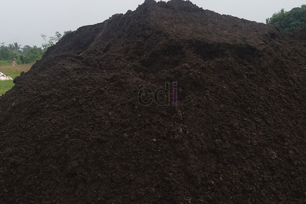
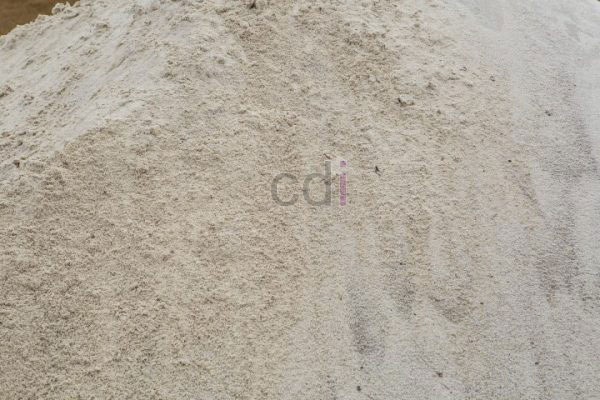

**Inilah yang Dimaksud dengan Pasir Laut dan Darat** - Hai Mitra CDI! Sedang merencanakan proyek konstruksi? Pasti nggak asing lagi dengan pasir, kan? Material satu ini memang krusial dalam berbagai pembangunan, mulai dari rumah, gedung, hingga infrastruktur lainnya. Tapi tahu nggak, ternyata pasir itu punya banyak jenis dengan kegunaan yang berbeda-beda. Nah, kali ini kita bakal membahas tuntas tentang dua jenis pasir yang paling umum ditemui: Pasir Laut dan Pasir Darat. Yuk, kita kupas tuntas perbedaannya, supaya Mitra lebih paham dan bisa memilih yang paling tepat untuk proyek Anda!

*Pasir Darat*

## Mengenal Lebih Dekat Pasir Laut dan Darat

Secara sederhana, pasir laut adalah pasir yang diambil dari area pantai atau pesisir laut. Sementara itu, pasir darat berasal dari sumber-sumber di daratan, seperti pegunungan, sungai, atau bekas letusan gunung berapi. Kalau dilihat dari segi ilmiah, pasir laut itu adalah sedimen berukuran 0,55-2,5 mm yang terbentuk dari pecahan batu karang atau batuan lainnya akibat erosi gelombang laut. Nah, kalau pasir darat, umumnya berasal dari pecahan batuan pegunungan atau sisa endapan vulkanik yang berukuran 0,55-3 mm. 

*Pasir Laut*

## Apa Saja Kegunaan Pasir Laut dan Darat?

Meskipun sekilas terlihat sama, sebenarnya pasir laut dan darat punya kegunaan yang sedikit berbeda. Keduanya sama-sama penting sebagai bahan campuran untuk membuat mortar, plesteran, atau sebagai lapisan dasar untuk pemasangan keramik. Tapi seiring perkembangan teknologi konstruksi, fungsi spesifik masing-masing jenis pasir ini semakin jelas. Contohnya, pasir laut atau pasir putih seringkali lebih direkomendasikan untuk pembuatan bata ringan (hebel), pelesteran dinding yang membutuhkan tekstur halus, pemasangan marmer, atau produksi genteng.

## Proses Penambangan Pasir Laut dan Darat di (not detected)

Selain memahami jenis dan kegunaannya, penting juga untuk mengetahui dari mana dan bagaimana kedua jenis pasir ini diperoleh. Lokasi penambangannya tentu berbeda, karena sumbernya pun berbeda. Di Indonesia, penambangan pasir laut banyak ditemukan di Bangka Belitung, Lampung, Banten, Kalimantan, Jawa Tengah, dan Sulawesi. Sementara itu, pasir darat banyak ditemukan di Jawa Barat, seperti Tasikmalaya (dengan Pasir Galunggung), Sukabumi (Pasir Cimangkok), Cianjur (Pasir Jebrod), Cimalaka, Purwakarta, Cilegon, Rangkas, dan Bogor. Selain itu, ada juga di luar Jawa Barat, seperti Lampung (Pasir Putih), Sungai Musi, Yogyakarta (endapan Merapi), dan Pontianak.

Proses penambangannya juga berbeda-beda. Untuk pasir yang berada di bawah air (sungai atau laut), biasanya ditambang dengan cara disedot dan dicuci. Sedangkan untuk pasir yang ditambang di pegunungan, biasanya dilakukan dengan metode penggalian dan pengayakan.

## Bagaimana Sistem Penjualan Pasir Laut dan Darat di (not detected)?

Sistem penjualannya sendiri kurang lebih sama. Umumnya, penambang menjual pasir langsung ke distributor dalam bentuk *delivery order* (DO). Distributor kemudian menjual dan mengangkutnya ke pengepul pasir atau langsung ke pabrik-pabrik konstruksi dalam skala besar. Ada juga pengecer yang mengambil langsung dari tambang dan menjualnya ke konsumen perorangan. Biasanya, harga yang ditawarkan pengecer sedikit lebih tinggi karena biaya operasional dan transportasi.

Nah, itu tadi pembahasan lengkap tentang Pasir Laut dan Darat. Semoga informasi ini bermanfaat ya, Mitra! Butuh pasir berkualitas untuk proyek Anda di (not detected)? **Yuk, segera hubungi kami untuk mendapatkan penawaran terbaik!** Kami juga menawarkan layanan pemesanan skala besar dengan sistem kontrak bagi perusahaan konstruksi. Jangan ragu untuk menghubungi tim kami melalui email atau telepon yang tertera di website ini.  [Inilah Yang Dimaksud Dengan Beton Normal](/blog/apa-itu-beton-normal/) dapat menjadi panduan tambahan untuk material pondasi yang kuat.