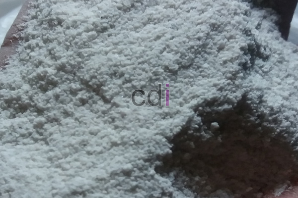

**Pasir Silika Terbaik Untuk Produksi Bata Ringan** - Halo Mitra CDI! Sedang mencari pemasok pasir silika berkualitas untuk produksi bata ringan? Nah, di bulan ini kami berhasil menjalin kontrak suplai pasir silika/silica untuk sejumlah pabrik bata ringan (hebel) di wilayah Jakarta, Bogor, Tangerang, Banten, Serang, Rangkas, Bekasi, Cikarang, Karawang, hingga Cikampek. Totalnya mencapai rata-rata 500.000 meter kubik per kontrak! Selain kualitasnya yang unggul, pasir silika ini memang sangat direkomendasikan dan dikenal sebagai Pasir Silika Terbaik Untuk Produksi Bata Ringan, karena sudah banyak digunakan oleh produsen bata ringan terkemuka di Indonesia. 

*pasir silika terbaik untuk bata ringan*

## Mengenal Spesifikasi Pasir Silika Terbaik

Kualitas pasir silika sangat menentukan hasil akhir bata ringan yang diproduksi. Ada beberapa spesifikasi pasir silika yang ideal untuk produksi bata ringan (hebel), yang bersumber dari berbagai penambangan pasir di Sumatera dan Kalimantan. Berikut detailnya:

- 1\. Komposisi: Mengandung Iron Trioxide, Alumunium Trioxide, Calcium Oxide, Magnesium Oxide, Manganese Dioxide, Chromium Trioxide, Sodium Oxide, Silicon Dioxide, Titanium Dioxide, Loss on Ignition, dan Moisture Content.
- 2\. Kadar Kotoran: Kandungan clay atau lumpur di bawah 5% atau kadar silika antara 90 s/d 99,90%. Ini memastikan kekuatan dan kualitas bata ringan yang optimal.
- 3\. Penampilan Fisik: Berwarna putih garam, bersih, dan bertekstur halus. Bebas dari kerikil atau bebatuan yang dapat mengganggu proses produksi.
- 4\. Tekstur: Saat digenggam, terasa berat dan lembab – indikasi kadar air yang pas untuk proses pencampuran.

## Sumber Pasir Silika Terbaik di Indonesia

Pada dasarnya, hampir semua jenis pasir silika dapat digunakan untuk produksi bata ringan (hebel), asalkan spesifikasinya memenuhi standar yang ditetapkan. Kualitas dan kandungan pasir adalah acuan utama, tidak peduli dari mana asalnya – Jawa, Sumatera, Kalimantan, atau bahkan Sulawesi. Saat ini, daerah penghasil pasir silika terbaik di Indonesia berada di **Tulang Bawang Lampung, Pulau Bangka, Palangkaraya Kalimantan, dan Cilacap Jawa Tengah**. Daerah-daerah ini dikenal dengan pasir silika yang memiliki kandungan SiO2 tinggi dan minim kontaminan.

## Tips Mendapatkan Harga Pasir Silika Termurah

Banyak konsumen pasir silika belum memahami cara pemesanan yang tepat untuk mendapatkan harga terbaik. Umumnya, mereka hanya berpikir bahwa volume pesanan yang besar akan otomatis menurunkan harga. Padahal, ada strategi lain yang bisa diterapkan untuk menghemat biaya produksi. Jika Anda berencana membuka pabrik bata ringan (hebel), perhatikan beberapa hal berikut:

- 1\. Hindari membeli dari calo atau broker. Harga mereka biasanya sudah dinaikkan oleh beberapa perantara.
- 2\. Pastikan pemasok pasir silika yang Anda pilih adalah perusahaan legal dan bergerak sebagai pihak pertama.
- 3\. Jangan membeli dari *quarry*. Lebih efisien jika Anda langsung membeli dari tambang dan menyewa jasa angkut/ekspedisi tongkang.
- 4\. Pertimbangkan sistem kontrak dengan minimal *quantity* 500.000 m³ per kontrak. Sistem ini memberikan harga yang lebih stabil, bahkan ketika harga di tambang naik.
- 5\. Cari pemasok yang menawarkan sistem pembayaran tempo atau SKBDN (Surat Kredit Bank Dalam Negeri).

## Rekomendasi Supplier Pasir Silika Terpercaya: UD. TRI PUTRA

Di tengah banyaknya pilihan pemasok, menemukan mitra yang terpercaya memang membutuhkan riset. Kepercayaan tidak bisa dibangun secara instan, melainkan melalui testimoni dan bukti nyata. Oleh karena itu, kami merekomendasikan **UD. TRI PUTRA** sebagai salah satu perusahaan tambang dan pemasok pasir berkualitas. Mengapa **UD. TRI PUTRA**? Karena kami sendiri pernah menjadi konsumen mereka dan merasakan langsung kualitas serta pelayanan yang diberikan. Selain itu, mereka memiliki tambang, armada *dump truck*, dan tongkang sendiri, sehingga harga yang ditawarkan lebih kompetitif. Anda bisa membandingkannya dengan perusahaan lain!

Anda bisa menghubungi tim marketing **UD. TRI PUTRA** untuk informasi lebih lanjut dan penawaran harga terkini. 

Demikian pembahasan tentang Pasir Silika Terbaik Untuk Produksi Bata Ringan yang dapat kami sampaikan. Semoga artikel ini bermanfaat bagi Anda yang sedang mencari pasir berkualitas untuk produksi bata ringan, khususnya di (not detected). Jika Anda membutuhkan solusi desain interior untuk pabrik bata ringan Anda, jangan ragu untuk menghubungi kami. Kami siap membantu mewujudkan ruang kerja yang efisien dan inspiratif!