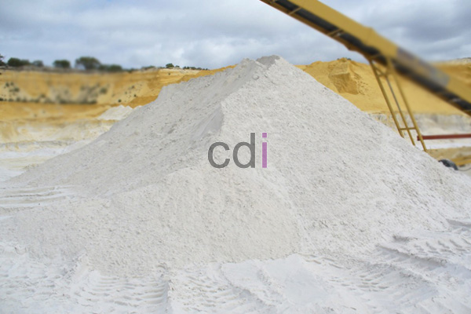

**Pasir Terbaik Untuk Produksi Mortar** - Halo Mitra CDI! Gimana kabarnya hari ini? Pernah nggak sih Anda perhatikan, kebutuhan akan mortar instan (semen mortar) terus meningkat dari tahun ke tahun? Hal ini nggak lepas dari popularitas penggunaan bata ringan atau hebel yang semakin banyak kita jumpai di berbagai proyek konstruksi. Semakin banyak bangunan yang menggunakan bata hebel, otomatis permintaan akan semen perekatnya – yaitu mortar instan perekat hebel – juga ikut naik.

*Solusi Material Berkualitas*

Dulu, perusahaan yang memproduksi mortar instan masih bisa dihitung dengan jari. Sekarang? Wah, pilihannya bejibun! Baik dari segi kualitas maupun harga, konsumen punya banyak opsi. Nah, peningkatan permintaan ini juga berdampak pada kebutuhan bahan bakunya, termasuk pasir dengan karakteristik khusus yang dicari oleh produsen mortar instan.

## Memilih Pasir yang Tepat untuk Produksi Mortar

Di artikel ini, kami akan berbagi tips memilih Pasir Terbaik Untuk Produksi Mortar. Siapa tahu, di antara Anda ada yang sedang mencari jenis pasir khusus untuk produksi mortar instan di perusahaannya. Yuk, simak kriteria penting berikut ini!

Berikut adalah beberapa kriteria Pasir Terbaik Untuk Instant Mortar yang perlu Anda perhatikan:
- 1\. Karakteristik/sifat pasir harus halus dengan ukuran mesh 30 s/d 200.
- 2\. Pasir harus bebas dari lempung, lumpur, dan kerikil berukuran 5 mm ke atas.
- 3\. Pastikan pasir benar-benar kering, jangan sampai lembab apalagi basah.
- 4\. Kadar air pada pasir sebaiknya di bawah 10%.
- 5\. Kandungan clay (kotoran) harus kurang dari 5%.
- 6\. Bentuk butiran pasir idealnya runcing atau tajam.

## Rekomendasi Jenis Pasir untuk Produksi Mortar

Setelah mengetahui kriteria Pasir Terbaik Untuk Produksi Semen Mortar, saatnya kita bahas jenis pasir apa saja yang sesuai. Berikut beberapa rekomendasi dari kami:
- 1\. [**Pasir Silika Bangka**](/product/pasir-putih-bangka). Pasir Bangka dikenal sebagai salah satu jenis pasir silika terbaik yang sangat cocok untuk produksi mortar instan karena kualitasnya yang sudah teruji lama.
- 2\. [**Pasir Silika Lampung**](/product/pasir-putih-lampung). Jenis pasir ini memiliki sifat dan kualitas yang nggak kalah baik dengan pasir Bangka, jadi bisa jadi alternatif yang menarik.
- 3\. **Pasir Pontianak**. Pasir sungai terbaik ini memenuhi semua kriteria yang kami sebutkan sebelumnya. Sifatnya yang halus dan bersih menjadikannya pilihan tepat untuk produksi mortar instan.
- 4\. **Pasir Pulang Pisau**. Pasir dari Kalimantan Tengah ini juga menjadi alternatif keempat yang memenuhi syarat untuk produksi semen mortar instan.
- 5\. [**Pasir Coklat Belitung**](/blog/daftar-harga-material-pasir-dan-batu-terlengkap). Pasir ini juga nggak kalah bagus dengan pasir-pasir lainnya dan bisa Anda andalkan sebagai bahan baku produksi semen mortar.

Nah, mitra, itulah beberapa sifat dan jenis Pasir Terbaik Untuk Produksi Mortar yang bisa kami sampaikan. Kalau Anda ingin berkonsultasi lebih lanjut atau tertarik untuk membeli salah satu jenis pasir di atas, jangan ragu untuk menghubungi kami melalui email atau telepon yang tertera di website ini. Kami dan tim dengan senang hati akan memberikan rujukan, informasi kualitas, dan penawaran terbaik untuk Anda. [Pasir Silika Terbaik Untuk Produksi Bata Ringan](/blog/pasir-silika-terbaik-untuk-produksi-bata-ringan/) juga bisa menjadi referensi tambahan untuk proyek Anda.