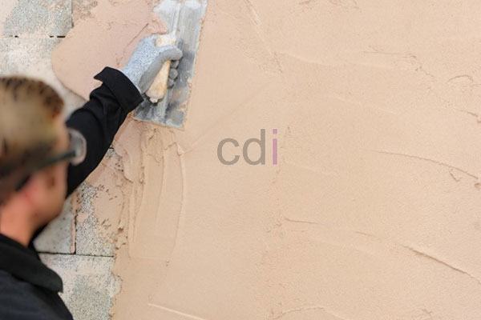

**Pasir Untuk Plester Dinding** - Hai Mitra CDI! Pernahkah Anda mengalami dinding yang retak setelah baru selesai diperbaiki? Atau mungkin kesulitan mendapatkan hasil plesteran yang benar-benar rata dan tahan lama? Nah, masalahnya mungkin terletak pada pasir yang Anda gunakan. Yuk, simak panduan lengkap dari Creative Design Interior ini untuk memilih pasir yang tepat untuk plester dinding Anda!

Seringkali kita menganggap pasir itu sama saja, toh namanya juga pasir. Padahal, kualitas pasir sangat berpengaruh pada kekuatan dan keawetan plesteran dinding. Pasir yang kurang berkualitas bisa jadi biang keladi keretakan pada dinding Anda. Artikel ini akan memandu Mitra CDI dalam memilih dan menguji kualitas Pasir Untuk Plester Dinding agar proyek konstruksi Anda berjalan lancar dan hasilnya memuaskan.

Masalahnya, seringkali dampak buruk pasir berkualitas rendah tidak langsung terasa. Dinding mungkin terlihat sempurna selama beberapa bulan, namun kemudian keretakan halus mulai bermunculan. Penting untuk berinvestasi pada pasir yang baik sejak awal demi menghindari masalah di kemudian hari.

## Memahami Fungsi Pasir dalam Plesteran Dinding

Pertama-tama, mari kita pahami apa sebenarnya peran pasir dalam proses plesteran. Pasir adalah salah satu komponen utama dalam campuran plester, berfungsi sebagai bahan pengikat dan memberikan kekuatan pada dinding. Tekstur pasir yang halus memudahkan pencampuran dengan semen dan air, menghasilkan adukan yang mudah diaplikasikan dan memberikan permukaan dinding yang rapi.

Namun, perlu diingat Mitra CDI, tidak semua jenis pasir cocok untuk plesteran. Pemilihan yang tepat adalah kunci untuk mendapatkan hasil plesteran yang kokoh, halus, dan tahan lama.

## Mengenal Jenis-Jenis Pasir yang Ideal untuk Plesteran

Lalu, jenis pasir apa saja yang bisa digunakan untuk plester dinding? Berikut beberapa pilihan yang umum digunakan:

### 1. Pasir Halus
Pasir halus adalah pilihan populer untuk plesteran karena teksturnya yang lembut dan halus. Biasanya, pasir ini telah melalui proses penyaringan untuk menghilangkan kerikil atau material kasar lainnya. Hasilnya? Permukaan plester yang rapi dan mulus, sangat cocok untuk dinding interior yang membutuhkan finishing sempurna.

### 2. Pasir Pasang
Pasir pasang memiliki tekstur yang sedikit lebih kasar dari pasir halus, namun tetap sering digunakan. Pasir ini cocok untuk area yang tidak memerlukan hasil super mulus, seperti dinding eksterior. Selain itu, harganya cenderung lebih terjangkau, menjadikannya pilihan menarik untuk proyek konstruksi berskala besar.

### 3. Pasir Sungai
Sesuai namanya, pasir sungai berasal langsung dari aliran sungai. Keunggulannya terletak pada kebersihan dan minimnya kandungan lumpur, sehingga menghasilkan plester yang kuat dan tahan lama. Pastikan pasir sungai yang Anda gunakan telah dicuci bersih untuk menghilangkan sisa lumpur dan kotoran.

## Mengapa Kualitas Pasir Begitu Penting?

Pasir bukan hanya "pengisi" dalam adukan. Kualitasnya berpengaruh signifikan terhadap daya rekat, penyusutan, dan ketahanan plesteran terhadap retak rambut. Pasir dengan kandungan lumpur tinggi dapat mengurangi daya rekat adukan ke dinding, meskipun terlihat baik saat masih basah. Ini karena lumpur menghalangi pengikatan antara butiran pasir dan semen, sehingga campuran tidak maksimal.

## Uji Kualitas Pasir: 3 Cara Praktis di Lokasi

Anda tidak perlu peralatan laboratorium mahal untuk mengecek kualitas pasir. Cukup lakukan tiga tes sederhana berikut ini langsung di lokasi pembelian:

### 1. Uji Kadar Lumpur dengan Botol Bening
Siapkan botol bening berisi air dan masukkan segenggam pasir. Kocok botol dengan kuat, lalu diamkan selama 10-15 menit. Perhatikan lapisan yang terbentuk di atas pasir yang mengendap. Jika lapisan lumpur cukup tebal, berarti kadar lumpurnya tinggi dan sebaiknya dihindari. Idealnya, lapisan lumpur tidak lebih dari 5% dari total volume pasir.

### 2. Uji Genggam
Ambil segenggam pasir, genggam erat, lalu lepaskan perlahan. Pasir berkualitas baik akan langsung pecah dan jatuh, tidak menggumpal. Pasir yang menggumpal menandakan kandungan tanah liat atau kelembapan berlebih yang dapat mengganggu pencampuran.

### 3. Perhatikan Warna dan Tekstur
Pilih pasir dengan warna cerah kecoklatan dan butiran seragam. Warna yang terlalu gelap dan butiran tidak rata sering kali mengindikasikan campuran tanah atau material organik yang dapat membusuk seiring waktu dan menyebabkan rongga pada plesteran.

## Estimasi Kebutuhan Pasir untuk Proyek Anda

Untuk gambaran kasar, plesteran dengan ketebalan standar 1,5 cm membutuhkan sekitar 0,02 m³ pasir per meter persegi dinding. Rasio campuran yang umum digunakan adalah 1 semen : 4 pasir untuk dinding interior. Namun, untuk dinding eksterior yang membutuhkan daya tahan ekstra, rasio 1:3 lebih disarankan.

## Hindari Kesalahan Umum Saat Membeli Pasir

Mitra CDI, jangan sampai melakukan kesalahan berikut: membeli pasir hanya berdasarkan harga termurah tanpa memeriksa kualitasnya, atau memesan dalam jumlah besar tanpa sampel uji terlebih dahulu. Kebiasaan ini seringkali berujung penyesalan karena perbaikan plesteran yang rusak jauh lebih mahal daripada melakukan uji sampel di awal.

## Penyimpanan Pasir yang Tepat

Pasir yang sudah lolos uji kualitas juga perlu disimpan dengan benar. Simpan di area kering yang tidak tergenang air hujan dan hindari kontak langsung dengan tanah. Jika perlu disimpan dalam waktu lama, tutup dengan terpal untuk menjaga kebersihannya.

## Kesimpulan

Memilih pasir untuk plester dinding adalah investasi penting untuk kualitas bangunan Anda. Dengan melakukan tiga tes sederhana di atas, Mitra CDI dapat memastikan material yang dibeli benar-benar layak sebelum digunakan.

Butuh bantuan lebih lanjut? Tim Creative Design Interior siap membantu! Hubungi Kami melalui tombol **Telepon** atau **WhatsApp** yang tersedia di bawah halaman ini untuk konsultasi dan rekomendasi terbaik untuk proyek Anda di (not detected). Kami juga melayani jasa aplikasi plester dinding profesional untuk hasil yang optimal. Jangan ragu untuk menghubungi Kami dan wujudkan bangunan impian Anda bersama Creative Design Interior!

[Panduan Lengkap Memilih Pasir untuk Plester Tembok: Jenis, Harga, dan Tips Aplikasi](/blog/pasir-untuk-plester-tembok/) — Artikel ini membahas secara rinci tentang jenis-jenis pasir yang bisa digunakan untuk plester tembok, serta harga dan tips aplikasinya. Ini bisa jadi referensi tambahan untuk Mitra CDI.