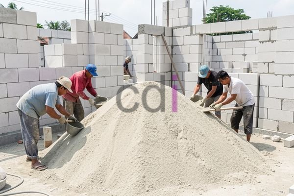

**Panduan Memilih Pasir Terbaik untuk Plester Hebel: Jenis, Rasio, dan Estimasi Biaya** - Hai Mitra CDI! Apakah Anda sedang merencanakan plester dinding hebel dan ingin memastikan hasilnya tahan lama serta tampak sempurna? Keretakan pada plesteran, atau permukaan yang kurang halus seringkali menjadi masalah yang menjengkelkan. Nah, salah satu kunci utamanya terletak pada pemilihan pasir yang tepat! Artikel ini akan mengupas tuntas segala yang perlu Anda ketahui tentang pasir untuk plester hebel, mulai dari jenis-jenisnya, takaran ideal, hingga perkiraan biayanya. Yuk, simak selengkapnya!

## Mengapa Pasir yang Tepat Sangat Penting untuk Plester Hebel?

Hebel, atau *Autoclaved Aerated Concrete* (AAC) dikenal sebagai material bangunan ringan yang banyak disukai karena kemudahannya dipasang dan sifat isolasi panasnya yang baik. Akan tetapi, sifat hebel yang berpori ini memerlukan perhatian khusus, terutama saat proses plesteran. Di sinilah peran pasir menjadi krusial. Pasir yang berkualitas akan sangat berpengaruh terhadap kekuatan, daya lekat, dan ketahanan plester terhadap retakan.

Bayangkan jika Anda menggunakan pasir yang kurang tepat – hasilnya mungkin plester mudah retak, mengelupas, atau bahkan hancur. Oleh karena itu, pemilihan pasir yang ideal harus memiliki ukuran butiran yang seragam, bersih dari material organik, dan punya kemampuan rekat yang optimal dengan semen dan air. Pasir yang terlalu kasar bisa membuat plester sulit diratakan, sementara pasir yang terlalu halus justru berpotensi menyebabkan penyusutan berlebihan dan memicu retakan. Kami selalu menyarankan untuk memastikan kualitas pasir sebelum Anda mulai bekerja.

## Mengenal Berbagai Jenis Pasir untuk Plester Hebel

Ada beberapa jenis pasir yang sering digunakan untuk plester hebel, masing-masing memiliki kelebihan dan kekurangannya. Berikut adalah beberapa yang paling umum:

*   **Pasir Pasang:** Pasir pasang adalah opsi yang paling sering dipilih dalam konstruksi. Harganya relatif terjangkau dan mudah ditemukan. Akan tetapi, kandungan lumpur dan debunya lebih tinggi dibandingkan jenis lain, jadi perlu dicuci bersih sebelum digunakan.
*   **Pasir Beton:** Pasir beton memiliki tekstur yang lebih kasar daripada pasir pasang. Pasir ini lazim dipakai untuk campuran beton, tetapi juga bisa digunakan untuk plester hebel dengan penyesuaian komposisi. Kelebihannya terletak pada kekuatan dan daya tahannya yang lebih baik.
*   **Pasir Silika:** Pasir silika adalah jenis pasir yang paling bersih dan memiliki ukuran butiran yang sangat seragam. Pasir ini ideal untuk plester hebel karena memberikan hasil plesteran yang halus dan kokoh. Namun, biasanya harganya lebih mahal dibandingkan jenis lainnya.

Memutuskan jenis pasir yang paling cocok tergantung pada anggaran, ketersediaan material di (not detected), dan kualitas yang Anda inginkan. Jangan ragu untuk berkonsultasi dengan tukang bangunan berpengalaman atau ahli konstruksi untuk mendapatkan saran terbaik.

## Takaran Campuran Plester Hebel yang Ideal dengan Pasir

Rasio campuran yang tepat antara semen, pasir, dan air sangat menentukan kualitas plester hebel Anda. Takaran yang ideal biasanya 1:3 atau 1:4 (semen:pasir). Artinya, setiap 1 bagian semen membutuhkan 3 atau 4 bagian pasir.

Misalnya, jika Anda menggunakan 1 sak semen seberat 50 kg, maka Anda memerlukan pasir sebanyak 150 kg hingga 200 kg. Tambahkan air secara bertahap sambil diaduk hingga menghasilkan adonan yang mudah diaplikasikan. Ingat, rasio ini bisa sedikit berbeda tergantung pada jenis semen dan pasir yang Anda gunakan.

Untuk hasil yang maksimal, Kami sarankan untuk melakukan uji coba campuran dalam skala kecil terlebih dahulu untuk menemukan rasio yang paling sesuai dengan material Anda. Pastikan semua material tercampur rata hingga adonan benar-benar homogen.

## Perkiraan Biaya Pasir untuk Plester Hebel di (not detected)

Biaya pasir untuk plester hebel bisa bervariasi tergantung pada jenis pasir, lokasi (not detected), dan ketersediaan material. Sebagai gambaran, harga pasir pasang biasanya berkisar antara Rp 250.000 hingga Rp 400.000 per truk (kurang lebih 8-10 meter kubik). Sedangkan harga pasir beton berada di kisaran Rp 300.000 hingga Rp 500.000 per truk, dan pasir silika bisa mencapai Rp 600.000 hingga Rp 800.000 per truk.

Sebagai ilustrasi, jika Anda membutuhkan 5 meter kubik pasir pasang untuk proyek di (not detected), perkiraan biayanya adalah Rp 156.250 hingga Rp 250.000 (dengan asumsi harga per meter kubik antara Rp 31.250 hingga Rp 50.000).

**Untuk informasi harga yang lebih akurat dan penawaran khusus, jangan ragu untuk menghubungi Kami – [akses tabel harga terbaru di sini]()!** Biaya ini belum termasuk biaya pengiriman dan upah tukang. Estimasi biaya total plester hebel per meter persegi (termasuk material dan upah) berkisar antara Rp 150.000 hingga Rp 300.000, tergantung pada tingkat kesulitan dan lokasi proyek di (not detected).

Butuh bantuan langsung untuk proyek plester hebel Anda? Jangan sungkan untuk klik tombol **WhatsApp** atau **Telepon** di bawah ini untuk berkonsultasi dengan tim ahli Kami! [Tips Memilih Pasir untuk Plester Dinding agar Hasilnya Kuat dan Rapi](/blog/pasir-untuk-plester-dinding/) juga akan membantu Anda memahami lebih lanjut.