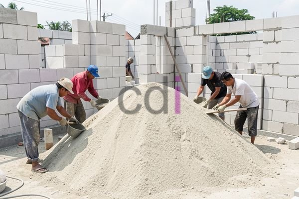

**Panduan Lengkap Memilih Pasir untuk Plester Tembok: Jenis, Harga, dan Tips Aplikasi** - Hai Mitra CDI! Pernahkah Anda bertanya-tanya, bagaimana caranya mendapatkan hasil plesteran tembok yang sempurna? Kualitas pasir yang dipilih punya pengaruh besar, lho! Pasir yang tepat akan membuat dinding lebih kokoh, lebih tahan lama, dan tentunya lebih rapi. Yuk, simak panduan lengkapnya!

### Kenapa Memilih Pasir yang Tepat Itu Penting?

Plester tembok bukan sekadar mempercantik tampilan dinding, tapi juga berfungsi sebagai lapisan pelindung utama. Nah, kekuatan dan kualitas lapisan ini sangat bergantung pada bahan campuran yang digunakan, termasuk pasirnya. Pasir yang berkualitas akan memberikan stabilitas maksimal, meminimalkan risiko retak akibat penyusutan, dan memastikan plesteran menempel kuat di permukaan dinding. Percaya deh, menggunakan pasir yang kurang tepat bisa menimbulkan masalah, mulai dari plesteran mudah lepas, muncul jamur, hingga bahkan mengganggu struktur bangunan.

### Ragam Jenis Pasir untuk Plester Tembok

Ada beberapa jenis pasir yang sering digunakan dalam pekerjaan plesteran. Setiap jenis memiliki karakteristik dan harga yang berbeda-beda. Pemilihan yang tepat harus disesuaikan dengan kebutuhan proyek serta anggaran yang Anda miliki. Berikut beberapa jenis pasir yang perlu Anda kenali:

*   **Pasir Pasang:** Pilihan paling populer untuk plesteran. Pasir ini punya butiran yang cukup kasar, bersih dari kotoran organik, dan kandungan lumpurnya rendah. Hasilnya? Daya rekat plesteran jadi optimal dan risiko retak berkurang.
*   **Pasir Beton:** Walaupun lebih sering dipakai untuk campuran beton, pasir beton juga bisa digunakan untuk plester tembok dengan perbandingan yang pas. Perlu diingat, pasir beton cenderung lebih kasar dan harus benar-benar bersih dari kotoran dan kerikil besar.
*   **Pasir Urug:** Nah, kalau yang ini biasanya harganya lebih terjangkau. Tapi, kami kurang rekomendasikan untuk plester tembok. Kenapa? Karena seringkali mengandung banyak kotoran, lumpur, dan material organik yang bikin kekuatan dan daya rekat plesteran menurun. Kalau terpaksa pakai, wajib disaring dan dicuci dulu ya.
*   **Pasir Silika:** Jenis pasir ini punya kandungan silika tinggi dan sering dipakai untuk pekerjaan plesteran khusus, misalnya untuk dekorasi atau yang butuh kekuatan ekstra. Harganya memang lebih mahal dibandingkan jenis lainnya.

### Perkiraan Harga Pasir Plester Tembok di (not detected) Tahun 2026

Harga pasir untuk plester tembok itu dinamis, tergantung jenis pasirnya, lokasi Anda di (not detected), dan jumlah yang dibeli. Sebagai gambaran, berikut perkiraan harga per meter kubik (m³) di wilayah (not detected) pada tahun 2026:

*   **Pasir Pasang:** Rp 350.000 – Rp 500.000 per m³
*   **Pasir Beton:** Rp 300.000 – Rp 450.000 per m³
*   **Pasir Urug:** Rp 200.000 – Rp 300.000 per m³
*   **Pasir Silika:** Rp 500.000 – Rp 800.000 per m³

Ingat ya, harga ini cuma estimasi dan bisa berubah sewaktu-waktu. Untuk mendapatkan penawaran harga terbaru dan paling akurat sesuai kebutuhan proyek Anda di (not detected), jangan ragu untuk menghubungi Kami. Ketahui juga bahwa harga di atas belum termasuk biaya pengiriman dan pajak.

### Tips Jitu Memilih dan Mengaplikasikan Pasir

Mau hasil plesteran yang maksimal? Perhatikan beberapa tips berikut ini:

*   **Pilih yang Bersih:** Pastikan pasir yang Anda pilih benar-benar bebas dari kotoran organik, lumpur, dan kerikil besar. Kotoran-kotoran ini bisa mengurangi daya rekat dan kekuatan plesteran.
*   **Perhatikan Ukuran Butiran:** Ukuran butiran pasir yang paling ideal untuk plester tembok adalah antara 0,25 mm hingga 2 mm. Kalau terlalu halus, bisa bikin plesteran mudah retak. Kalau terlalu kasar, hasilnya jadi kurang halus dan susah diratakan.
*   **Jangan Lupa Cuci:** Jika menggunakan pasir urug atau beton, jangan lupa dicuci dulu untuk membersihkan kotoran dan lumpurnya.
*   **Takaran yang Tepat:** Campurkan pasir dengan semen dan kapur dengan perbandingan yang pas. Umumnya, takaran idealnya adalah 1 bagian semen : 3 bagian pasir : 0.5 bagian kapur. Pastikan juga jumlah airnya pas, jangan terlalu encer atau terlalu kental.
*   **Aduk Rata:** Pastikan semua bahan tercampur merata sebelum diaplikasikan ke dinding.

Butuh bantuan atau konsultasi lebih lanjut? Jangan sungkan untuk menghubungi Kami! Tombol **Telepon** dan **WhatsApp** di bawah halaman ini siap membantu Anda. Kami siap melayani kebutuhan material bangunan Anda di (not detected) dan sekitarnya. [Tips Memilih Pasir untuk Plester Dinding agar Hasilnya Kuat dan Rapi](/blog/pasir-untuk-plester-dinding/) — artikel ini bisa jadi pelengkap informasi yang Anda butuhkan lho!