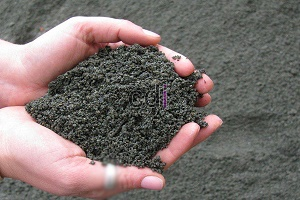

**Pasir Warna Hitam: Kegunaan, Kelebihan, dan Estimasi Harga untuk Proyek Anda** - Hai Mitra CDI! Pernahkah Anda memperhatikan bagaimana pasir hitam bisa memberikan sentuhan unik pada sebuah bangunan? Seringkali kita terpaku pada estetika, padahal kekuatan dan daya tahan sebuah proyek juga sangat penting. Nah, pasir berwarna hitam ini menawarkan kombinasi menarik: keindahan visual dan potensi fungsional yang patut dipertimbangkan. Mari kita bedah lebih dalam!

### Mengenal Lebih Dekat Karakteristik Pasir Warna Hitam

Apa yang membuat pasir ini berbeda? Warna gelapnya berasal dari kandungan mineral berat seperti magnetit, ilmenit, atau hematit. Ini bukan sekadar perbedaan warna, lho! Komposisi mineral ini memengaruhi tekstur yang biasanya lebih kasar dan berat jenis yang lebih tinggi dibanding pasir silika biasa. Perbedaan ini memengaruhi kemampuan pasir menahan air, menyerap zat, dan menahan beban.

Kandungan mineral tertentu bahkan bisa bersifat magnetis. Walau tidak selalu berpengaruh, ini penting diperhatikan jika proyek Anda menggunakan peralatan sensitif terhadap medan magnet. Sumber asal juga memengaruhi kualitasnya. Pasir dari endapan vulkanik, misalnya, mungkin mengandung belerang yang perlu dipertimbangkan.

### Aplikasi Pasir Warna Hitam: Konstruksi Hingga Dekorasi

Jangan salah, pasir hitam ini serbaguna banget! Selain mempercantik tampilan, ia punya fungsi penting dalam konstruksi. Salah satu pemanfaatannya adalah sebagai campuran pembuatan beton. Penambahan pasir hitam dalam takaran tepat dapat meningkatkan kekuatan dan ketahanan beton terhadap gesekan. Namun, perlu diingat, kandungan lempung yang tinggi bisa membuat beton lebih sulit dikerjakan.

Selain beton, pasir hitam sering dipakai untuk paving block, bata merah, dan material bangunan lain. Warna gelapnya memberikan kesan modern dan unik. Di dunia dekorasi, pasir hitam jadi favorit untuk lanskap taman, jalan setapak, atau area kolam renang. Kontras yang kuat menciptakan efek visual yang menawan. Untuk dekorasi, ukuran butiran pasir berpengaruh: butiran halus untuk permukaan rata, butiran kasar untuk tekstur alami.

### Mengenal Biaya dan Faktor-faktor yang Memengaruhinya

Berapa kira-kira biaya yang dibutuhkan? Harga pasir warna hitam bisa bervariasi tergantung sumber, jarak transportasi, dan kualitas material. Umumnya, harganya per meter kubik lebih tinggi dibandingkan pasir silika biasa. Di wilayah (not detected), harga pasir hitam berkisar antara Rp 250.000 hingga Rp 400.000 per meter kubik, berdasarkan data terbaru. Ingat, harga ini hanyalah estimasi — untuk informasi harga terkini dan penawaran khusus, yuk hubungi Kami!

Volume pemesanan juga memengaruhi harga. Pembelian dalam jumlah besar biasanya ada diskon. Biaya pengiriman ke lokasi proyek di (not detected) juga perlu diperhitungkan. Untuk proyek besar, sebaiknya bandingkan harga dari beberapa supplier. Perhatikan juga, pasir dengan kandungan mineral tertentu mungkin memerlukan perlakuan khusus yang bisa menambah biaya.

### Hal-hal yang Perlu Diperhatikan Sebelum Membeli

Sebelum Anda memutuskan, ada beberapa hal penting yang perlu dipertimbangkan. Pertama, pastikan kualitas pasir memenuhi standar. Uji laboratorium bisa membantu mengetahui kandungan mineral, ukuran butiran, dan kelembaban. Kedua, perhatikan dampak lingkungannya. Pastikan pasir berasal dari sumber legal dan berkelanjutan untuk menghindari kerusakan ekosistem pesisir di (not detected).

Ketiga, cek apakah pasir ini cocok dengan material lain yang Anda gunakan. Pastikan tidak ada reaksi kimia yang merugikan saat dicampur dengan semen, misalnya. Terakhir, jangan ragu berkonsultasi dengan ahli konstruksi atau desain interior. Kami di Creative Design Interior siap membantu Anda memilih material yang tepat untuk proyek di (not detected).

Butuh informasi lebih lanjut? Jangan sungkan untuk menghubungi Kami melalui tombol **Telepon** dan **WhatsApp** di bawah ini! Kami siap menjawab semua pertanyaan Anda. [Jual Pasir Hitam Kasar di Ciampel Karawang Gratis Ongkir](/pasir/jual-pasir-hitam-kasar-di-ciampel-karawang-gratis-ongkir/) — mungkin artikel ini juga bisa membantu Anda memahami lebih detail tentang jenis pasir hitam yang tersedia.