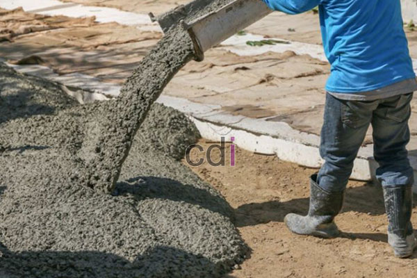

**Penyebab Dak Beton Bocor |** Hai Mitra CDI! Pernahkah Anda mengalami masalah dak beton bocor saat musim hujan tiba di (not detected)? Pasti menjengkelkan, ya! Nah, memahami penyebab kebocoran ini sangat penting agar Anda bisa mencegahnya terjadi lagi. Membuat dak beton yang kuat dan tahan lama memang butuh perhitungan matang dan keahlian khusus. Jika tidak ditangani dengan benar, risiko kebocoran akan terus menghantui. Yuk, simak artikel ini untuk mengetahui penyebab umum kebocoran dak beton dan bagaimana cara mengatasinya.

*Mengenal Penyebab Utama Kebocoran Dak Beton*

## Apa Saja Penyebab Dak Beton Bocor?

Ada beberapa faktor yang bisa menyebabkan dak beton bocor. Berikut ini enam hal utama yang perlu Anda ketahui:

**Pertama,** kesalahan dalam perhitungan campuran beton adalah penyebab umum. Ini bisa terjadi karena keterbatasan waktu proyek atau kurangnya pengalaman tukang dalam meracik adonan beton. Pengadukan idealnya dilakukan terus-menerus dengan penambahan air secara bertahap, bukan menunggu campuran mengering dulu.

**Kedua,** kualitas material yang buruk juga berperan penting. Ibarat pakaian, jika bahannya jelek, tentu tak akan tahan lama. Pastikan Anda menggunakan semen, pasir, kerikil, dan air berkualitas baik untuk campuran beton Anda.

**Ketiga,** kurangnya kepadatan beton saat pengecoran bisa menyebabkan retakan dan akhirnya bocor. Proses pemadatan beton (vibrasi) harus dilakukan secara menyeluruh untuk menghilangkan rongga udara.

**Keempat,** perawatan setelah pengecoran seringkali diabaikan. Padahal, perawatan yang tepat sangat krusial! Idealnya, dak beton direndam air selama 7 hari setelah pengecoran untuk memastikan tidak ada rembesan yang mengindikasikan adanya cacat pada pengecoran.

**Kelima,** jangan menempatkan beban berat di atas dak beton yang belum mengering sempurna atau belum cukup kuat. Ini bisa merusak struktur beton dan memicu kebocoran.

**Terakhir,** pergeseran struktur bumi akibat gempa atau pergerakan tanah juga bisa menyebabkan retakan pada dak beton dan mengakibatkan kebocoran.

Nah, memahami enam penyebab ini akan membantu Anda mencegah atau mengatasi masalah dak beton bocor di bangunan Anda di (not detected).

Jika Anda membutuhkan solusi praktis dan terpercaya,  Kami dari CDI siap membantu! Jangan ragu untuk menghubungi kami untuk konsultasi gratis dan penawaran terbaik untuk kebutuhan material bangunan Anda. Jangan biarkan kebocoran dak beton merusak investasi Anda! [Baca juga tips penting tentang cara membuat dak beton tidak bocor di artikel ini.]( /blog/cara-membuat-dak-beton-tidak-bocor/)