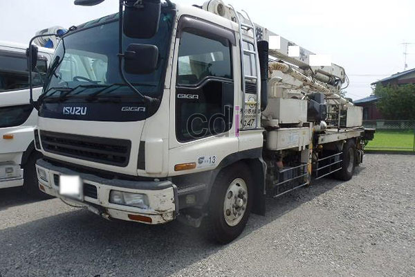

**Penyebab Pompa Beton Macet** - Hai Mitra CDI! Pengecoran beton seringkali membutuhkan bantuan pompa untuk mengalirkan material ke area yang sulit dijangkau, terutama di proyek bertingkat atau dengan akses terbatas. Nah, pompa beton ini memang solusi praktis, tapi tahukah Anda kalau alat ini juga bisa mengalami masalah? Kali ini, kami akan membahas beberapa penyebab umum pompa beton macet, supaya Anda bisa lebih waspada dan mencegah potensi kerugian di proyek (not detected).

*Pompa Beton*

## Mengungkap Akar Permasalahan: Penyebab Pompa Beton Macet

Pompa beton memang mempermudah pekerjaan, tapi perlu diingat bahwa ada sejumlah faktor yang bisa menyebabkan alat ini bermasalah. Mari kita telusuri lebih jauh penyebab-penyebabnya berikut ini.

### Penggunaan Additive Beton yang Berlebihan

Dalam upaya meningkatkan kualitas beton, banyak yang menambahkan *additive* atau campuran kimia seperti *waterproofing* dan *plasticizer*. Tujuannya jelas: membuat beton lebih kuat, tahan lama, dan kedap air. Additive ini juga mempercepat proses pengeringan dan pengerasan beton, bahkan bisa menghasilkan tampilan yang lebih putih.

Namun, perlu diingat, penggunaan additive yang berlebihan justru bisa mengganggu kinerja pompa beton. Sifatnya yang cenderung mengeras membuat beton harus segera dipompa, dan jika tidak, campuran ini bisa menghambat atau menyumbat pompa. Lebih jauh lagi, penggunaan berlebihan bisa mempercepat kerusakan pada pipa pompa, membuatnya cepat aus dan kropos.

### Pemilihan Kelas Beton yang Kurang Tepat

Kualitas beton juga memainkan peran penting. Penggunaan beton dengan mutu rendah, atau yang diproduksi oleh perusahaan yang tidak mengikuti standar mutu SNI, bisa menjadi penyebab masalah pompa. Beberapa kelas beton *ready mix* memang kurang ideal untuk dipompa secara horizontal, seperti kelas B0, K100, K125, K150, K175, dan K200. Kelas-kelas ini memiliki komposisi split yang sedikit sehingga membebani kinerja pompa.

Di sisi lain, kelas beton K-225, K-250, K-275, K-300, K-325, K-350, K-375, dan K-400 umumnya lebih mudah dipompa secara horizontal maupun vertikal. Jika Anda menggunakan beton dengan mutu rendah atau terlalu kental, pompa akan kesulitan memprosesnya dan berpotensi rusak. Pastikan kekentalan (slump) beton berada dalam rentang standar, yaitu 12 ± 2.

### Pipa Beton yang Sudah Uzur

Masalah tidak selalu berasal dari campuran beton. Kondisi pipa pompa juga berpengaruh. Pipa ini berfungsi menghubungkan pompa dengan lokasi pengecoran. Jika pipa sudah tua dan mengalami kerusakan, risiko macet sangat tinggi. Kami sarankan untuk selalu memilih jasa sewa pompa beton dengan kondisi prima, meskipun sedikit lebih mahal.

### Ketidaksesuaian Jenis Pompa dengan Kebutuhan Proyek

Pemilihan jenis pompa yang tepat juga krusial. Berikut beberapa jenis pompa beton yang umum digunakan:

- **Pompa Beton Standard:** Jangkauan di bawah 18-20 meter.
- **Pompa Beton Long Boom:** Jangkauan di atas 20-30 meter.
- **Pompa Beton Super Long Boom:** Jangkauan di atas 30 – di bawah 40 meter.
- **Pompa Beton Double Long Boom:** Jangkauan di atas 40 s/d 60 meter.
- **Pompa Beton Portable (Pompa Kodok):** Jangkauan 100-200 meter.
- **Pompa Beton Minimix:** Cocok untuk bangunan 2 lantai. 

Perhatikan juga kondisi pompa secara keseluruhan. Apakah alat tersebut terawat dengan baik dan rutin menjalani pemeriksaan? Semua faktor ini akan memengaruhi kinerja pompa beton secara keseluruhan.

Untuk solusi pengecoran beton yang lancar dan efisien di (not detected), jangan ragu untuk berkonsultasi dengan tim ahli kami. Kami siap membantu Anda memilih pompa beton yang tepat dan memastikan pekerjaan pengecoran berjalan sukses. Hubungi kami untuk informasi lebih lanjut dan penawaran terbaik! [beralih ke tombol Telepon/WhatsApp] [Inilah Penyebab Beton Cor Lambat Mengering](/blog/inilah-penyebab-beton-cor-lambat-mengering/) — artikel terkait ini mungkin berguna untuk Anda.