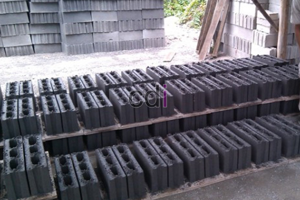
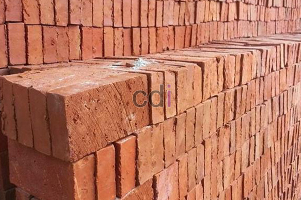
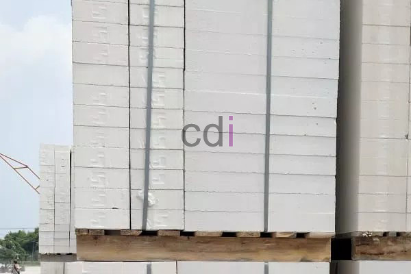

**Perbandingan Bata Merah, Batako, dan Bata Ringan** - Hai Mitra CDI! Mencari bahan bangunan terbaik untuk proyek Anda di (not detected)? Punya rencana membangun rumah impian, tapi bingung memilih antara bata merah, batako, atau bata ringan? Memang, di era sekarang ini, membandingkan kualitas dan harga material konstruksi membutuhkan pengetahuan yang mumpuni. Nah, kami dari CDI (not detected) siap membantu Anda memahami perbedaan mendasar dari ketiga material populer ini. Dengan begitu, Anda bisa membuat keputusan yang tepat dan sesuai dengan kebutuhan proyek Anda.

## Kelebihan dan Kekurangan Bata Merah, Batako, dan Bata Ringan

Sebagai penyedia material bangunan berkualitas di (not detected) – termasuk pasir, batu, dan tentu saja bata – kami ingin berbagi pengalaman dan pengetahuan untuk membantu Anda. Mari kita telaah perbandingan bata merah, batako, dan bata ringan yang sering digunakan dalam konstruksi. Ketiga material ini punya peran penting dalam mewujudkan bangunan impian Anda. Berikut rinciannya:

## Material Bata Merah

Bata merah sudah lama menjadi pilihan utama dalam pembangunan. Mengulas kelebihan dan kekurangannya akan membantu Anda memahami lebih baik dalam Perbandingan bata merah batako dan bata ringan ini.

### **Kelebihan Bata Merah:**

- Pemasangan relatif mudah dan tidak memerlukan keahlian khusus.
- Ukurannya yang kecil memudahkan proses pengangkutan.
- Ideal untuk membentuk bidang-bidang kecil yang kompleks.
- Harganya terjangkau.
- Mudah ditemukan di pasaran.
- Tidak memerlukan perekat khusus.
- Cukup tahan terhadap panas, menjadikannya perlindungan tambahan terhadap api.

### **Kekurangan Bata Merah:**

- Membuat pasangan dinding yang rapi memerlukan ketelitian lebih.
- Menyerap panas dan dingin, sehingga kurang ideal untuk menjaga stabilitas suhu ruangan.
- Cenderung membutuhkan lebih banyak material perekat.
- Kualitas dan ukuran yang bervariasi dapat meningkatkan potensi pemborosan (waste).
- Butuh pelesteran tebal untuk menghasilkan dinding yang rata.
- Waktu pemasangan cenderung lebih lama dibandingkan material lain.
- Berat, sehingga memberikan beban signifikan pada struktur bangunan.
- Beban yang ditimbulkan cukup besar dan memerlukan perhitungan struktur yang tepat.

> _"Kami juga menyediakan Bata Merah dengan ukuran standar **19 x 9 x 4 cm** serta ukuran jumbo **20 x 10 x 5 cm** dengan harga yang kompetitif (Anda bisa membandingkannya sendiri!). Kami melayani pemesanan dalam jumlah kecil maupun besar untuk wilayah Jabodetabek, Cikarang, Cibitung, Karawang, Cikampek, Purwakarta dan sekitarnya. Untuk informasi harga lebih lanjut serta pemesanan, silahkan hubungi kami melalui tombol Telepon/WhatsApp yang tersedia di halaman ini."_

## Material Batako

Batako menawarkan alternatif yang menarik. Berikut kelebihan dan kekurangannya dalam Perbandingan bata merah batako dan bata ringan.

### **Kelebihan Batako:**

- Proses pembuatan relatif mudah dan ukuran dapat diproduksi seragam.
- Ukurannya yang besar mempercepat waktu dan menghemat biaya pemasangan.
- Jenis berlubang dapat berfungsi sebagai isolasi udara.
- Jika pemasangan rapi, dinding bisa tidak perlu diplester.
- Mudah dipotong untuk menyesuaikan dengan detail desain tertentu.
- Tidak perlu direndam air sebelum digunakan.
- Cukup kedap air, meminimalkan risiko rembesan.
- Pemasangan lebih cepat dibandingkan bata merah.

### **Kekurangan Batako:**

- Rentan terhadap retak rambut pada dinding.
- Mudah dilubangi dan pecah karena memiliki rongga.
- Kurang optimal sebagai insulasi panas dan suara.

> _"Batako yang kami jual tersedia dalam ukuran **17 cm x 9 cm x 36 cm** dan **18 cm x 8 cm x 38 cm**. Kami melayani pesanan dalam jumlah kecil maupun besar untuk wilayah Jakarta, Bogor, Depok, Tangerang, Bekasi, Tambun, Cikarang, Cibitung, Lemah Abang, Karawang, Cikampek dan Purwakarta. Untuk informasi harga, silahkan hubungi tim kami melalui tombol Telepon/WhatsApp di halaman ini."_

## Material Bata Ringan (Hebel/Celcon)

Bata ringan menjadi semakin populer karena keunggulannya. Simak kelebihan dan kekurangannya dalam Perbandingan bata merah batako dan bata ringan.

### **Kelebihan Bata Ringan:**

- Ukuran dan kualitas seragam, menghasilkan dinding yang lebih rapi.
- Meminimalkan penggunaan perekat karena tidak memerlukan siar lebar.
- Lebih ringan dari bata biasa, mengurangi beban struktural bangunan.
- Pengangkutan lebih mudah.
- Proses pemasangan lebih cepat.
- Membutuhkan plesteran tipis, sekitar 2,5 cm saja.
- Kedap air, meminimalisir rembesan.
- Meredam suara dengan baik.
- Memiliki kekuatan tekan yang tinggi.
- Lebih tahan terhadap gempa bumi.

### **Kekurangan Bata Ringan:**

- Ukurannya yang besar menghasilkan sisa material yang cukup banyak.
- Memerlukan perekat khusus, seperti semen instan.
- Pemasangan memerlukan keahlian khusus untuk hasil optimal.
- Membutuhkan waktu lebih lama untuk kering jika terkena air.
- Harganya relatif lebih mahal dibandingkan bata merah.
- Ketersediaannya terbatas, umumnya hanya di toko material besar.
- Penjualan biasanya dalam satuan volume (m3) yang besar.

> _"Tertarik menggunakan bata ringan (hebel) untuk proyek Anda di (not detected)? Kami menawarkan harga yang kompetitif! Hubungi tim kami melalui tombol Telepon/WhatsApp untuk mendapatkan penawaran terbaik.  Anda juga bisa melihat daftar harga lengkap kami [DISINI](/blog/daftar-harga-material-pasir-dan-batu-terlengkap)."_

Kesimpulannya, setiap material memiliki kelebihan dan kekurangan masing-masing. Pilihan terbaik tergantung pada kebutuhan dan kondisi proyek Anda. Pertimbangkan faktor-faktor seperti anggaran, kebutuhan insulasi, ketahanan terhadap cuaca, dan keahlian tenaga kerja yang tersedia di (not detected). 

Itulah Perbandingan bata merah batako dan bata ringan dari kami, berdasarkan pengalaman di lapangan. Semoga analisis ini bermanfaat bagi Anda dalam mempersiapkan material konstruksi yang terbaik! Jangan ragu menghubungi kami jika Anda membutuhkan pasokan cor beton curah siap pakai (Ready mix concrete) berkualitas. Tim kami siap membantu Anda melalui tombol Telepon/WhatsApp di situs web ini. Terima kasih. [Jual Material Bata Merah di Abadijaya Depok Gratis Ongkir](/bata/jual-material-bata-merah-di-abadijaya-depok-gratis-ongkir/) [Jual Material Bata Merah di Ancol Jakarta Gratis Ongkir](/bata/jual-material-bata-merah-di-ancol-jakarta-gratis-ongkir/)