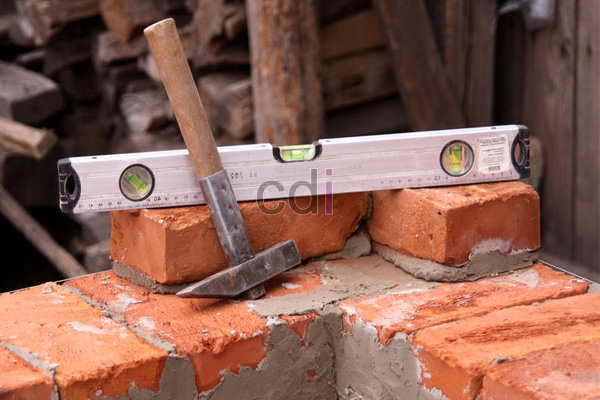

**Perbandingan Harga Tukang Bangunan Borongan Dan Harian** - Hai Mitra CDI! Mau bangun rumah impian atau merenovasi properti di (not detected)? Pasti timbul pertanyaan: enaknya pakai tukang harian atau borongan, ya? Tenang, kami bantu jabarkan perbandingannya supaya Anda makin mantap dalam memilih. Yuk, simak ulasan lengkapnya!

*Memilih Tukang Bangunan: Borongan atau Harian?*

## Membandingkan Upah Tenaga Kerja: Tukang Bangunan Borongan vs. Harian

Memutuskan antara tukang bangunan harian dan borongan memang butuh pertimbangan matang. Kalau Anda punya waktu untuk mengawasi langsung dan menginginkan hasil yang sesuai detail, opsi harian bisa jadi pilihan tepat. Nah, kalau lebih praktis dan tidak terlalu perfeksionis soal detail, sistem borongan bisa jadi solusi. Simak perbandingannya lebih lanjut, ya!

### Jasa Tenaga Kerja Bangunan Harian: Fleksibilitas & Kontrol Penuh

Saat memilih tukang harian, kesepakatan soal upah biasanya terjadi di awal. Sekarang, tarif tukang bangunan harian berkisar antara Rp 70.000,- hingga Rp 100.000,- per hari, dan pembayaran bisa dilakukan mingguan atau bahkan harian. Sebagai pemilik rumah, Anda perlu memastikan ketersediaan material bangunan yang cukup agar pekerjaan bisa berjalan lancar.

Keunggulan utama sistem ini adalah kualitas pekerjaan yang potensial lebih baik karena Anda bisa memberikan arahan langsung. Selain itu, Anda memiliki kontrol penuh atas setiap detail pembangunan. Namun, perlu diingat bahwa sistem harian menuntut waktu dan tenaga ekstra untuk pengawasan. Secara biaya, biasanya lebih mahal dibandingkan borongan, dan waktu pengerjaan pun cenderung lebih lama. 

### Jasa Tenaga Kerja Bangunan Borongan: Praktis & Efisien

Ada dua cara memilih jasa pemborong bangunan: borongan total (material dan upah) atau borongan upah saja. Kalau memilih borongan total, Anda tinggal menentukan spesifikasi material yang diinginkan, dan pemborong akan mengurus pembelian serta pelaksanaan pekerjaan.

Keuntungan utama borongan adalah kepraktisannya. Anda tidak perlu repot berbelanja material. Kekurangannya? Biaya total biasanya lebih tinggi karena pemborong akan menambahkan laba dari harga material.

Jika ingin lebih hemat, Anda bisa memborongkan upah tenaga kerja saja. Ada dua sistem yang bisa dipilih: perhitungan plak atau keteng. Sistem plak menghitung ongkos kerja berdasarkan gambar dan spesifikasi, misalnya Rp 1.000.000,- per meter persegi luas bangunan. Sistem keteng, di sisi lain, menetapkan upah per satuan pekerjaan, seperti Rp 40.000,- per meter persegi untuk pembangunan dinding.

 Dengan sistem yang tepat, proyek konstruksi Anda di (not detected) akan berjalan lancar dan sesuai anggaran! Jangan ragu untuk menghubungi kami untuk konsultasi lebih lanjut dan mendapatkan penawaran terbaik untuk kebutuhan desain interior, furniture custom, material bangunan, serta jasa pengecoran di (not detected). Kami siap membantu mewujudkan rumah impian Anda!