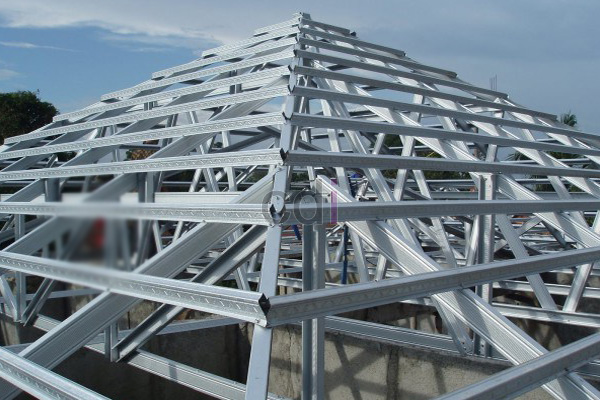

**Perbandingan Kelebihan dan Kekurangan Rangka Atap Baja Ringan |** Mitra CDI! Hai Mitra CDI! Pernahkah Anda mempertimbangkan rangka atap baja ringan untuk proyek konstruksi di (not detected)? Material ini semakin populer, lho! Banyak yang beralih karena kepraktisan, kekuatan, dan harganya yang bersahabat. Tapi, seperti semua material, baja ringan punya sisi plus dan minusnya. Di artikel ini, kami akan mengulas tuntas keduanya agar Anda bisa membuat keputusan terbaik.

*Rangka Atap Baja Ringan Sudah Terpasang*

Sebagai bahan pertimbangan, berikut ini kami paparkan beberapa kelebihan dan kekurangan rangka atap baja ringan, hasil rangkuman dari berbagai sumber dan pengalaman tim kami di lapangan:

## Kelebihan atau Keuntungan Baja Ringan

Pilihan yang tepat untuk atap rumah Anda mungkin ada pada baja ringan. Ini dia alasannya:

- 1\. Beban Ringan: Baja ringan mengurangi beban pada struktur bangunan di bawahnya – pondasi, dinding, dan kolom. Ini karena bobotnya yang ringan, lho.
- 2\. Tahan Lama: Material ini tahan karat, serangan rayap, serta perubahan cuaca dan kelembaban yang ekstrem. Jadi, lebih awet!
- 3\. Pemasangan Cepat: Dibandingkan dengan rangka kayu atau baja konvensional, pemasangan rangka atap baja ringan relatif lebih cepat dan efisien.
- 4\. Keamanan Kebakaran: Baja ringan bersifat tidak merambatkan api (non-combustible). Sistem strukturnya dirancang untuk membatasi penyebaran api, bahkan tetap menahan struktur saat terpapar api.
- 5\. Stabil Terhadap Perubahan Suhu: Baja ringan tidak mengalami pemuaian dan penyusutan seperti material kayu, sehingga lebih stabil dalam jangka panjang.
- 6\. Ekonomis & Efisien: Biaya pemeliharaan lebih kecil dan daya tahan lebih lama (karena bebas rayap dan tidak lapuk) membuat baja ringan pilihan yang ekonomis.

## Kekurangan Rangka Atap Baja Ringan

Meskipun banyak keunggulannya, ada juga beberapa hal yang perlu dipertimbangkan:

- 1\. Estetika: Sistem struktur rangka baja ringan yang rapat dan padat mungkin kurang menarik secara visual jika dibiarkan terekspos.
- 2\. Perhitungan Akurat: Perhitungan yang matang sangat krusial. Kesalahan dalam perhitungan atau pemasangan dapat melemahkan struktur dan berpotensi menyebabkan kegagalan.
- 3\. Keterbatasan Bentuk: Baja ringan tidak sefleksibel kayu dalam hal pemotongan dan pembentukan profil yang rumit.
- 4\. Butuh Keahlian Khusus: Pemasangan baja ringan membutuhkan keahlian khusus. Tidak semua orang bisa melakukannya dengan benar.

> _Jadi, bagaimana? Simpulkan sendiri! Dibanding material lain, rangka atap baja ringan menawarkan banyak keunggulan. Pilihan akhir tentu tergantung pada kebutuhan dan anggaran proyek Anda di (not detected)._

Demikianlah ulasan kami tentang kelebihan dan kekurangan rangka atap baja ringan. Setiap material pasti memiliki kelebihan dan kekurangannya masing-masing. Pilihan terbaik untuk struktur atap rumah Anda sepenuhnya ada di tangan Anda. Untuk informasi harga rangka atap baja ringan, silakan kunjungi artikel kami berjudul [Daftar harga terbaru atap baja ringan.](/blog/daftar-harga-terbaru-atap-baja-ringan) Semoga bermanfaat! Jika Anda membutuhkan bantuan profesional atau ingin konsultasi lebih lanjut, jangan ragu untuk menghubungi tim kami. Kami siap membantu Anda mewujudkan bangunan impian Anda di (not detected). [Daftar Harga Terbaru Atap Baja Ringan](/blog/daftar-harga-terbaru-atap-baja-ringan/) — yuk, cek penawaran terbaik kami! Jangan lupa juga untuk membaca [Tips dan Cara Pasang Baja Ringan Sendiri di Rumah, Mudah dan Aman!](/blog/cara-pasang-baja-ringan-sendiri/) agar Anda mendapat gambaran lebih jelas. Cara Simpel Menghitung Kebutuhan Baja Ringan juga bisa jadi referensi awal yang berguna.