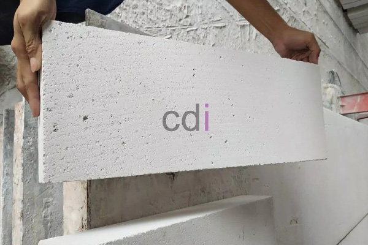
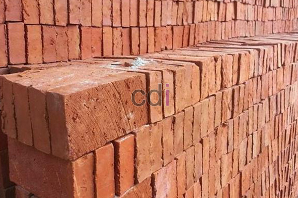

**Perbedaan Bata Merah dan Ringan yg Wajib Anda Tahu** | Mitra CDI! Pernahkah Anda mempertimbangkan material yang tepat untuk dinding bangunan impian? Kami dari CDI ingin membahas perbandingan antara dua pilihan populer: **bata merah dan bata ringan**. Kedua material ini sama-sama kerap digunakan dalam konstruksi, namun memiliki karakteristik unik yang perlu Anda ketahui. Yuk, simak ulasan lengkapnya!

*Bata Merah dan Ringan: Pilihan Tepat untuk Konstruksi Anda*

## Proses Pembuatan Bata Merah dan Ringan

Baik *bata merah maupun bata ringan* sama-sama menjadi fondasi penting dalam membangun struktur yang kokoh. Dinding yang terbuat dari bata jelas lebih tahan lama dibandingkan dinding bambu atau kayu – apalagi di iklim (not detected) yang lembap dan rentan hama. Bata merah, seperti namanya, dibuat dari tanah liat yang dibentuk dan dibakar. Proses pembakaran tradisional ini menghasilkan bata yang kuat. Sementara itu, bata ringan adalah inovasi modern, diproduksi secara massal di pabrik dengan teknologi mutakhir, meminimalkan campur tangan manusia. 

> _"Untuk kebutuhan bata merah atau bata ringan berkualitas, jangan ragu hubungi kami! Kami siap melayani proyek Anda di (not detected) dan sekitarnya. Nikmati kemudahan transaksi dengan sistem pembayaran COD – barang sampai, baru Anda bayar!"_

## Apa Saja Perbedaan Bata Merah dan Ringan?

Banyak orang membayangkan bata selalu berwarna merah dan terbuat dari tanah liat. Padahal, dunia material konstruksi terus berkembang! Selain bata merah tradisional, kini ada juga bata ringan sebagai alternatif yang semakin populer. Keduanya punya kelebihan dan kekurangannya masing-masing.

*Memahami Karakteristik Bata Merah dan Bata Ringan*

### Karakteristik Bata Merah:

- Terbuat dari tanah liat, sehingga memberikan warna alami yang khas.
- Proses pembuatan umumnya dilakukan secara tradisional atau semi-manual.
- Ukurannya bisa sedikit bervariasi karena proses produksi yang tidak selalu presisi.
- Membutuhkan waktu pembakaran yang cukup lama untuk mencapai kekuatan optimal.
- Harganya cenderung lebih ekonomis dibandingkan bata ringan.

### Karakteristik Bata Ringan:

- Merupakan hasil pengembangan dari bata merah dengan teknologi modern.
- Bobotnya lebih ringan, sehingga mengurangi beban struktur bangunan secara keseluruhan.
- Warnanya umumnya putih atau abu-abu terang yang mudah dipadukan dengan finishing dinding lainnya.
- Ukurannya seragam karena diproduksi dengan mesin berpresisi tinggi.
- Memiliki kekuatan yang baik dan tahan terhadap panas serta air.
- Investasi awal mungkin sedikit lebih tinggi dibandingkan bata merah.

Meskipun ada perbedaan signifikan antara **bata merah dan bata ringan**, keduanya memiliki tujuan yang sama: membentuk dinding yang kuat, kokoh, dan melindungi bangunan Anda di (not detected). Dinding bata, selain kuat secara struktural, juga memberikan perlindungan dari cuaca ekstrem, hama, dan membantu menciptakan interior yang nyaman. Dengan sentuhan cat atau pelapis yang tepat, dinding bata akan semakin mempercantik tampilan bangunan Anda.