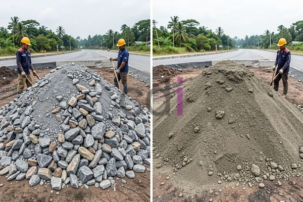

**Perbedaan Sirtu dan Sirdam: Panduan Memilih Fondasi Rumah Terbaik untuk Mitra CDI** - Halo Mitra CDI! Pernahkah Anda bertanya-tanya, material apa yang paling tepat untuk fondasi rumah impian Anda? Pondasi yang kokoh adalah kunci utama bangunan yang tahan lama. Banyak pilihan material tersedia, tapi dua yang paling sering dibandingkan adalah sirtu dan sirdam. Artikel ini akan mengupas tuntas perbedaan keduanya, kelebihan dan kekurangannya, serta membantu Anda menentukan opsi terbaik untuk proyek konstruksi di (not detected). Mari kita bahas secara mendalam!

## Mengenal Sirtu: Pilihan Praktis untuk Fondasi Rumah

Sirtu, singkatan dari *split* atau batu pecah, adalah material agregat hasil pemecahan batu alam. Material ini populer sebagai fondasi karena mudah didapatkan dan harganya cukup bersahabat. Sirtu umumnya terdiri dari campuran pecahan batu berbagai ukuran—dari yang kasar hingga halus—beserta debu batu. Ukuran yang umum digunakan bervariasi antara 5 hingga 50 mm, menyesuaikan kebutuhan proyek.

Penerapan sirtu dalam fondasi memerlukan proses pemadatan yang cermat menggunakan alat berat seperti stamper atau vibrator. Tujuannya? Agar porositas tanah berkurang dan daya dukung fondasi meningkat. Selain itu, sirtu seringkali dipadukan dengan semen dan air untuk membuat *lean concrete* sebagai lapisan dasar sebelum pengecoran beton bertulang.

## Sirdam: Fondasi Kuat untuk Stabilitas Bangunan

Sirdam, meski istilahnya kurang lazim digunakan secara teknis (*sirap dam*), umumnya merujuk pada "agregat padat" atau "batu makadam". Sederhananya, sirdam adalah material agregat berukuran lebih besar dari sirtu—biasanya berupa batu bulat atau pecahan batu yang saling mengunci dengan bantuan semen atau bahan pengikat. Kekuatan utama sirdam terletak pada kemampuannya menstabilkan tanah dan mencegah pergeseran fondasi.

Dibanding sirtu, sirdam memiliki porositas yang lebih rendah. Artinya, material ini lebih kedap air dan menawarkan drainase yang lebih baik. Namun, pemadatan sirdam membutuhkan alat berat berkapasitas besar dan proses yang lebih teliti.

## Sirtu vs Sirdam: Perbandingan Mendalam untuk Proyek Anda di (not detected)

Agar Mitra CDI makin memahami perbedaan keduanya, berikut tabel perbandingan yang bisa Anda jadikan panduan:

| Fitur             | Sirtu                               | Sirdam                              |
|-------------------|-------------------------------------|-------------------------------------|
| Ukuran Agregat     | 5-50 mm                              | Lebih besar dari 50 mm              |
| Porositas         | Lebih tinggi                          | Lebih rendah                          |
| Kemampuan Drainase | Cukup                               | Baik                                |
| Harga             | Lebih terjangkau                      | Lebih mahal                          |
| Kekuatan          | Cukup untuk beban ringan             | Lebih kuat untuk beban berat         |
| Pemadatan         | Relatif mudah                        | Membutuhkan alat berat dan ketelitian |
| Penggunaan Ideal   | Fondasi rumah tipe sederhana         | Fondasi rumah tipe besar atau di lahan miring |

Sebagai gambaran, mari kita hitung perkiraan biaya pemasangan sirtu untuk area 50 meter persegi dengan ketebalan 10 cm (0,1 meter) dan harga sirtu Rp 150.000 per meter kubik: Volume sirtu = 50 m² x 0,1 m = 5 m³. Biaya total = 5 m³ x Rp 150.000/m³ = Rp 750.000. Perlu diingat, angka ini hanyalah estimasi—harga dapat berubah sewaktu-waktu. Untuk penawaran terkini dan paling presisi sesuai kebutuhan proyek Anda di (not detected), silakan hubungi Kami.

## Faktor Krusial: Kondisi Tanah dan Beban Bangunan

Material mana yang lebih cocok untuk Anda? Jawabannya bergantung pada kondisi tanah dan perkiraan beban bangunan. Jika tanah di (not detected) cenderung labil atau berpotensi bergeser, sirdam adalah pilihan yang lebih aman karena kemampuannya menstabilkan tanah. Sirdam juga ideal untuk bangunan yang akan menanggung beban berat, seperti rumah bertingkat atau properti komersial.

Namun, jika tanah di (not detected) stabil dan bangunan yang direncanakan tidak terlalu berat, sirtu bisa jadi solusi ekonomis. Perlu diingat: menggunakan sirtu di tanah yang kurang stabil berisiko menyebabkan penurunan atau keretakan bangunan.

Untuk hasil terbaik, Kami merekomendasikan penyelidikan tanah menyeluruh sebelum memulai proyek. Informasi ini akan memberi gambaran akurat mengenai jenis tanah, daya dukungnya, dan potensi masalah lainnya. Berbekal data ini, Kami dapat merekomendasikan material fondasi yang paling optimal untuk bangunan Anda di (not detected).

Yuk, wujudkan impian membangun rumah kokoh bersama Kami! Jangan ragu untuk menghubungi tim ahli Kami melalui tombol **Telepon** atau **WhatsApp** yang tersedia di bawah. Kami siap membantu!