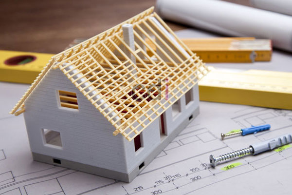

**Perencanaan Pembangunan Rumah Yang Tepat** - Hai Mitra CDI! Punya keinginan besar untuk membangun rumah impian di (not detected)? Sebuah perencanaan yang matang adalah kunci utama kesuksesan proyek ini. Rumah bukan sekadar tempat tinggal, tapi investasi jangka panjang dan saksi bisu cerita keluarga. Nah, sebelum mulai mengangkat batu bata pertama, yuk kita bahas bagaimana menyusun perencanaan yang solid agar rumah impian Anda benar-benar terwujud! Kami dari CDI siap membantu mewujudkan rumah idaman Anda, mulai dari desain hingga penyediaan material berkualitas.

## Mempersiapkan Perencanaan Pembangunan Rumah

Memulai proyek pembangunan rumah memang terasa rumit. Tapi jangan khawatir! Kami, _CDI_, akan memandu Anda dengan beberapa poin penting yang mendasar dalam merencanakan pembangunan rumah yang tepat.

*Perencanaan Pembangunan Rumah*

### 1. Menentukan Lokasi yang Ideal

Lokasi adalah segalanya! Pikirkan baik-baik apakah Anda lebih suka suasana tenang di pinggiran kota atau kemudahan akses di pusat (not detected). Perhatikan juga luas lahan yang dibutuhkan sesuai dengan konsep rumah yang Anda inginkan dan tentu saja, sesuaikan dengan anggaran Anda. Kalau Anda masih bingung mencari tanah yang strategis dan terjangkau, jangan ragu untuk membaca tips kami di halaman [Tips Memilih tanah Yang murah dan Strategis](/blog/tips-membeli-tanah-yang-strategis-dan-murah).

### 2. Merancang Desain Rumah Impian

Tahap ini adalah momen paling menyenangkan sekaligus paling penting! Bayangkan bagaimana rumah idaman Anda dari sudut pandang Anda. Apakah Anda lebih suka desain minimalis modern, klasik elegan, atau gaya tropis yang asri? Sebaiknya, jangan terburu-buru memutuskan. Pertimbangkan kebutuhan ruang, fungsi setiap area, dan pastikan desain tersebut benar-benar mencerminkan kepribadian Anda. Konsultasikan dengan arsitek berpengalaman untuk mendapatkan desain yang optimal dan sesuai dengan anggaran. Ingat, desain yang matang akan menghemat waktu dan biaya di kemudian hari.

### 3. Menghitung Anggaran Pembangunan Secara Detail

Setelah memiliki gambaran desain, saatnya menyusun anggaran. Hitung semua biaya yang mungkin timbul, mulai dari upah tukang, harga material bangunan (beton, pasir, batu, baja, dan lain-lain), hingga biaya tak terduga. Jangan lupa alokasikan dana cadangan untuk hal-hal yang mungkin tidak terpikirkan sebelumnya. Untuk membantu Anda menghitung kebutuhan material, kami menyediakan [**Kalkulator Bahan Bangunan**](/page/kalkulator-bangunan) yang bisa Anda gunakan secara gratis. Pastikan anggaran Anda realistis dan sesuai dengan kemampuan finansial Anda.

Itulah tiga hal utama yang perlu Anda persiapkan untuk merencanakan Pembangunan Rumah Yang Tepat. Jangan ragu untuk berkonsultasi dengan tim ahli kami di CDI! Kami tidak hanya menyediakan layanan desain interior, furniture custom, dan material bangunan berkualitas tinggi, tetapi juga jasa pengecoran yang terpercaya.

Kami **CDI** menyediakan berbagai material berkualitas untuk kebutuhan pembangunan Anda, seperti Beton Cor Siap Pakai (Ready Mix Concrete), Pasir Beton, Pasir Pasang, Pasir Plester, Batu Pondasi, Batu Split Cor, Bata Merah, Hebel, Batako, Urugan, Bondek, Wiremesh, dan masih banyak lagi. Semua material kami diantarkan GRATIS ongkir ke wilayah Jabodetabek hingga Purwakarta. Untuk informasi lebih lanjut dan pemesanan, silakan hubungi kami melalui tombol Telepon/WhatsApp yang tersedia di website. Jangan tunda lagi, wujudkan rumah impian Anda bersama CDI sekarang! [Perbedaan Sirtu dan Sirdam: Mana yang Tepat untuk Fondasi Rumah Mitra CDI?](/blog/perbedaan-sirtu-dan-sirdam/) mungkin bisa membantu Anda menentukan pondasi yang tepat untuk rumah impian Anda.