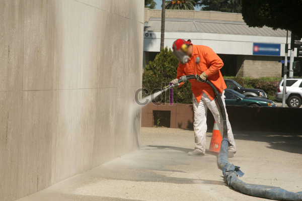

**Persiapan Sebelum Mengerjakan Sand Blasting** - Hai Mitra CDI! Pernahkah Anda menghadapi masalah karat membandel di permukaan besi atau metal? Jangan khawatir, kami punya solusinya! Sand blasting adalah metode efektif untuk membersihkan dan mengembalikan kilau material Anda. Proses ini bertujuan menghilangkan kontaminasi seperti oli, garam, cat lama, karat, dan kotoran lainnya. Singkatnya, sand blasting memanfaatkan semprotan material abrasive—bisa pasir, steel grit, atau silica—dengan tekanan tinggi.

*Proses sand blasting untuk membersihkan dan mempersiapkan permukaan.*

Setelah proses sand blasting, permukaan benda akan bersih sekaligus kasar. Efek tumbukan dan gesekan dari semprotan bertekanan tinggi ini ideal untuk membantu cat atau krom menempel lebih kuat. Bahkan, sand blasting jauh lebih cepat menghilangkan karat dan cat dibandingkan penggunaan cairan remover biasa. Material yang cocok untuk dibersihkan dengan metode ini antara lain perunggu, kuningan, aluminium, dan tentu saja, besi.

## Prioritaskan Keamanan Saat Sand Blasting

Proses sand blasting, meski efektif, memiliki potensi bahaya jika tidak didukung perlengkapan keselamatan yang memadai. Debu halus yang dihasilkan dapat membahayakan pernapasan dan kesehatan secara keseluruhan. Itulah sebabnya penggunaan helm khusus sangat penting. Pilih helm yang dilengkapi saluran udara bersih untuk memastikan kenyamanan dan perlindungan optimal. Berikut adalah panduan penting untuk keamanan Anda:

- 1\. Hindari penggunaan helm sand blasting jika ada bagian yang tidak lengkap, meskipun terlihat masih berfungsi.
- 2\. Pastikan helm sand blasting terpasang dengan pas di kepala Anda, tanpa celah yang memungkinkan debu masuk.
- 3\. Cek secara berkala saluran udara untuk memastikan tidak tersumbat dan pasokan udara tetap lancar.
- 4\. Jika sand blasting dilakukan di lingkungan perusahaan, pastikan tingkat debu (dust level) berada dalam batas aman bagi petugas.

## Jaga Kebersihan Sepanjang & Setelah Pengerjaan

Jangan kendurkan kewaspadaan meskipun pengerjaan sand blasting telah selesai! Tetap gunakan helm selama proses pembersihan karena debu halus masih mungkin menempel pada pakaian. Membasahi area sekitar lokasi kerja setelah selesai juga membantu mencegah penyebaran partikel debu. Selain helm, gunakan headphone untuk meredam kebisingan dari kompresor dan respirator selama proses pembersihan atau pemindahan material yang telah diproses.

Sekali lagi, Mitra, ingatlah bahwa perlengkapan pengamanan adalah kunci utama untuk menjaga kesehatan dan keselamatan selama pekerjaan sand blasting. Keamanan pribadi dan lingkungan sekitar harus selalu menjadi prioritas. Peralatan pengamanan yang tepat tidak boleh diabaikan. [Apa yang dimaksud dengan Sand Blasting?](/blog/apa-itu-sand-blasting/) untuk pemahaman yang lebih dalam tentang prosesnya. Semoga informasi ini bermanfaat dan menambah wawasan Anda! Segera hubungi kami untuk konsultasi dan penawaran jasa sand blasting profesional di (not detected). Kami siap membantu Anda! 
<table class="table">
  <caption>Spesifikasi Sand Blasting CDI</caption>
  <thead>
    <tr><th>Jenis Abrasive</th><th>Tekanan Ideal (PSI)</th><th>Aplikasi</th></tr>
  </thead>
  <tbody>
    <tr><td>Pasir Silika</td><td>60-90</td><td>Pembersihan karat ringan, persiapan permukaan</td></tr>
    <tr><td>Steel Grit</td><td>80-120</td><td>Pembersihan karat berat, tekstur permukaan kasar</td></tr>
    <tr><td>Aluminium Oxide</td><td>70-100</td><td>Pembersihan presisi, tekstur halus</td></tr>
  </tbody>
</table>
