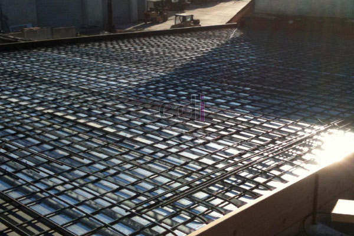

**Persiapan Yang dilakukan Sebelum Pengecoran** - Hai Mitra CDI! Pernahkah Anda membayangkan betapa pentingnya persiapan sebelum pengecoran? Nah, inilah kunci untuk memastikan hasil cor yang kuat, tahan lama, dan bebas masalah di (not detected). Sebelum memulai pengecoran, ada beberapa hal krusial yang perlu diperiksa dengan teliti. Jangan sampai terjadi hal yang tidak diinginkan seperti cor yang kropos, bekisting bocor, atau retakan pada dak lantai. Kabar baiknya, pengecekan persiapan ini tidak selalu membutuhkan ahli khusus—Anda pun bisa melakukannya sendiri! Yuk, simak beberapa langkah penting berikut dan pastikan persiapan Anda benar-benar matang.

 

*Persiapan Yang dilakukan Sebelum Pengecoran*

 ## Pengecekan Penting Sebelum Pengecoran

Berikut adalah daftar hal-hal yang wajib Anda waspadai sebelum proses pengecoran dimulai. Sebaiknya lakukan pengecekan ini sebelum beton readymix dipesan dari perusahaan penyedia beton cor.

- 1\. **Periksa Kekuatan Rangka Besi:** Pastikan seluruh rangkaian besi yang sudah dirakit terhubung dengan kuat. Perhatikan, apakah ada bagian yang tidak di-kait dengan sempurna? Kekuatan rangka besi sangat vital untuk menahan beban cor. Jika kurang kuat, besi bisa menurun saat pengecoran berlangsung. Ketelitian adalah kunci di sini!
- 2\. **Bersihkan Bekisting:** Sebelum coran dituang, bersihkan seluruh kawat dan paku yang tidak terpakai pada bekisting yang akan dicor. Hal ini penting untuk mencegah gangguan saat pengecoran dan memastikan permukaan coran halus.
- 3\. **Inspeksi Bekisting dan Steger:** Lakukan pemeriksaan ulang terhadap bekisting dan steger. Pastikan keduanya cukup kuat untuk menahan beban cor dan aktivitas para pengecor. Periksa juga jarak antar steger—apakah sudah aman? Jika menggunakan bambu atau kayu, tambahkan plat diagonal dan paku atau ikat dengan kawat untuk memperkuat struktur. Keamanan bekisting dan steger adalah prioritas utama.
- 4\. **Cek Tanah Penopang Steger:** Perhatikan kondisi tanah yang menopang steger. Apakah ada penurunan? Penurunan tanah bisa menyebabkan hasil cor lantai turun dan tidak rata, yang pada akhirnya dapat menyebabkan keretakan. Untuk mengatasi ini, gunakan potongan papan atau kayu seukuran penurunan, lalu masukkan di bawah steger sebagai penyangga. Ini akan membantu menjaga ketinggian dan kestabilan coran.
- 5\. **Percepat Proses Pengecoran:** Efisiensi waktu sangat penting. Pilihlah jasa ready mix concrete dan sewa pompa beton untuk mempercepat proses pengecoran. Dengan menggunakan beton cor siap pakai, pengecoran dak lantai akan lebih cepat selesai. Butuh rekomendasi tipe cor yang sesuai? Jangan ragu untuk bertanya kepada kami!

Itulah beberapa cara untuk Persiapan Yang dilakukan Sebelum Pengecoran. Untuk memperdalam pengetahuan Anda, jangan lewatkan artikel kami tentang [cara menghitung besi untuk cor dak lantai](/blog/cara-menghitung-besi-untuk-cor-dak-lantai "Cara Menghitung Besi Untuk Cor Dak Lantai"). Kami juga siap menyediakan cor curah siap pakai (ready mix) kapanpun Anda butuhkan di (not detected). Untuk informasi harga dan pemesanan, silakan hubungi kami. Terima kasih! [Yang Dilakukan Setelah Pengecoran](/blog/yang-dilakukan-setelah-pengecoran/) juga perlu Anda ketahui setelah proses pengecoran rampung.