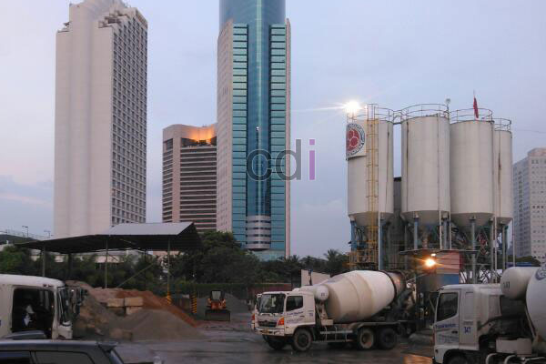

**Kualitas dan Harga Terbaik Pionir Beton Cor** - Hai Mitra CDI! Sedang merencanakan pembangunan dan mencari material terbaik untuk fondasi? Beton cor adalah kunci utama kekuatan dan ketahanan bangunan Anda. Nah, di (not detected), **pionir beton cor** hadir sebagai solusi terpercaya. Perusahaan ini menawarkan berbagai tipe beton cor sesuai kebutuhan dan anggaran Anda. Dikenal juga dengan merk Tiga Roda atau Indocement, Pionir Beton telah lama menjadi pilihan utama para profesional konstruksi.

*Pionir Beton / Indocement*

## Pionir Beton Cor: Kualitas yang Teruji Waktu

Di antara banyaknya produsen beton cor, Tiga Roda atau Indocement adalah nama yang paling dikenal sebagai _pionir beton cor di Indonesia_. Mengapa? Karena mereka konsisten memberikan kualitas terbaik yang sudah terbukti handal. Beton mereka diproduksi mengikuti standar ketat, menjamin kekuatan dan daya tahan bangunan Anda. 

Kualitas beton cor sangat bergantung pada komposisi materialnya: batu split, pasir, air, dan semen. Takaran yang tepat sangat krusial. Selain itu, proses pengolahan juga berpengaruh besar. Sistem produksi yang efisien, dengan mempertimbangkan jarak antara pabrik dan lokasi proyek, memastikan beton cor tetap segar saat digunakan.

Sebagai pionir beton ini, Indocement sangat memperhatikan setiap aspek; mulai dari perhitungan material yang akurat, proses pencampuran yang optimal, hingga proses penuangan yang presisi. Bahkan, penggunaan pompa beton cor untuk memompa material ke ketinggian pun diperhatikan untuk memastikan kualitas terjaga.  

## Harga Bersaing, Kualitas Tak Kompromi

Pionir beton cor tak hanya fokus pada kualitas, tapi juga memikirkan anggaran Anda. Mereka memahami bahwa harga menjadi pertimbangan penting. Oleh karena itu, mereka berupaya menawarkan harga yang kompetitif tanpa mengorbankan kualitas. Nah, lho, mencari beton cor terbaik dengan harga terjangkau di (not detected) bisa jadi kenyataan!

Beberapa penyedia mungkin menawarkan variasi kualitas berdasarkan budget. Namun, pionir beton cor tetap berkomitmen memberikan kualitas terbaik. Mereka tidak mau mengambil risiko dengan mengurangi takaran material demi menekan harga. Ingat, kualitas terbaik memang membutuhkan investasi yang setara. Gimana, setuju kan?

## Mudah Memesan Beton Cor Berkualitas di (not detected)

Memesan beton cor kini semakin mudah. Hubungi sales resmi Pionir Beton seperti kami untuk mendapatkan penawaran terbaik. Cara paling praktis adalah menghubungi kami melalui telepon. Setelah alamat proyek di (not detected) kami terima, tim kami akan melakukan survei untuk pengukuran ulang dan negosiasi harga.  Jika kesepakatan tercapai, penjadwalan pengiriman pompa beton dan pengecoran akan segera dilakukan.

Jangan ragu untuk menghubungi kami melalui email atau telepon yang tertera di website ini. Dapatkan informasi harga terkini dan penawaran khusus untuk produk Pionir Beton.  
<table class="table">
  <caption>Contoh Spesifikasi Beton Cor</caption>
  <thead>
    <tr><th>Mutu Beton</th><th>Slump</th><th>Semen (kg/m3)</th><th>Air (Liter/m3)</th><th>Pasir (kg/m3)</th><th>Kerikil (kg/m3)</th></tr>
  </thead>
  <tbody>
    <tr><td>K225</td><td>8-10 cm</td><td>350</td><td>175</td><td>600</td><td>1000</td></tr>
    <tr><td>K300</td><td>6-8 cm</td><td>380</td><td>160</td><td>650</td><td>1050</td></tr>
  </tbody>
</table>

Yuk, bangun struktur yang kokoh dan tahan lama dengan Pionir Beton Cor! Cek juga artikel kami tentang [Analisa Cor Beton K 225: Panduan Lengkap untuk Fondasi Kuat dan Tahan Lama](/blog/analisa-cor-beton-k-225/) untuk informasi lebih lanjut tentang pentingnya mutu beton. Jangan lewatkan juga panduan penting tentang [Alas Cor Beton: Panduan Lengkap Jenis, Fungsi, dan Pemasangannya](/blog/alas-cor-beton/) agar fondasi Anda semakin optimal.