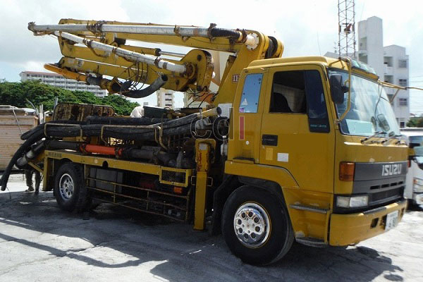

**Dalam Pengecoran Haruskah Pakai Pompa Beton ?** - Hai Mitra CDI! Pembangunan gedung, sekolah, mall, atau proyek lainnya pasti melibatkan cor beton. Nah, kualitas cor beton ini krusial banget, lho. Kalau nggak sesuai standar, dampaknya bisa ringan sampai berat, bahkan mengancam keselamatan. Ketika memilih beton *ready mix*, penggunaan **pompa beton** sangat penting untuk menyalurkan beton dari truk mixer ke lokasi pengecoran dengan lancar.

*Pompa Beton Mini*

## Pilihan Pompa Beton: Sewa Terpisah untuk Efisiensi

Biasanya, operator beton *ready mix* tidak menyediakan pompa beton sendiri. Mereka bekerja sama dengan perusahaan penyedia layanan pompa beton seperti kami. Kami menyediakan beragam tipe _pompa beton_ yang bisa disesuaikan dengan kebutuhan proyek Anda. Pilihan yang tersedia antara lain *concrete pump* standar, *concrete pump long boom*, pompa *portable*, dan *concrete pump mini*. Anda bisa menyewa pompa ini dengan sistem per jam, harian, atau bahkan bulanan.

## Teknik Pengecoran Beton yang Tepat: Kunci Keawetan Bangunan

Yuk, bahas lebih lanjut soal pengecoran beton. Proses penyaluran beton ke bekisting harus dilakukan dengan benar agar kualitas beton tetap terjaga. Kalau tekniknya salah, ini beberapa masalah yang mungkin muncul:

- 1\. ### Risiko Retak pada Beton Cor

Beton cor harus dibuat dengan bahan dan komposisi yang tepat sesuai standar. Kalau tidak, dampaknya adalah retakan pada cor beton yang bisa muncul tak lama setelah bangunan selesai. Retakan ini bisa terlihat jelas saat beton baru mengering. Kalau sudah begitu, sebaiknya komposisi atau teknik pembuatan beton dipertimbangkan ulang.
- 2\. ### Potensi Keropos yang Tersembunyi

Dampak lainnya yang lebih serius adalah keropos pada beton cor. Kondisi ini mungkin tidak terlihat langsung. Berbeda dengan retakan yang mudah dideteksi, keropos menunjukkan adanya rongga di dalam beton yang tidak terisi dengan sempurna. Jadi, pembeli harus memeriksa kondisi beton dengan cermat dan menghindari beton yang keropos.
- 3\. ### Permukaan yang Tidak Rata dan Bergelombang

Cara membedakan beton berkualitas bagus dan yang kurang baik adalah dengan melihat permukaannya. Permukaan yang halus dan tidak memperlihatkan batu split yang menonjol menunjukkan proses pengolahan dan pencetakan yang baik. Sebaliknya, permukaan kasar, tidak rata, dan batu split yang terlihat menonjol menandakan proses pengolahan dan pencetakan yang kurang optimal.
- 4\. ### Bahaya Keruntuhan Struktur

Akibat terburuk dari pengecoran yang tidak benar adalah keruntuhan struktur beton. Ini tentu sangat berbahaya! Keruntuhan tidak hanya menyebabkan kerugian materi, tetapi juga bisa mengakibatkan kecelakaan yang serius, bahkan hilangnya nyawa. Bayangkan jika yang roboh adalah dinding rumah atau gedung tinggi!

Untuk menghindari semua risiko tersebut, sangat disarankan untuk memilih perusahaan yang profesional dan terpercaya. Pastikan juga **pompa beton** yang digunakan dalam proses pengecoran beroperasi dengan baik. Pilih pompa beton yang prima kondisinya, meskipun mungkin sedikit lebih mahal di awal. Ini akan memastikan kelancaran proyek dan mencegah keterlambatan akibat kerusakan pompa. Demikian ulasan singkat mengenai _pompa beton dalam pengecoran_ ini, semoga bermanfaat bagi Anda!

> _Untuk konsultasi lebih detail mengenai penggunaan pompa beton, jangan ragu untuk menghubungi tim kami. Informasi kontak tersedia di bagian atas website ini._