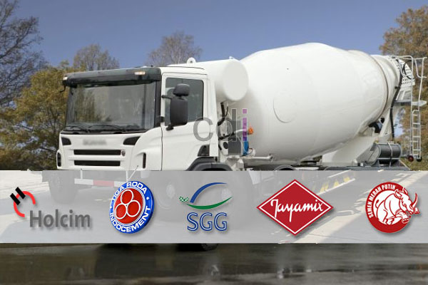

**Perusahaan Beton Cor Ready Mix Terbaik** - Hai Mitra CDI! Sedang mencari solusi beton untuk proyek Anda? Nah, Anda datang ke tempat yang tepat! Dalam pembangunan struktur beton bertulang, beton adalah kunci utama. Secara garis besar, ada dua cara mendapatkan beton: melalui *batching plant* (beton readymix) atau pengadukan langsung di lokasi (beton site mix). Artikel ini akan membahas keunggulan beton readymix, serta merekomendasikan produsen yang terpercaya di (not detected) dan sekitarnya. Mari kita bahas lebih lanjut!

*Penyedia Beton Cor Ready Mix Terpercaya*

## Produsen Readymix Terkemuka: Holcim, Pionir, SGG, Jayamix, dan Merah Putih

Menggunakan beton readymix itu menguntungkan, lho. Apa saja kelebihannya? Pertama, proses pembelian jadi lebih praktis—Anda tinggal menentukan mutu beton yang dibutuhkan dalam satuan m3. Tidak perlu lagi pusing memikirkan takaran dan komposisi yang tepat. Kedua, pengecoran jadi lebih efisien dan hemat tenaga kerja. Ketiga, kualitas beton lebih konsisten karena komposisi dan adukannya sudah terstandarisasi. Dengan begitu, Anda mendapat beton yang tepat mutu dan berkualitas tinggi. Nah, kalau proyek Anda berskala kecil, beton readymix tetap bisa menjadi pilihan efektif karena tidak memerlukan lahan yang luas untuk proses pencampuran. Selain itu, administrasi juga lebih mudah dan pengawasan bisa lebih ringkas.

Beberapa produsen beton cor ready mix yang bisa Anda pertimbangkan antara lain: Holcim, Pionir, SGG (Gresik), Jayamix, dan Merah Putih. Mereka menyuplai ready mix berkualitas sesuai standar SNI, cocok untuk berbagai proyek, mulai dari pembangunan rumah, jalan raya, hingga gedung bertingkat di (not detected). Produsen-produsen ini punya pengalaman membangun struktur yang kuat, awet, dan tahan lama. Tim mereka siap mengantarkan beton segar ke lokasi proyek sesuai kebutuhan Anda.  Jangan ragu untuk menghubungi kami untuk informasi lebih lanjut!

## Mini Mix: Solusi Tangguh untuk Akses Terbatas

Butuh beton di area yang sulit dijangkau? Produsen beton cor ready mix juga menyediakan *truck mixer mini* dengan kapasitas 2-3 m3. Ukurannya yang lebih ringkas memungkinkan pengiriman beton ke jalan sempit, kompleks perumahan, atau gang-gang kecil di (not detected). Walaupun harga per meter kubik mungkin sedikit lebih tinggi dibandingkan truck mixer standar berkapasitas 6-7 m3, kemudahan akses yang ditawarkan sepadan dengan investasinya.

Untuk mempermudah proses pengecoran, terutama pada proyek dengan jarak tempuh yang jauh atau bangunan bertingkat, sering digunakan *concrete pump*. Ada beberapa jenis concrete pump yang umum digunakan: pompa standar (jangkauan 18 m), pompa *long boom* (jangkauan 30 m), dan pompa kodok (mampu mencapai ketinggian lebih dari 100 m dengan sambungan pipa).

## Bagaimana Cara Memesan Beton Cor Readymix?

Memilih beton cor readymix yang tepat memang penting. Pastikan Anda memilih produsen yang terpercaya dan sudah memenuhi standar mutu SNI. Beberapa nama yang sudah terbukti kualitasnya adalah Holcim, Pionir, SGG (Gresik), Jayamix, dan Merah Putih. Pilih salah satu yang paling sesuai dengan kebutuhan dan lokasi proyek Anda di (not detected). 

Tapi, kalau Anda tidak punya waktu untuk meneliti satu per satu, serahkan saja pada kami! Kami sudah menjalin kerjasama yang baik dengan produsen beton readymix ternama tersebut.  Kami juga menawarkan harga yang kompetitif, setara dengan harga langsung dari pabrik. Keuntungan bekerja sama dengan kami adalah Anda bisa bebas memilih merek beton cor yang diinginkan dan membandingkan harganya.

> _"Proses pemesanannya sangat mudah. Tinggal informasikan alamat proyek, dan tim kami akan melakukan survei serta mengatur jadwal pengecoran."_

Demikianlah informasi tentang beberapa produsen beton cor ready mix terbaik untuk proyek sekala kecil, menengah, dan besar. Jangan sungkan untuk berkonsultasi dengan kami mengenai kebutuhan cor Anda. Hubungi kami segera untuk mendapatkan penawaran terbaik! [Daftar Harga Beton Cor Ready Mix Non Fly Ash dan Fly Ash](/blog/daftar-harga-beton-cor-ready-mix-non-fly-ash-dan-fly-ash/) — cek daftar harga terbaru kami.  

<table class="table">
  <caption>Perbandingan Mutu Beton Readymix</caption>
  <thead>
    <tr><th>Mutu Beton</th><th>Karakteristik</th><th>Aplikasi Umum</th></tr>
  </thead>
  <tbody>
    <tr><td>K-225</td><td>Kuat tekan 22.5 MPa, Umum digunakan untuk pondasi ringan dan lantai kerja</td><td>Pondasi rumah tinggal, lantai kerja</td></tr>
    <tr><td>K-300</td><td>Kuat tekan 30 MPa, Cocok untuk struktur bangunan yang membutuhkan kekuatan sedang</td><td>Kolom praktis, balok, dinding</td></tr>
    <tr><td>K-350</td><td>Kuat tekan 35 MPa, Ideal untuk struktur yang membutuhkan kekuatan lebih tinggi</td><td>Sloof beton, lantai untuk pabrik</td></tr>
  </tbody>
</table>
