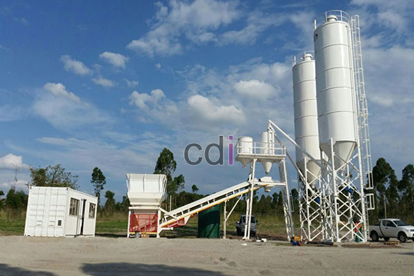

**Rahasia Campuran Beton ReadyMix** - Hai Mitra CDI! Pernahkah Anda bertanya-tanya tentang bagaimana beton readymix dibuat agar sesuai dengan kebutuhan konstruksi yang berbeda? Banyak yang mengira campuran beton itu seragam—paduan pasir, split, semen, dan air—padahal kenyataannya, produsen beton readymix seperti pionir beton, jayamix, holcim, dan adhimix membagi kualitas beton menjadi berbagai tingkatan mutu. Pembagian ini penting untuk memastikan beton yang digunakan sesuai dengan desain dan beban bangunan.

## Mengapa Mutu Beton Itu Penting?

Pertanyaan mendasar yang sering muncul adalah, mengapa mutu beton berbeda-beda? Jawabannya sederhana: setiap desain bangunan membutuhkan kualitas beton cor yang sesuai. Bayangkan perbedaan antara rumah dua lantai dan gedung empat lantai. Keduanya memiliki ukuran dan beban yang berbeda, sehingga mutu beton yang digunakan pun harus disesuaikan. Menggunakan mutu beton yang tidak tepat bisa membahayakan kekuatan dan keamanan bangunan. Jadi, untuk tiang rumah dua lantai, beton ReadyMix K250 biasanya sudah cukup, sementara bangunan empat lantai memerlukan mutu yang lebih tinggi, seperti K300 atau K325.

Nah, timbul pertanyaan lain: bagaimana cara mengetahui campuran mutu yang tepat jika Anda hendak membuat beton secara manual? Artikel ini akan mengungkap rahasia campuran beton readymix yang jarang dibahas oleh perusahaan supplier beton.

Kami akan fokus pada mutu beton readymix yang paling umum digunakan: K225, K250, K300, K350, dan K400.

## Membongkar Rahasia Campuran Beton ReadyMix K225

Jika Anda ingin membuat adukan beton readymix dengan mutu K225 untuk volume 1m³, berikut adalah bahan-bahan yang dibutuhkan:

- **Pasir Khusus Beton** (kandungan lumpur <10%): 698 kg
- **Batu Krikil/Split Runcing** (ukuran 1-2cm untuk dak, 2-3cm untuk tiang/pondasi): 1047 kg
- **Semen Portland**: 371 kg
- **Air bersih**: 215 liter (untuk kekentalan standar – slump 12±2)

## Komposisi Campuran Beton ReadyMix K250 yang Tepat

Berikut adalah komposisi campuran beton readymix dengan Nilai Mutu Beton K250 untuk volume 1m³. Jika Anda membutuhkan volume lebih banyak, kalikan takaran sesuai kebutuhan:

- **Pasir Cor/Beton** (kandungan lumpur <10%): 692 kg
- **Batu Split Runcing** (ukuran 1-2cm untuk dak, 2-3cm untuk tiang/pondasi): 1039 kg
- **Semen Portland**: 384 kg
- **Air bersih**: 215 liter (untuk kekentalan standar – slump 12±2)

## Panduan Takaran Material Campuran Beton ReadyMix K300

Untuk membuat campuran beton readymix dengan kualitas mutu K300 sebanyak 1 meter kubik (m³), siapkan bahan-bahan berikut dan kalikan takarannya sesuai kebutuhan volume:

- **Pasir Beton** (kandungan lumpur <10%): 681 kg
- **Batu Krikil/Split Runcing** (ukuran 1-2cm untuk dak, 2-3cm untuk tiang/pondasi): 1021 kg
- **Semen Portland**: 413 kg
- **Air bersih**: 215 liter (untuk kekentalan standar – slump 12±2)

## Rahasia Campuran Mutu Beton K350 yang Kuat

Persiapkan material berikut untuk membuat adukan/campuran beton readymix dengan kualitas mutu K350 (takaran di bawah ini untuk volume 1m³):

- **Pasir Khusus Cor** (kandungan lumpur <10%): 667 kg
- **Batu Split Runcing** (ukuran 1-2cm untuk dak, 2-3cm untuk tiang/pondasi): 1000 kg
- **Semen Portland**: 448 kg
- **Air bersih**: 215 liter (untuk kekentalan standar – slump 12±2)

## Campuran Material Ideal untuk Mutu Beton K400

Sama seperti sebelumnya, untuk membuat 1m³ beton readymix dengan kualitas mutu K400, Anda perlu menyiapkan empat jenis material:

- **Pasir Khusus Cor** (kandungan lumpur <10%): 653 kg
- **Batu Split Cor** (ukuran 1-2cm untuk dak, 2-3cm untuk tiang/pondasi): 979 kg
- **Semen Portland**: 483 kg
- **Air bersih**: 215 liter (untuk kekentalan standar – slump 12±2)

## Tips Pencampuran Adonan yang Benar untuk Hasil Optimal

Berikut adalah saran dari kami untuk mencampur takaran-takaran yang telah ditentukan:

- 1\. Siapkan tempat atau kotak khusus yang bersih berukuran 2 m² agar tidak tercampur tanah atau lumpur.
- 2\. Tuang pasir beton yang sudah ditakar terlebih dahulu, buat lubang tengah pada tumpukannya.
- 3\. Tuang semen Portland yang sudah ditakar di atas lubang tersebut, lalu aduk menggunakan sekop atau cangkul hingga tercampur rata. Buat lubang kembali di tengah.
- 4\. Tuangkan air sesuai takaran atau tambahkan sedikit jika adukan ingin lebih encer.
- 5\. Tambahkan batu split cor yang sudah ditakar.
- 6\. Aduk semua adonan secara perlahan hingga rata. Beton cor kualitas plant readymix pun siap digunakan!

Demikian, Mitra, penjelasan Rahasia Campuran Beton ReadyMix dari beberapa mutu yang paling sering dipakai. Jika Anda ingin membuat campuran beton secara manual, gunakan tips di atas. Semoga artikel ini menjadi acuan bagi Anda dalam memilih dan mengaplikasikan mutu beton yang tepat sesuai fungsinya. 
<table class="table">
  <caption>Perbandingan Mutu Beton Readymix</caption>
  <thead>
    <tr><th>Mutu Beton</th><th>Semen (kg)</th><th>Pasir (kg)</th><th>Split (kg)</th><th>Air (liter)</th></tr>
  </thead>
  <tbody>
    <tr><td>K225</td><td>371</td><td>698</td><td>1047</td><td>215</td></tr>
    <tr><td>K250</td><td>384</td><td>692</td><td>1039</td><td>215</td></tr>
    <tr><td>K300</td><td>413</td><td>681</td><td>1021</td><td>215</td></tr>
    <tr><td>K350</td><td>448</td><td>667</td><td>1000</td><td>215</td></tr>
    <tr><td>K400</td><td>483</td><td>653</td><td>979</td><td>215</td></tr>
  </tbody>
</table>

Kami selalu siap menerima saran atau konsultasi tentang beton ReadyMix. Untuk informasi lebih lanjut atau pemesanan, jangan ragu untuk menghubungi kami! [Hubungi kami disini](URL) untuk informasi dan penawaran harga terbaik. Di (not detected), kami siap mendukung proyek konstruksi Anda. [Beton Readymix Surabaya](URL) juga tersedia untuk kebutuhan Anda di wilayah tersebut. Jangan lupa kunjungi [Analisa Campuran Beton 1 3 5](URL) untuk informasi tambahan!