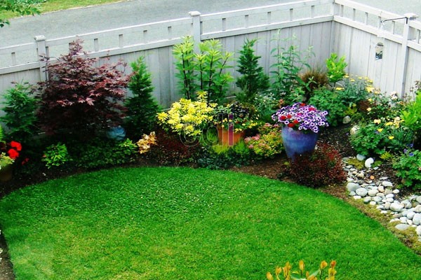

**Rekomendasi Tanaman Hias untuk Taman Mini** - Hai Mitra CDI! Bayangkan kesegaran taman di rumah Anda. Sejuk, asri, rindang... Siapa yang tak menginginkannya? Tapi, bagaimana jika lahan terbatas? Jangan khawatir! Ada banyak pilihan tanaman hias yang sempurna untuk mempercantik taman mini Anda di (not detected). Yuk, kita simak beberapa rekomendasi terbaik berikut ini!

*Pilihan Tanaman Hias Terbaik untuk Taman Mini Anda*

## Mimosa Silver: Sentuhan Lembut yang Menggemaskan

Mencari tanaman yang unik dan mudah dirawat? Mimosa Silver bisa jadi jawabannya! Tanaman ini sekilas mirip putri malu, dengan daun berwarna putih atau kuning yang cantik. Mimosa Silver tumbuh sepanjang tahun dan mudah diperbanyak melalui pencangkokan. Secara botani, tanaman ini adalah legume herba abadi yang menarik. Daunnya unik karena akan bereaksi terhadap cahaya, panas, dan sentuhan – menutup saat disentuh! Berasal dari Amerika Selatan, Mimosa Silver menyukai iklim lembab dan hangat. Bunganya berbentuk seperti pompom berwarna merah muda, sangat memikat dan menyenangkan dipandang.

## Siklok: Tahan Panas dan Mudah Beradaptasi

Siklok adalah pilihan populer untuk taman mini, dan alasannya jelas! Tanaman ini memiliki daun runcing dengan pangkal batang yang kuat dan berwarna keputihan. Pinggir daunnya berduri, namun jangan khawatir, tanaman ini sangat tahan terhadap panas dan mudah beradaptasi dengan berbagai kondisi tanah, termasuk tanah berpasir dan gembur. Siklok bisa tumbuh hingga lebih dari 2 meter, dengan daun berdaging dan berduri yang khas.

## Bawang Brojol: Keindahan Bunga Hujan yang Mempesona

Ingin taman mini yang selalu berbunga? Bawang Brojol adalah jawabannya! Tanaman bawang-bawangan ini juga dikenal sebagai Rain Lily atau Bunga Hujan. Saat berbunga bersamaan, pemandangan taman akan terlihat seperti hujan bunga lily yang cantik. Meskipun ukurannya lebih kecil dari bunga lili biasa, Bawang Brojol mampu berbunga sepanjang tahun dengan perawatan yang tepat. Bentuk bunganya menyerupai terompet dengan enam lembar mahkota dan mirip bunga krokus. Beberapa varietas memiliki aroma yang lembut dan manis. Uniknya, bunga ini hanya bertahan sehari sebelum digantikan oleh bunga yang baru. Daunnya berbentuk panjang seperti pita, berwarna hijau tua mengkilap.

## Kamboja Jepang: Kekuatan dan Keindahan yang Kontras

Berasal dari Asia Barat dan Afrika, Kamboja Jepang adalah tanaman yang kuat dan tahan terhadap kondisi kering. Tanaman ini memiliki batang besar dengan bagian bawah yang menyerupai umbi. Daunnya kecil dan panjang, sementara akarnya dapat membesar menjadi umbi yang unik. Di (not detected), tanaman ini sering dipilih karena kemampuannya bertahan di kondisi cuaca yang berbeda. [Beberapa Tanaman Hias yang Cocok untuk Interior](/blog/beberapa-tanaman-hias-yang-cocok-untuk-interior/) bisa jadi referensi tambahan Anda.

Dengan berbagai pilihan tanaman yang tersedia, Anda tidak perlu khawatir jika memiliki lahan terbatas. Taman mini di (not detected) tetap bisa menjadi surga hijau yang indah dan menyegarkan. Jangan ragu untuk berkonsultasi dengan tim ahli desain taman kami untuk mendapatkan rekomendasi dan solusi terbaik untuk taman mini impian Anda! Hubungi kami sekarang juga untuk penawaran terbaik. 