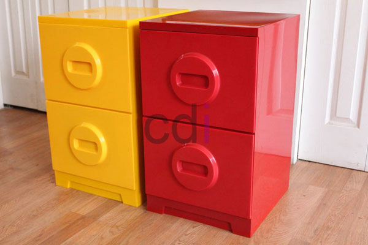

**Review Harga dan Kualitas Lemari Plastik** - Hai Mitra CDI! Butuh solusi penyimpanan yang praktis, ekonomis, dan mudah dipindah-pindah? Lemari plastik bisa jadi jawabannya! Nah, di artikel ini kita akan kupas tuntas soal lemari plastik: kualitas, kelebihan, dan perkiraan harganya di (not detected). Jangan sampai salah pilih ya!

Lemari adalah kebutuhan dasar di setiap rumah. Menyimpan pakaian, perlengkapan, dan barang-barang penting lainnya jadi lebih rapi dan terorganisir. Ada banyak pilihan material lemari, mulai dari kayu, kaca, hingga plastik. Kali ini, kita fokus pada lemari plastik—pilihan yang semakin populer karena kepraktisannya. Lemari plastik ini pas banget buat kalian yang tinggal di kos, apartemen, atau rumah dengan mobilitas tinggi.

*Lemari Plastik Multifungsi untuk Kebutuhan Penyimpanan Anda*

## Apa Saja Kelebihan Lemari Plastik?

Sebelum memutuskan membeli, yuk, simak dulu apa saja kelebihan yang ditawarkan lemari plastik. Dengan mengetahui kelebihannya, kalian bisa lebih yakin dalam memilih lemari yang tepat.

### 1. Harga Terjangkau

Ini dia nilai plus utama dari lemari plastik: harganya yang ramah di kantong! Dibandingkan lemari kayu atau kaca, lemari plastik jelas lebih ekonomis. Cocok banget buat kalian yang lagi mengatur anggaran belanja.

### 2. Ringan dan Mudah Dipindah

Salah satu keunggulan paling menonjol dari lemari plastik adalah bobotnya yang ringan. Jadi, kalian bisa memindahkan lemari ini dengan mudah, misalnya saat pindah kost, apartemen, atau sekadar menata ulang ruangan. Bahkan, beberapa model bisa dilipat, lho!

### 3. Tahan Lama dan Awet

Jangan salah, meskipun harganya terjangkau, lemari plastik dikenal cukup awet. Material plastik yang digunakan umumnya tahan terhadap rayap dan tidak mudah rusak. Dengan perawatan yang tepat, lemari plastik bisa menemani kalian dalam waktu yang lama.

## Berapa Harga Lemari Plastik?

Permintaan lemari plastik terus meningkat karena kepraktisannya. Banyak yang menjadikannya pilihan utama saat tinggal di kos atau kontrakan. Tentu saja, harga lemari plastik bervariasi, tergantung kualitas material, ukuran, dan desainnya. Semakin besar dan rumit desainnya, biasanya harganya juga lebih tinggi.

Kalian bisa menemukan berbagai model lemari plastik yang bisa disesuaikan dengan selera dan kebutuhan. Untuk harga, pastinya bervariasi ya, Mitra. Nah, untuk info harga terbaru dan [promo menarik](URL_PROMO_LEMARI_PLASTIK) dari kami, jangan ragu untuk menghubungi tim kami atau cek tabel harga di atas ya! 

Kami siap membantu kalian menemukan lemari plastik impian. Kalian bisa mengirimkan contoh desain yang kalian inginkan, atau memilih dari berbagai pilihan yang sudah tersedia. Kami berkomitmen untuk memberikan pelayanan terbaik dan produk berkualitas untuk seluruh pelanggan kami di (not detected). Jika sering berbelanja di sini, ada diskon khusus untuk pelanggan setia, lho! Jadi, tunggu apa lagi? Yuk, segera miliki lemari plastik yang sesuai dengan kebutuhan Anda. [Hubungi kami sekarang untuk konsultasi gratis!](URL_KONTAK) Jangan khawatir soal kualitas, kami menjamin kepuasan Anda! Kami juga melayani jasa desain interior untuk rumah di (not detected).