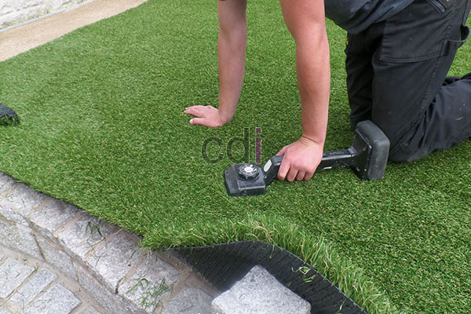

**Rumput Sintetis dan Cara Penggunaannya** - Hai Mitra CDI! Ingin mempercantik ruang outdoor atau menciptakan area bermain yang nyaman di (not detected)? Rumput sintetis bisa jadi solusi tepat. Tapi, bagaimana cara memasangnya agar hasilnya maksimal dan tahan lama? Nah, artikel ini akan memandu Anda langkah demi langkah. Yuk, simak!

## 5 Langkah Mudah Memasang Rumput Sintetis

Memasang rumput sintetis sebenarnya tidak jauh berbeda dengan memasang lantai. Bisa diaplikasikan di atas permukaan beton sebagai alasnya, menggunakan lem atau paku. Untuk area interior, lem adalah pilihan terbaik agar pemasangan lebih rapi. Sedangkan untuk eksterior, paku lebih disarankan karena memberikan kekuatan ekstra, tahan terhadap cuaca ekstrem, dan mencegah rumput terlepas.

Berikut adalah panduan lengkap untuk memasang rumput sintetis dengan benar:

- 1. **Ukur Area yang Akan Dipasang:** Pertama, ukur dengan teliti luas area yang akan ditutupi rumput sintetis. Setelah itu, beli rumput sintetis dengan ukuran yang sedikit lebih besar. Ini penting untuk memastikan Anda memiliki cukup material untuk menutupi seluruh area.
- 2. **Siapkan Permukaan yang Rata:** Idealnya, rumput sintetis dipasang di atas lantai semen yang rata. Jika belum ada, Anda bisa membuat lantai semen sendiri. Pastikan permukaan lantai benar-benar rata, karena permukaan yang tidak rata akan menyebabkan rumput bergelombang dan terlihat kurang menarik.
- 3. **Bersihkan Permukaan:** Kemudian, bersihkan seluruh permukaan lantai dari debu dan kotoran. Pastikan juga lantai benar-benar kering, terutama jika Anda berencana menggunakan lem untuk pemasangan. Jangan lupa bersihkan bagian belakang rumput sintetis juga sampai kering dan bersih.
- 4. **Hamparkan dan Sesuaikan:** Letakkan rumput sintetis di atas permukaan lantai dan atur posisinya agar pas dengan ruangan. Atur peletakannya dengan cermat agar tidak ada bagian yang bergelombang. Biarkan selama 3-5 jam untuk mengantisipasi perubahan ukuran akibat pemuaian. Setelah itu, potong bagian pinggir yang berlebihan.
- 5. **Rekatkan Secara Permanen:** Terakhir, rekatkan rumput sintetis secara permanen menggunakan lem kayu. Untuk pemasangan di luar ruangan, gunakan paku usuk baja tahan karat. Pasang paku dengan jarak 30x30cm untuk memastikan rumput terpasang kuat dan tidak mudah lepas.

Itulah langkah-langkah memasang rumput sintetis dengan baik dan benar. Pemilihan lokasi pemasangan juga sangat berpengaruh pada kualitas dan ketahanan rumput. Jika Anda memiliki pertanyaan lebih lanjut atau membutuhkan bantuan, jangan ragu untuk menghubungi kami melalui tombol Telepon/WhatsApp di halaman ini. Kami siap membantu Anda menciptakan ruang impian di (not detected)!

**Tips Tambahan:**

*   **Perawatan:** Rumput sintetis relatif mudah dirawat. Cukup disapu atau disedot debu secara berkala.
*   **Pembersihan:** Untuk noda membandel, gunakan sabun lembut dan air. Hindari penggunaan bahan kimia keras yang dapat merusak serat rumput sintetic.
*   **Pemilihan Jenis:** Pilih jenis rumput sintetis yang sesuai dengan kebutuhan Anda. Tersedia berbagai pilihan dengan tingkat kepadatan, tinggi serat, dan warna yang berbeda.

Apakah Anda mencari solusi terbaik untuk menghijaukan area Anda di (not detected)? Kami menawarkan berbagai pilihan rumput sintetis berkualitas tinggi dengan harga yang kompetitif. Cek  untuk informasi lebih lanjut! [Jual Rumput Sintetis Jabodetabek](/blog/jual-rumput-sintetis-jabodetabek/) — temukan pilihan terbaik untuk proyek Anda di Jabodetabek dan sekitarnya.