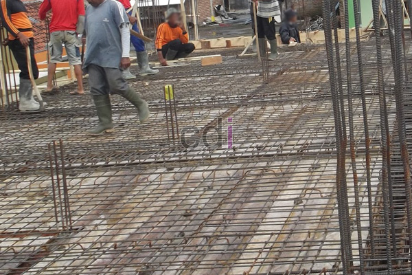

**Scaffolding untuk Cor Dak: Panduan Lengkap Pemilihan, Pemasangan, dan Biaya di Jabodetabek** - Hai Mitra CDI! Punya proyek cor dak di Jabodetabek tapi masih bingung soal scaffolding yang tepat? Jangan khawatir! Pemilihan scaffolding yang cocok itu krusial, lho, untuk kelancaran dan keamanan pekerjaan. Artikel ini akan membahas semuanya: mulai dari jenis-jenis scaffolding, langkah-langkah pemasangan yang aman, sampai perkiraan biayanya. Yuk, simak selengkapnya!

## Mengenal Berbagai Jenis Scaffolding untuk Cor Dak

Nah, sebelum melangkah lebih jauh, penting buat Mitra memahami ada banyak jenis scaffolding yang tersedia. Masing-masing punya kelebihan dan kekurangan sendiri-sendiri. Memilih yang sesuai dengan kebutuhan proyek akan mengoptimalkan efisiensi sekaligus menjamin keselamatan para pekerja. Beberapa jenis scaffolding yang umum digunakan untuk pekerjaan cor dak antara lain:

*   **Scaffolding Bambu:** Opsi paling ekonomis, tapi perlu diingat, scaffolding bambu punya batasan dalam hal kekuatan dan stabilitas. Penggunaannya butuh pengawasan ekstra ketat dan lebih cocok untuk proyek kecil dengan beban ringan.
*   **Scaffolding Baja Ringlock:** Ini primadona di kalangan kontraktor profesional. Kuat, stabil, dan fleksibel – itulah keunggulan scaffolding baja ringlock. Sistem pengunciannya juga simpel, mempercepat proses pemasangan dan pembongkaran.
*   **Scaffolding Modular:** Scaffolding modular itu kayak Lego-nya konstruksi. Terdiri dari komponen standar yang bisa dirakit sesuai kebutuhan. Cocok banget buat proyek dengan bentuk bangunan rumit atau akses terbatas.
*   **Scaffolding Sistem (Frame Scaffolding):** Biasanya dipakai untuk pekerjaan yang butuh ketinggian ekstra. Konstruksinya kokoh dan stabil, jadi pilihan aman untuk proyek-proyek berskala besar di Jabodetabek.

Memilih scaffolding yang tepat itu enggak bisa sembarangan. Tinggi bangunan, luas area kerja, beban yang akan ditopang, dan tentu saja anggaran proyek jadi faktor penentu. Jangan ragu untuk berkonsultasi dengan Kami di Creative Design Interior. Kami siap membantu Mitra menemukan solusi terbaik!

## Langkah-Langkah Pemasangan Scaffolding yang Aman dan Benar

Keselamatan kerja itu nomor satu, Mitra! Pemasangan scaffolding yang ceroboh bisa berakibat fatal. Berikut adalah beberapa langkah penting yang wajib diperhatikan:

1.  **Perencanaan Matang:** Sebelum mulai, buat perencanaan yang detail. Tentukan titik-titik penopang yang kuat dan pastikan tanah permukaannya rata dan stabil.
2.  **Pemasangan Dasar yang Kuat:** Pastikan base plate (dasar scaffolding) terpasang dengan benar dan kokoh. Gunakan balok kayu atau plat baja sebagai alas untuk mendistribusikan beban.
3.  **Pemasangan Tiang Vertikal yang Tegak:** Pasang upright (tiang vertikal) secara tegak lurus dan kunci dengan rapat. Pastikan setiap sambungan terkunci sempurna.
4.  **Pemasangan Ledger yang Presisi:** Pasang ledger (penyangga horizontal) untuk menghubungkan tiang vertikal. Periksa lagi, pastikan ledger terpasang kuat dan rata.
5.  **Pemasangan Decking yang Aman:** Pasang decking (lantai kerja) di atas ledger dengan material yang kuat dan tahan lama.
6.  **Pemasangan Railing untuk Pencegahan:** Pasang railing (pagar pengaman) di sepanjang tepi decking untuk mencegah insiden terjatuh.

Ingat ya, Mitra, pemasangan scaffolding sebaiknya dilakukan oleh tenaga ahli. Kami di Creative Design Interior menyediakan jasa pemasangan scaffolding profesional yang menjamin keamanan dan kualitas kerja.

## Perkiraan Biaya Scaffolding untuk Cor Dak di Jabodetabek

Biaya sewa scaffolding untuk cor dak bervariasi, tergantung beberapa faktor seperti jenis scaffolding, luas area kerja, tinggi bangunan, dan lama penyewaan. Berikut adalah kisaran harga yang bisa jadi acuan:

*   **Scaffolding Bambu:** Kisaran harga sewa sekitar Rp 25.000 – Rp 40.000 per meter persegi per bulan.
*   **Scaffolding Baja Ringlock:** Biaya sewa berkisar antara Rp 60.000 – Rp 120.000 per meter persegi per bulan.
*   **Scaffolding Modular:** Harga sewa biasanya antara Rp 70.000 – Rp 150.000 per meter persegi per bulan.

Sebagai contoh: kalau Mitra punya area cor dak seluas 50 meter persegi dengan tinggi 3 meter, dan menggunakan scaffolding baja ringlock, perkiraan biayanya adalah: 50 m² x Rp 80.000/m²/bulan = Rp 4.000.000 per bulan.

Perlu diingat, ini hanya estimasi. Untuk mendapatkan penawaran harga yang paling akurat sesuai kebutuhan proyek Mitra di Jabodetabek, silakan hubungi Kami. Biaya tambahan seperti transportasi, pemasangan, dan pembongkaran scaffolding juga perlu diperhitungkan.

## Dapatkan Jasa Scaffolding Profesional dari Creative Design Interior

Kami di Creative Design Interior adalah solusi tepat untuk kebutuhan scaffolding Mitra di wilayah Jabodetabek! Kami menyediakan berbagai jenis scaffolding, termasuk scaffolding bambu, baja ringlock, dan modular. Tim ahli Kami akan memastikan pemasangan scaffolding dilakukan dengan cepat, efisien, dan yang terpenting, aman. Kami juga menawarkan solusi scaffolding yang disesuaikan dengan anggaran dan kebutuhan proyek Mitra CDI.

Ada pertanyaan atau butuh penawaran harga? Jangan sungkan! Klik tombol **WhatsApp** atau **Telepon** di bawah untuk berkonsultasi dengan tim Kami. Kami siap membantu mewujudkan proyek Mitra CDI di Jabodetabek!