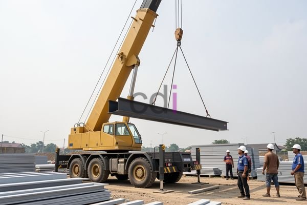

**Sewa Crane Cipulir: Solusi Efisien untuk Proyek Konstruksi Anda** - Hai Mitra CDI! Punya proyek di Cipulir yang butuh pengangkatan barang berat? Atau mungkin menghadapi akses lokasi yang sulit bikin proses konstruksi jadi lama? Nah, Kami punya solusinya! Menyewa crane bisa jadi jawaban cerdas untuk mempercepat pekerjaan Anda tanpa harus repot mikirin perawatan dan penyimpanan.

Mengangkat material berat, khususnya di area padat seperti Cipulir, memang butuh perencanaan matang. Tapi tenang, Creative Design Interior (CDI) hadir dengan beragam pilihan crane yang siap mendukung kelancaran proyek Anda. Mulai dari yang mungil untuk area terbatas, sampai yang besar untuk konstruksi bertingkat tinggi.

## Kenapa Sewa Crane Lebih Unggul Dibanding Beli?

Pertimbangkan dulu, apakah membeli crane benar-benar solusi terbaik? Terkadang, menyewa bisa jadi langkah yang lebih cerdas, lho. Apalagi kalau proyek Anda bersifat sementara atau membutuhkan jenis crane yang berbeda-beda.

Investasi awal untuk membeli crane lumayan besar. Belum lagi biaya perawatan berkala, perbaikan mendadak, biaya penyimpanan, dan urusan perizinan yang bikin pusing. Dengan menyewa, Mitra CDI cukup membayar sesuai kebutuhan. Dana yang ada bisa dialokasikan untuk hal-hal penting lain dalam proyek Anda.

Selain hemat biaya, menyewa crane juga memberi fleksibilitas tinggi. Anda bisa memilih jenis crane yang paling pas dengan kebutuhan proyek, tanpa terkungkung pada satu model saja. Kami punya banyak pilihan armada crane dengan spesifikasi beragam, jadi Anda pasti menemukan solusi optimal untuk pekerjaan Anda.

## Pilihan Crane yang Tersedia untuk Proyek di Cipulir

Kami menyediakan berbagai jenis crane untuk memenuhi kebutuhan konstruksi di Cipulir dan sekitarnya. Berikut beberapa pilihan populer yang bisa Anda sewa:

*   **Mobile Crane:** Ideal untuk proyek yang butuh fleksibilitas dan mobilitas tinggi. Mudah dipindahkan antar lokasi proyek, cocok untuk area terbatas.
*   **Tower Crane:** Pilihan utama untuk konstruksi vertikal seperti gedung apartemen atau perkantoran. Menyediakan jangkauan tinggi dan kemampuan mengangkat beban besar.
*   **Crawler Crane:** Sering digunakan di lahan yang kurang stabil atau berlumpur. Memberikan stabilitas tinggi dan kemampuan manuver yang baik.
*   **Truck Crane:** Kombinasi antara truk dan crane yang menawarkan mobilitas praktis dan kapasitas angkat yang memadai untuk berbagai proyek.

Memilih jenis crane yang tepat itu krusial. Tim Kami siap membantu Anda menganalisis kebutuhan proyek Anda, mempertimbangkan berat material, tinggi bangunan, dan kondisi lingkungan, untuk memastikan Anda mendapatkan crane yang paling cocok.

## Perkiraan Biaya Sewa Crane di Cipulir – Apa Saja Yang Mempengaruhi?

Harga sewa crane di Cipulir itu dinamis, tergantung beberapa faktor:

*   **Jenis crane:** Setiap jenis punya tarif yang berbeda, sesuai kapasitas dan fitur yang ditawarkan.
*   **Lama sewa:** Semakin lama Anda menyewa, biasanya tarif per jam atau per hari akan lebih hemat.
*   **Jarak lokasi:** Biaya transportasi crane ke lokasi proyek juga akan memengaruhi total biaya.
*   **Kebutuhan operator:** Kalau Anda butuh operator berpengalaman, biayanya akan ditambahkan.

Untuk gambaran, berikut perkiraan biaya sewa crane di Cipulir (harga ini bisa berubah sewaktu-waktu — yuk, hubungi Kami untuk penawaran terbaik yang disesuaikan dengan proyek Anda!):

| Jenis Crane      | Tarif Per Jam (Estimasi) | Tarif Harian (Estimasi) |
| ---------------- | ------------------------ | ----------------------- |
| Mobile Crane     | Rp 750.000 – Rp 1.500.000 | Rp 6.000.000 – Rp 12.000.000 |
| Tower Crane      | Rp 1.200.000 – Rp 2.500.000 | Rp 9.600.000 – Rp 20.000.000 |
| Crawler Crane    | Rp 900.000 – Rp 1.800.000 | Rp 7.200.000 – Rp 14.400.000 |
| Truck Crane      | Rp 600.000 – Rp 1.200.000 | Rp 4.800.000 – Rp 9.600.000 |

Ingat, tarif ini hanya estimasi. Untuk mendapatkan harga yang pasti dan sesuai dengan kebutuhan proyek Anda, jangan ragu untuk langsung menghubungi Kami.

## Keamanan dan Legalitas: Prioritas Kami

Di CDI, keselamatan kerja adalah yang utama. Semua crane yang Kami sewakan rutin diperiksa dan memenuhi standar keselamatan yang ketat. Operator Kami juga bersertifikasi dan berpengalaman, jadi Anda bisa tenang saat proses pengangkatan berlangsung.

Selain itu, Kami juga membantu Anda mengurus semua dokumen dan izin yang diperlukan. Jangan khawatir, Kami pastikan semua proses sewa crane sesuai dengan aturan yang berlaku.

Yuk, wujudkan proyek Anda dengan aman dan efisien! Jangan ragu untuk menghubungi Kami melalui tombol **Telepon** atau **WhatsApp** di bawah ini untuk konsultasi gratis dan penawaran terbaik. Kami siap membantu Anda! [Concrete Pump Kodok: Solusi Pengecoran Efisien untuk Proyek Jabodetabek](/blog/concrete-pump-kodok/) [Bekisting Knock Down: Solusi Efisien dan Ekonomis untuk Proyek Konstruksi Anda](/blog/bekisting-knock-down/)