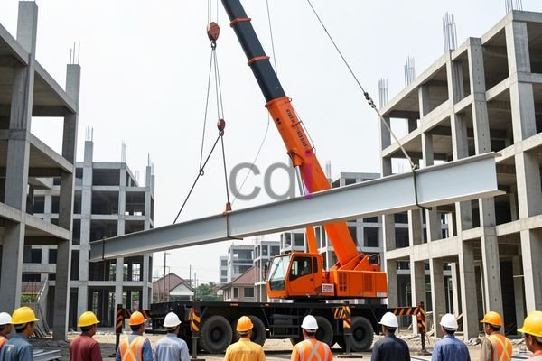

**Sewa Crane Karawang: Pilihan Tepat untuk Proyek Konstruksi Anda** - Mitra CDI dimana saja berada, pernah mengalami kesulitan dalam mengangkat material berat di lokasi proyek? Memindahkan barang-barang konstruksi berukuran besar seringkali menjadi tantangan tersendiri, membutuhkan tenaga ekstra dan waktu yang tidak sedikit. Di sinilah peran penting layanan sewa crane di Karawang menjadi solusi efektif untuk mempercepat pekerjaan Anda.

### Memahami Kebutuhan Sewa Crane di Karawang

Karawang sebagai kawasan industri yang berkembang pesat memiliki kebutuhan tinggi akan layanan alat berat, termasuk crane. Penggunaan crane sangat vital dalam berbagai tahapan konstruksi, mulai dari mengangkat material bangunan seperti baja, beton, hingga pemasangan struktur bangunan tinggi. Memiliki akses mudah ke layanan sewa crane yang terpercaya dan berkualitas dapat menghemat biaya, waktu, dan tenaga dalam penyelesaian proyek Anda.

Anda mungkin bertanya-tanya, mengapa memilih layanan sewa daripada membeli crane sendiri? Investasi pembelian crane memerlukan biaya yang signifikan, termasuk biaya perawatan, penyimpanan, dan operator yang bersertifikasi. Dengan menyewa crane, Anda hanya membayar biaya penggunaan sesuai kebutuhan, menghindari biaya-biaya tambahan tersebut dan membebaskan modal untuk investasi lain yang lebih strategis.

### Jenis-Jenis Crane yang Tersedia untuk Disewa di Karawang

Kami menyediakan berbagai jenis crane yang dapat disesuaikan dengan kebutuhan proyek Anda. Berikut ini beberapa jenis crane yang umum digunakan:

*   **Mobile Crane:** Cocok untuk pekerjaan yang membutuhkan mobilitas tinggi dan sering berpindah lokasi. Kapasitas angkatnya bervariasi, mulai dari 25 ton hingga 300 ton atau lebih.
*   **Tower Crane:** Ideal untuk proyek konstruksi gedung bertingkat. Memiliki kemampuan mengangkat beban berat ke ketinggian yang signifikan.
*   **Crawler Crane:** Digunakan untuk pekerjaan di medan yang sulit, seperti tanah berlumpur atau berpasir. Memiliki stabilitas yang baik dan mampu mengangkat beban berat.
*   **Truck Crane:** Kombinasi antara truk dan crane, mudah dipindahkan dan dioperasikan di berbagai lokasi proyek.

Untuk menentukan jenis crane yang paling sesuai dengan proyek Anda, pertimbangkan beberapa faktor penting seperti berat beban yang akan diangkat, ketinggian pengangkatan, kondisi medan lokasi proyek, dan jangkauan area kerja. Tim Kami siap membantu Anda dalam memilih crane yang tepat dan memberikan solusi yang paling efisien.

### Layanan Sewa Crane All-in-One dari Creative Design Interior

Kami di Creative Design Interior berpengalaman lebih dari 10 tahun dalam menyediakan layanan sewa crane di Karawang dan sekitarnya. Kami memahami betul kebutuhan proyek konstruksi Anda dan berkomitmen untuk memberikan layanan terbaik dengan harga yang kompetitif.

Layanan sewa crane Kami mencakup:

*   **Penyediaan Berbagai Jenis Crane:** Kami memiliki armada crane yang lengkap dan terawat dengan baik, siap melayani kebutuhan proyek Anda.
*   **Operator Bersertifikasi:** Setiap unit crane Kami dilengkapi dengan operator yang berpengalaman dan memiliki sertifikasi yang sesuai standar keselamatan.
*   **Skema Harga All-in-One:** Harga sewa Kami sudah termasuk biaya material, pengiriman, dan bongkar muat, sehingga Anda tidak perlu khawatir dengan biaya tambahan.
*   **Wilayah Layanan Luas:** Kami melayani area Karawang, Cikarang, Purwakarta, Subang, dan sekitarnya.

Dengan memilih layanan sewa crane Kami, Anda akan mendapatkan solusi praktis dan efisien untuk menyelesaikan proyek konstruksi Anda tepat waktu dan sesuai anggaran. Kami juga menyediakan layanan konsultasi gratis untuk membantu Anda menentukan jenis crane yang paling sesuai dengan kebutuhan Anda.

### Kemudahan Pemesanan dan Pembayaran Sewa Crane

Kami memahami pentingnya kemudahan dalam proses pemesanan dan pembayaran. Oleh karena itu, Kami menyediakan berbagai pilihan pembayaran yang fleksibel, termasuk COD, transfer bank, DP 50%, transfer setelah barang terkirim, bayar bertahap, atau transfer setelah pekerjaan selesai. 

Untuk pemesanan, Anda dapat menghubungi Kami melalui tombol **WhatsApp** atau **Telepon** yang tersedia di halaman Kami. Tim Kami akan segera merespons pertanyaan Anda dan memberikan penawaran terbaik sesuai dengan kebutuhan proyek Anda. Jangan ragu untuk bertanya jika Anda membutuhkan informasi lebih lanjut tentang layanan sewa crane Kami.

Membutuhkan bantuan langsung untuk kebutuhan proyek Anda? Silakan klik tombol **WhatsApp** atau **Telepon** di bawah untuk berkonsultasi dengan tim Kami.
